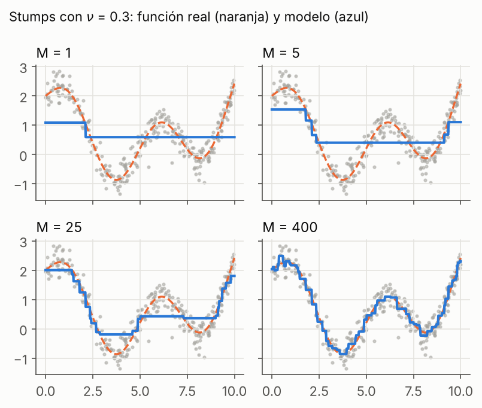
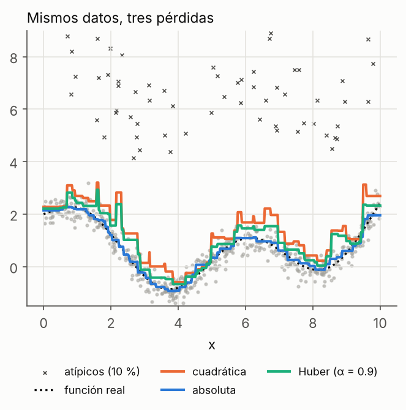
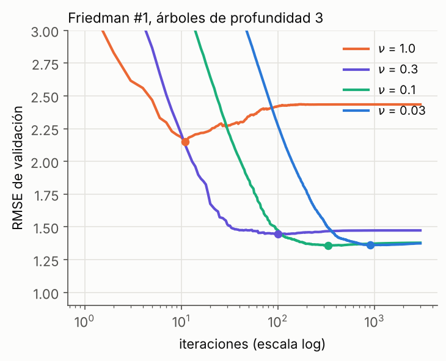

*Nota introductoria. Objetivo: entender de dónde sale el algoritmo antes de ver XGBoost, LightGBM y CatBoost, y ver con datos simulados el efecto de cada decisión (tasa de aprendizaje, tamaño del árbol, submuestreo, pérdida). Los experimentos usan `scikit-learn` 1.9.1, cuyo `GradientBoostingRegressor` implementa directamente el algoritmo de Friedman, y una implementación mínima propia. Script: `ejemplos/fundamentos_experimentos.py`.*

# El problema de aprendizaje

Tenemos datos $(\mathbf{x}_i, y_i)$, $i=1,\dots,n$, que modelamos como observaciones independientes de una distribución $P$, y una función de pérdida $\ell(y, F)$ que mide el costo de predecir $F$ cuando el valor real es $y$. El **riesgo** de una función $F$ es

$$R(F) = \mathbb{E}\big[\ell\big(Y, F(X)\big)\big], \qquad F^{*} = \underset{F}{\arg\min}\; R(F)$$

Como $R(F)=\mathbb E_X\big[\mathbb E[\ell(Y,F(X))\mid X]\big]$, basta minimizar punto por punto: $F^*(\mathbf x)$ es el valor $c$ que minimiza $\mathbb E[\ell(Y,c)\mid X=\mathbf x]$. El minimizador depende de la pérdida:

| Pérdida | $\ell(y,F)$ | $F^*(\mathbf x)$ |
|:--|:--|:--|
| Cuadrática | $\tfrac12(y-F)^2$ | $\mathbb E[Y\mid \mathbf x]$ |
| Absoluta | $\lvert y-F\rvert$ | mediana de $Y\mid\mathbf x$ |
| Cuantil $\tau$ | $\rho_\tau(y-F)$ | cuantil $\tau$ de $Y\mid\mathbf x$ |
| Binomial, $y\in\{0,1\}$ | $-yF+\ln(1+e^F)$ | $\ln\frac{P(Y=1\mid\mathbf x)}{P(Y=0\mid\mathbf x)}$ |
| Exponencial, $y\in\{-1,1\}$ | $e^{-yF}$ | $\tfrac12\ln\frac{P(Y=1\mid\mathbf x)}{P(Y=-1\mid\mathbf x)}$ |

con $\rho_\tau(u)=u\,(\tau-\mathbf 1\{u<0\})$. La binomial es la log-verosimilitud negativa con $p=\sigma(F)=1/(1+e^{-F})$.

> **Ejemplo: la exponencial.** Con $p=P(Y=1\mid\mathbf x)$, hay que minimizar $p\,e^{-c}+(1-p)\,e^{c}$. Derivando: $-p\,e^{-c}+(1-p)\,e^{c}=0$, así que $e^{2c}=p/(1-p)$ y $c=\tfrac12\ln\frac{p}{1-p}$. Es la mitad del log-odds; lo verificaremos con datos en la sección de AdaBoost.

Como $P$ es desconocida, minimizamos el **riesgo empírico** sobre una clase de funciones $\mathcal{F}$:

$$\hat R(F) = \frac{1}{n}\sum_{i=1}^{n} \ell\big(y_i, F(\mathbf{x}_i)\big)$$

Si $\mathcal{F}$ es demasiado rica, $\hat R$ llega a cero y el modelo memoriza. Si es demasiado pobre, hay sesgo. Boosting propone una clase de funciones construida **por sumas** de piezas simples, y una forma controlada de recorrerla.

# Árboles de regresión como piezas básicas

Un árbol de regresión con $J$ hojas parte el espacio de variables en regiones disjuntas $R_1,\dots,R_J$ y es constante en cada una:

$$h(\mathbf{x}) = \sum_{j=1}^{J} c_j\, \mathbf{1}\{\mathbf{x}\in R_j\}$$

Dadas las regiones, el mejor valor de hoja para error cuadrático es la media de $y$ en la región: $c_j = \bar y_{R_j}$.

Las regiones se construyen con **particiones binarias recursivas voraces** (CART): en cada nodo se prueba cada variable $k$ y cada umbral $s$, y se elige el corte que más reduce la suma de cuadrados. Para un nodo $R$ con $n$ observaciones que se parte en $R_L$ y $R_R$ (con $n_L$ y $n_R$ observaciones):

$$\mathrm{SSE}(R) - \mathrm{SSE}(R_L) - \mathrm{SSE}(R_R) = \frac{n_L\, n_R}{n}\,\big(\bar y_L - \bar y_R\big)^2$$

> **Demostración.** Descomponiendo la varianza dentro y entre grupos, $\mathrm{SSE}(R)=\mathrm{SSE}(R_L)+\mathrm{SSE}(R_R)+n_L(\bar y_L-\bar y)^2+n_R(\bar y_R-\bar y)^2$. Como $\bar y = (n_L\bar y_L + n_R \bar y_R)/n$, se tiene $\bar y_L-\bar y = n_R(\bar y_L-\bar y_R)/n$ y $\bar y_R-\bar y=-n_L(\bar y_L-\bar y_R)/n$. Sustituyendo, los dos últimos términos suman $\frac{n_L n_R^2 + n_R n_L^2}{n^2}(\bar y_L-\bar y_R)^2 = \frac{n_L n_R}{n}(\bar y_L-\bar y_R)^2$. $\blacksquare$

Esta identidad reaparecerá en la nota de XGBoost: la ganancia de un corte generaliza esta reducción de suma de cuadrados.

**Por qué árboles y por qué pequeños.** Un árbol profundo tiene sesgo bajo y varianza alta. Boosting hace lo contrario: usa piezas de sesgo alto y varianza baja (árboles chicos) y reduce el sesgo sumando muchas. Además, los árboles son invariantes a transformaciones monótonas de cada variable, no necesitan escalar y capturan interacciones sin especificarlas.

**Tamaño del árbol e interacciones.** Una rama de profundidad $d$ combina a lo sumo $d$ condiciones, así que un árbol de profundidad $d$ puede representar interacciones de orden a lo sumo $d$ (en términos de hojas: un árbol con $J$ hojas, a lo sumo de orden $J-1$; Hastie, Tibshirani y Friedman, cap. 10). Con *stumps* ($d=1$, $J=2$) el modelo final es puramente aditivo, $F(\mathbf{x})=\sum_k f_k(x_k)$. Lo comprobamos experimentalmente más abajo.

# Modelos aditivos y ajuste por etapas

Buscamos $F$ de la forma

$$F_M(\mathbf{x}) = F_0 + \sum_{m=1}^{M} \beta_m\, h(\mathbf{x};\boldsymbol{\gamma}_m)$$

donde $h(\mathbf{x};\boldsymbol{\gamma})$ es un árbol con parámetros $\boldsymbol{\gamma}$ (estructura y valores de hoja) y $\beta_m$ es un coeficiente. Optimizar todos los términos a la vez es difícil. El **ajuste por etapas** (*forward stagewise*) los agrega de uno en uno, sin reajustar los anteriores:

$$(\beta_m, \boldsymbol{\gamma}_m) = \underset{\beta,\boldsymbol{\gamma}}{\arg\min}\; \sum_{i=1}^{n} \ell\big(y_i,\; F_{m-1}(\mathbf{x}_i) + \beta\, h(\mathbf{x}_i;\boldsymbol{\gamma})\big)$$

Con error cuadrático el paso se simplifica. Como $y_i - F_{m-1}(\mathbf{x}_i) - \beta h(\mathbf{x}_i)$ es el residuo actual menos la contribución nueva, la etapa consiste en **ajustar $h$ a los residuos** $y_i - F_{m-1}(\mathbf{x}_i)$. Para otras pérdidas no hay forma cerrada, y ahí entra el gradiente.

# Boosting como descenso de gradiente en el espacio de funciones

Idea de Friedman (2001). El riesgo empírico depende de $F$ solo a través del vector $\mathbf{F}=\big(F(\mathbf{x}_1),\dots,F(\mathbf{x}_n)\big)\in\mathbb{R}^n$. Podemos hacer descenso de gradiente sobre ese vector:

$$\mathbf{F}_m = \mathbf{F}_{m-1} - \rho_m\, \mathbf{g}_m, \qquad g_{im} = \left.\frac{\partial\, \ell(y_i, F)}{\partial F}\right|_{F=F_{m-1}(\mathbf{x}_i)}$$

El problema es que $\mathbf{g}_m$ solo está definido en los puntos de entrenamiento y no generaliza. La solución es **aproximar el gradiente negativo con un árbol**: se ajusta $h_m$ por mínimos cuadrados a los **pseudo-residuos**

$$r_{im} = -g_{im} = -\left.\frac{\partial\, \ell(y_i, F)}{\partial F}\right|_{F=F_{m-1}(\mathbf{x}_i)}$$

Así $h_m$ es la función de la clase que mejor imita la dirección de máximo descenso, pero definida para cualquier $\mathbf{x}$.

> **Algoritmo (Gradient Tree Boosting, Friedman 2001).**
>
> 1. Inicializar $F_0(\mathbf{x}) = \arg\min_c \sum_i \ell(y_i, c)$.
>
> 2. Para $m=1,\dots,M$:
>
> (a) Calcular los pseudo-residuos $r_{im}$ para $i=1,\dots,n$.
>
> (b) Ajustar un árbol de regresión con $J$ hojas a los $r_{im}$; esto da las regiones $R_{jm}$.
>
> (c) Para cada hoja $j$, elegir $\gamma_{jm}$ que minimice $\sum_{\mathbf{x}_i\in R_{jm}} \ell\big(y_i, F_{m-1}(\mathbf{x}_i)+\gamma\big)$.
>
> (d) Actualizar $F_m(\mathbf{x}) = F_{m-1}(\mathbf{x}) + \nu \sum_{j} \gamma_{jm}\,\mathbf{1}\{\mathbf{x}\in R_{jm}\}$, con $\nu\in(0,1]$.

Dos observaciones sobre el paso (b) y (c):

- Las **regiones** se eligen mirando el gradiente (aproximación de primer orden), pero los **valores de hoja** se recalculan con la pérdida verdadera en el paso (c). Eso distingue a TreeBoost de ajustar el árbol a los residuos y quedarse con sus medias.
- El factor $\nu$ es la **tasa de aprendizaje** o *shrinkage*: se da solo una fracción del paso.

## Cómo se ve, iteración por iteración

Datos en una dimensión: $y=\sin(1.3x)+0.08(x-5)^2+\varepsilon$, $\varepsilon\sim N(0,0.3^2)$, 300 puntos. *Stumps* y $\nu=0.3$:



Cada iteración añade **un escalón**: un *stump* parte el eje en dos y suma una constante pequeña de cada lado. Al principio los escalones capturan la estructura gruesa (la caída central); después refinan zonas locales. El RMSE contra la función verdadera baja así:

| $M$ | 1 | 5 | 25 | 100 | 400 |
|:--|:--|:--|:--|:--|:--|
| RMSE vs. $f$ | 0.819 | 0.625 | 0.353 | 0.142 | 0.110 |

Con 400 iteraciones el modelo empieza a seguir el ruido (los dientes del panel inferior derecho). Ese es el punto de partida de la regularización.

## Experimento: ¿importa recalcular las hojas? (TreeBoost)

Con pérdida absoluta, $\ell=\lvert y-F\rvert$, los pseudo-residuos son signos: $r_i=\operatorname{sign}(y_i-F_{m-1}(\mathbf x_i))\in\{-1,+1\}$. Comparé dos variantes con mi implementación mínima (árboles de profundidad 3, $\nu=0.1$, Friedman #1 con 2 000 filas):

- **Media:** quedarse con la media de los signos en cada hoja, un valor en $[-1,1]$.
- **TreeBoost:** paso (c), con la mediana de los residuos $y_i-F_{m-1}(\mathbf x_i)$ en la hoja, que es el minimizador exacto de la pérdida absoluta.

MAE de prueba (el mínimo posible es 0.80, el MAE del ruido):

| Hojas | $M=10$ | 50 | 200 | 1000 |
|:--|:--|:--|:--|:--|
| media de los signos | 3.668 | 2.570 | 1.177 | 1.080 |
| TreeBoost (mediana) | 2.663 | 1.432 | 1.061 | 1.025 |

Con la media de signos, cada paso mide a lo sumo $\nu\cdot1=0.1$ en las unidades de $y$, sin importar cuán lejos esté la hoja de su valor óptimo. TreeBoost da pasos del tamaño correcto. Las regiones son las mismas; solo cambia cuánto se mueve cada una. Es la misma idea que XGBoost convierte en el paso de Newton.

## El puente hacia XGBoost

Si en el paso (c) aproximamos la pérdida de cada hoja con Taylor de segundo orden alrededor de $\gamma=0$,

$$\sum_{i\in R_{jm}} \ell\big(y_i, F_{m-1}(\mathbf{x}_i)+\gamma\big) \approx \text{cte} + \gamma \sum_{i} g_i + \tfrac12 \gamma^2 \sum_{i} h_i$$

con $h_i=\dfrac{\partial^2 \ell}{\partial F^2}\Big|_{F_{m-1}(\mathbf{x}_i)}$ el hessiano. Al minimizar en $\gamma$ se obtiene el **paso de Newton**

$$\gamma_{jm} = -\frac{\sum_{i\in R_{jm}} g_i}{\sum_{i\in R_{jm}} h_i}$$

XGBoost lleva esta idea más lejos: usa $g_i$ y $h_i$ también para **elegir** los cortes, y añade regularización explícita. Ese es el tema de la siguiente nota.

# Casos particulares de pérdida

Los pseudo-residuos y los valores de hoja para pérdidas comunes:

| Pérdida | $r = -\partial \ell/\partial F$ | Valor de hoja $\gamma$ |
|:--|:--|:--|
| Cuadrática | $y-F$ | media de $r$ |
| Absoluta | $\operatorname{sign}(y-F)$ | mediana de $y-F$ |
| Cuantil $\tau$ | $\tau-\mathbf 1\{y<F\}$ | cuantil $\tau$ de $y-F$ |
| Huber ($\delta$) | $\operatorname{clip}(y-F,\,-\delta,\,\delta)$ | mediana + corrección (ver abajo) |
| Binomial | $y-p$ | $\dfrac{\sum r_i}{\sum p_i(1-p_i)}$ (Newton) |
| Poisson | $y-e^{F}$ | $\dfrac{\sum r_i}{\sum e^{F_i}}$ (Newton) |

Notas:

- **Huber** es cuadrática cerca de cero y lineal en las colas: $\ell=\tfrac12 u^2$ si $\lvert u\rvert\le\delta$ y $\delta(\lvert u\rvert-\delta/2)$ si no, con $u=y-F$. Friedman (2001) usa para la hoja la mediana de los residuos más la media de las desviaciones recortadas en $\pm\delta$ alrededor de ella. En `scikit-learn`, $\delta$ se recalcula en cada iteración como el cuantil `alpha` de $\lvert y-F\rvert$ (0.9 por defecto).
- En el caso **binomial**, $p=\sigma(F)$, $\partial\ell/\partial F = p-y$ y $\partial^2\ell/\partial F^2=p(1-p)$. No existe forma cerrada para el $\gamma$ exacto, por lo que se usa un paso de Newton.
- En el caso **Poisson** con enlace log, $\mu = e^{F}$; la pérdida es la log-verosimilitud negativa sin el término constante $\ln y!$. Aquí $g=\mu-y$ y $h=\mu$.
- En **multiclase** con softmax y $K$ clases, hay una función $F_k$ por clase y $p_k = e^{F_k}/\sum_l e^{F_l}$. Los pseudo-residuos son $r_{ik}=\mathbf{1}\{y_i=k\}-p_{ik}$ y se ajusta **un árbol por clase** en cada iteración.

## Experimento: pérdidas robustas con atípicos

Los mismos datos 1D que arriba (600 puntos), pero al 10 % de las observaciones se le suma un valor uniforme entre 4 y 8. Tres modelos idénticos salvo la pérdida (300 árboles de profundidad 2, $\nu=0.05$, al menos 25 datos por hoja):



| Pérdida | RMSE vs. función real | sesgo medio |
|:--|:--|:--|
| cuadrática | 0.733 | +0.616 |
| absoluta | 0.122 | +0.029 |
| Huber, $\alpha=0.9$ | 0.484 | +0.372 |

- La **cuadrática** estima la media condicional, que con atípicos se desplaza: $0.10\times6=0.6$ en promedio, exactamente el sesgo observado. No es un error del algoritmo: estima lo que se le pidió.
- La **absoluta** estima la mediana, que casi no se mueve con un 10 % de contaminación.
- **Huber** queda en medio. Con `alpha=0.9`, el umbral $\delta$ es el cuantil 90 % de los residuos absolutos, y como hay justo 10 % de atípicos, parte de ellos cae en la zona cuadrática. Bajar `alpha` lo hace más robusto.

Lección práctica: **la pérdida define qué se estima**. Si en tus datos hay errores de captura, la pérdida absoluta o de Huber protege; si los valores extremos son reales y te importa la media (por ejemplo, para sumar montos), la cuadrática es la correcta.

# Conexión con AdaBoost

AdaBoost es el caso particular de ajuste por etapas con **pérdida exponencial**. Sea $y\in\{-1,+1\}$, $\ell(y,F)=e^{-yF}$ y $h(\mathbf{x})\in\{-1,+1\}$. El problema de la etapa $m$ es

$$\underset{\beta, h}{\arg\min} \sum_{i} w_i^{(m)}\, e^{-\beta\, y_i h(\mathbf{x}_i)}, \qquad w_i^{(m)} = e^{-y_i F_{m-1}(\mathbf{x}_i)}$$

Separando aciertos y errores, con $W_c$ la suma de pesos de los aciertos y $W_e$ la de los errores:

$$e^{-\beta} W_c + e^{\beta} W_e$$

Para $\beta$ fijo, minimizar equivale a elegir el $h$ que minimice el error ponderado. Derivando en $\beta$ e igualando a cero, $e^{2\beta}=W_c/W_e$, es decir

$$\beta_m = \tfrac12 \ln\frac{1-\mathrm{err}_m}{\mathrm{err}_m}, \qquad \mathrm{err}_m = \frac{W_e}{W_c+W_e}$$

Los pesos se actualizan como $w_i^{(m+1)}=w_i^{(m)}e^{-\beta_m y_i h_m(\mathbf{x}_i)}$: los errores pesan más en la ronda siguiente. Es el resultado de Friedman, Hastie y Tibshirani (2000). Gradient boosting generaliza el esquema a **cualquier pérdida diferenciable**.

**Experimento.** Clasificación con log-odds verdadero $3x_1+2\sin(3x_2)-2x_3^2$, $x\sim U(-1,1)^4$, 4 000 filas de entrenamiento y 20 000 de prueba. Tres modelos con *stumps* y 400 iteraciones:

| Modelo | exactitud | AUC | pendiente de $\hat F$ vs. log-odds real |
|:--|:--|:--|:--|
| AdaBoost (scikit-learn) | 0.810 | 0.891 | — |
| GB, pérdida exponencial | 0.812 | 0.893 | 0.491 |
| GB, log-loss | 0.812 | 0.893 | 0.905 |

La “pendiente” es el coeficiente de regresar $\hat F(\mathbf x)$ sobre el log-odds verdadero en prueba. Con pérdida exponencial, $\hat F$ estima la **mitad** del log-odds, como predice $F^*=\tfrac12\ln\frac{p}{1-p}$: la razón entre ambas pendientes es 0.54. Para convertir a probabilidad hay que usar $p=\sigma(2\hat F)$, que es lo que hace `predict_proba` de `scikit-learn` con esa pérdida. Que la pendiente con log-loss sea algo menor que 1 refleja el encogimiento por $\nu$ y por los *stumps*. Las tres variantes discriminan igual: la diferencia está en la escala de $\hat F$.

# Efecto de los hiperparámetros

La pérdida de entrenamiento baja con cada iteración. El error de validación suele bajar y luego subir. Las palancas son el número de iteraciones $M$, la tasa $\nu$, el tamaño del árbol y el submuestreo.

## Tasa de aprendizaje y número de iteraciones

Friedman #1: $y = 10\sin(\pi x_1x_2)+20(x_3-0.5)^2+10x_4+5x_5+\varepsilon$, con 5 variables de ruido adicionales y $\varepsilon\sim N(0,1)$. Entrenamiento 1 000, validación 5 000, prueba 20 000, árboles de profundidad 3, hasta 3 000 iteraciones:



| $\nu$ | mejor $M$ | RMSE prueba en el mejor $M$ | RMSE entrenamiento ahí | RMSE validación con $M=3000$ |
|:--|:--|:--|:--|:--|
| 1.0 | 11 | 2.174 | 1.460 | 2.435 |
| 0.3 | 100 | 1.438 | 0.599 | 1.473 |
| 0.1 | 330 | 1.366 | 0.533 | 1.379 |
| 0.03 | 905 | 1.360 | 0.602 | 1.374 |

- **Sin encogimiento ($\nu=1$) el modelo es mucho peor**, aun deteniéndose en el mejor momento: cada árbol se ajusta de golpe al ruido de sus residuos.
- Bajar $\nu$ mejora, con **rendimientos decrecientes**: de 0.1 a 0.03 la mejora es nula, pero se necesitan casi 3 veces más árboles. Aproximadamente, $\nu\cdot M$ se mantiene en el mismo orden (entre 27 y 33 para 0.3, 0.1 y 0.03).
- Con $\nu$ pequeño, la curva de validación es **plana alrededor del mínimo**: pasarse de iteraciones cuesta poco. Con $\nu$ grande, el mínimo es estrecho y la parada temprana es crítica.
- El RMSE de entrenamiento en el óptimo (0.5–0.6) está muy por debajo del de prueba (1.36). Esa brecha es normal y no es por sí misma señal de problema.

**Por qué ayuda un $\nu$ pequeño.** Con pasos pequeños, el algoritmo recorre un “camino de regularización” suave, en el que cada árbol corrige solo un poco y los siguientes pueden repartir el trabajo entre variables. Con $\nu$ pequeño, boosting se comporta de forma parecida a la regresión *forward stagewise*, relacionada con la trayectoria del lasso (Hastie, Tibshirani y Friedman, §10.12). Es una conexión conceptual, no una igualdad exacta.

## Tamaño del árbol y orden de las interacciones

Tres funciones verdaderas sobre $x\sim U(0,1)^{10}$, con $\varepsilon\sim N(0,1)$, 2 000 filas de entrenamiento, $\nu=0.1$ y parada temprana. RMSE de prueba (mínimo posible: 1):

| Función verdadera | prof. 1 | 2 | 3 | 6 |
|:--|:--|:--|:--|:--|
| aditiva: $10\sin(\pi x_1)+20(x_3-\tfrac12)^2+10x_4+5x_5$ | **1.073** | 1.113 | 1.130 | 1.236 |
| Friedman #1 (interacción de orden 2) | 1.739 | **1.238** | 1.244 | 1.390 |
| con un término $15\cdot\mathbf 1\{x_3,x_4,x_5>\tfrac12\}$ (orden 3) | 4.201 | 2.675 | **1.387** | 1.442 |

Es la teoría en números:

- Si la función es aditiva, los *stumps* son lo mejor: no gastan varianza en interacciones que no existen.
- Con una interacción de orden 2, los *stumps* no pueden representarla (1.74) y la profundidad 2 basta.
- Con un término de orden 3, hace falta profundidad 3; con 2, el error sigue alto.
- Profundidad 6 siempre es peor que la profundidad justa: más varianza sin ganancia en sesgo.

En la práctica no conoces el orden de las interacciones, así que la profundidad se ajusta por validación. Lo que dice el experimento es que **la profundidad es una hipótesis sobre el orden de interacción**, no solo una perilla de complejidad.

## Submuestreo (*stochastic gradient boosting*)

Friedman (2002): en cada iteración, ajustar el árbol con una fracción de las observaciones, sin reemplazo. Friedman #1 con 1 000 filas, profundidad 3, $\nu=0.05$, 5 semillas:

| `subsample` | RMSE prueba (media ± DE) | segundos (1 núcleo) |
|:--|:--|:--|
| 1.0 | 1.394 ± 0.028 | 3.8 |
| 0.8 | 1.341 ± 0.022 | 3.1 |
| 0.5 | **1.319** ± 0.029 | 2.1 |
| 0.2 | 1.342 ± 0.016 | 1.2 |

Submuestrear **mejora** el error y además ahorra tiempo. La aleatoriedad hace que árboles consecutivos estén menos correlacionados, como en *bagging*. Con fracciones muy pequeñas cada árbol se vuelve demasiado ruidoso, y la mejora se pierde. Un valor entre 0.5 y 0.8 es un buen punto de partida.

## Parada temprana en la práctica

Con `scikit-learn`, hay dos formas:

```python
from sklearn.ensemble import GradientBoostingRegressor

# 1) Interna: separa validation_fraction y para tras
#    n_iter_no_change rondas sin mejora
m = GradientBoostingRegressor(
    n_estimators=5000, learning_rate=0.05, max_depth=3,
    subsample=0.8, validation_fraction=0.2,
    n_iter_no_change=50, random_state=0).fit(X, y)
m.n_estimators_          # árboles realmente usados

# 2) Manual: entrenar de más y mirar la curva completa
m = GradientBoostingRegressor(n_estimators=3000,
                              learning_rate=0.05).fit(X, y)
curva = [rmse(p, y_val) for p in m.staged_predict(X_val)]
mejor_M = int(np.argmin(curva)) + 1
```

La segunda forma es la que usé en los experimentos: además de dar el mejor $M$, muestra la forma de la curva.

# Ejemplo numérico: dos iteraciones con pérdida cuadrática

Datos: $x=1,\dots,6$ e $y=(1,2,1,3,6,5)$. Usamos *stumps* ($J=2$) y $\nu=0.5$.

**Inicialización.** $F_0=\bar y = 3$. El ECM inicial es $3.667$.

**Iteración 1.** Residuos $r=(-2,-1,-2,0,3,2)$. La SSE de cada corte candidato:

| Corte | 1.5 | 2.5 | 3.5 | 4.5 | 5.5 |
|:--|:--|:--|:--|:--|:--|
| SSE | 17.20 | 15.25 | 5.33 | **3.25** | 17.20 |

El mejor corte es $x<4.5$: media izquierda $-1.25$, media derecha $2.5$. Entonces $F_1=3+0.5\cdot(-1.25)=2.375$ para $x\le 4$ y $F_1 = 3+0.5\cdot 2.5=4.25$ para $x\ge 5$. El ECM baja a $1.323$.

**Iteración 2.** Residuos $-1.375$, $-0.375$, $-1.375$, $0.625$, $1.75$ y $0.75$.

| Corte | 1.5 | 2.5 | 3.5 | 4.5 | 5.5 |
|:--|:--|:--|:--|:--|:--|
| SSE | 5.67 | 5.64 | **1.43** | 3.25 | 7.26 |

Ahora el mejor corte es distinto, $x<3.5$: medias $-1.0417$ y $1.0417$. Resulta
$F_2 = 1.854$ para $x\le3$, $2.896$ para $x=4$ y $4.771$ para $x\ge5$; el ECM baja a $0.509$.

Dos stumps con cortes distintos ya producen una función escalonada de tres peldaños: cada iteración puede refinar una zona distinta del espacio.

# Implementación mínima

Gradient boosting con pérdida cuadrática, usando `DecisionTreeRegressor` de scikit-learn como pieza base:

```python
import numpy as np
from sklearn.tree import DecisionTreeRegressor

def gb_fit(X, y, M=100, nu=0.1, depth=3):
    F0 = y.mean()
    F = np.full(len(y), F0)
    trees = []
    for m in range(M):
        r = y - F                      # pseudo-residuo (pérdida L2)
        t = DecisionTreeRegressor(max_depth=depth).fit(X, r)
        F += nu * t.predict(X)         # la hoja ya es la media de r
        trees.append(t)
    return F0, trees

def gb_predict(X, F0, trees, nu=0.1):
    return F0 + nu * sum(t.predict(X) for t in trees)
```

Con los datos del ejemplo, `depth=1`, `nu=0.5` y `M=2` reproduce exactamente $F_2$ y el ECM de $0.509$ de arriba (lo verifiqué ejecutándolo). La función `gb` del script de experimentos extiende esta versión a la pérdida absoluta, con y sin el paso TreeBoost.

# Receta práctica

1. **Elige la pérdida por lo que quieres estimar**: media (cuadrática), mediana o cuantil (absoluta, cuantil), robustez a errores de captura (Huber), probabilidad (log-loss).
2. Fija $\nu$ entre 0.03 y 0.1 y usa parada temprana con un conjunto de validación.
3. Ajusta la profundidad (2 a 6) por validación; piensa en ella como el orden de interacción permitido.
4. Usa `subsample` entre 0.5 y 0.8.
5. Mira la curva de validación completa, no solo el mínimo: si es plana, el modelo es estable; si el mínimo es estrecho, baja $\nu$.

# Resumen

- Boosting es **ajuste aditivo por etapas**: $F_m = F_{m-1} + \nu\, h_m$.
- Gradient boosting interpreta cada etapa como un **paso de descenso de gradiente en el espacio de funciones**, aproximando $-\partial \ell/\partial F$ con un árbol.
- Las regiones salen del gradiente; recalcular los valores de hoja con la pérdida verdadera (TreeBoost) o con un paso de Newton acelera mucho.
- **La pérdida define qué se estima**: con atípicos, la cuadrática se desplaza exactamente lo que predice la teoría.
- AdaBoost es el caso de la pérdida exponencial, y estima la mitad del log-odds.
- Se regulariza con $M$ (parada temprana), $\nu$, submuestreo y profundidad; la profundidad fija el orden de las interacciones.
- **Siguiente nota:** XGBoost, que convierte el paso de Newton en el criterio de construcción del árbol y añade regularización explícita.

# Ejercicios

1. **Minimizador del cuantil.** Demuestra que $c\mapsto\mathbb E[\rho_\tau(Y-c)]$ se minimiza en el cuantil $\tau$ de $Y$. *Pista:* deriva y obtén $P(Y<c)=\tau$.
2. **Interacciones de los stumps.** Demuestra que una suma de *stumps* es una función aditiva, y que un árbol de profundidad 2 puede representar $\mathbf 1\{x_1>a\}\mathbf 1\{x_2>b\}$.
3. **Huber.** Calcula $-\partial\ell/\partial F$ para la pérdida de Huber y comprueba que es $\operatorname{clip}(y-F,-\delta,\delta)$.
4. **Experimento.** En el script, repite la comparación de $\nu$ con 10 000 filas de entrenamiento. ¿Cambia el $\nu$ óptimo? ¿Cambia la brecha entre $\nu=1$ y $\nu=0.1$?

# Referencias

- Friedman, J. H. (2001). *Greedy function approximation: a gradient boosting machine*. Annals of Statistics, 29(5).
- Friedman, J. H., Hastie, T. y Tibshirani, R. (2000). *Additive logistic regression: a statistical view of boosting*. Annals of Statistics, 28(2).
- Friedman, J. H. (2002). *Stochastic gradient boosting*. Computational Statistics & Data Analysis, 38(4).
- Freund, Y. y Schapire, R. (1997). *A decision-theoretic generalization of on-line learning and an application to boosting*. Journal of Computer and System Sciences, 55(1).
- Huber, P. J. (1964). *Robust estimation of a location parameter*. Annals of Mathematical Statistics, 35(1).
- Hastie, T., Tibshirani, R. y Friedman, J. *The Elements of Statistical Learning*, cap. 10.
