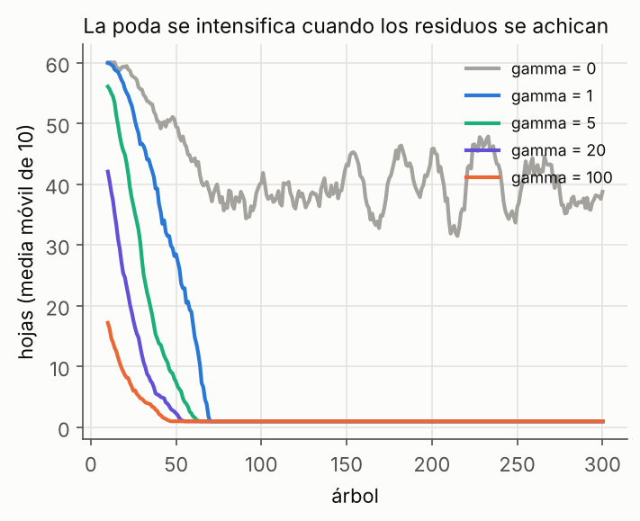
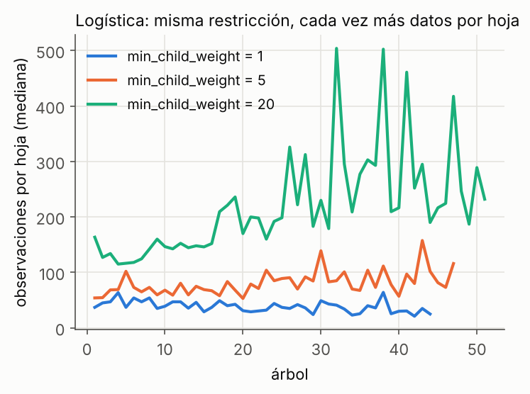
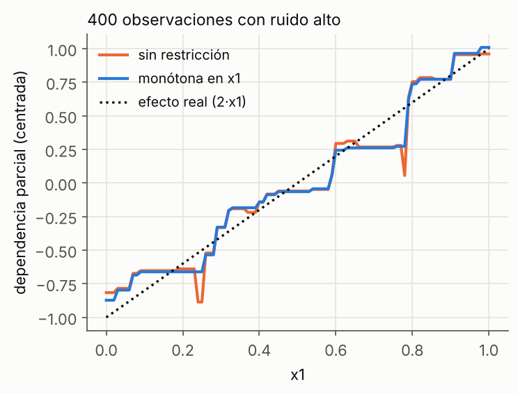

*Segunda nota. Parte de la nota «Fundamentos de Gradient Boosting»: aquí se deriva con detalle qué cambia en XGBoost y por qué, y después se mide con datos simulados el efecto de cada hiperparámetro. Todo se verificó con `xgboost` 3.4.1; el script de los experimentos es `ejemplos/xgboost_experimentos.py`. Salvo que se diga otra cosa, los experimentos usan Friedman #1 ($y = 10\sin(\pi x_1x_2)+20(x_3-0.5)^2+10x_4+5x_5+\varepsilon$, 5 variables de ruido, $\varepsilon\sim N(0,1)$) con 1 000 filas de entrenamiento, 5 000 de validación para la parada temprana y 20 000 de prueba; el RMSE mínimo posible es 1.*

# Qué cambia respecto al gradient boosting clásico

Chen y Guestrin (2016) mantienen el esquema aditivo por etapas, pero modifican cuatro cosas:

1. **Objetivo regularizado explícito.** La complejidad del árbol entra en lo que se optimiza, no solo como un parámetro externo.
2. **Segundo orden.** Se usa la aproximación de Taylor con gradiente $g_i$ y hessiano $h_i$ por observación. El valor óptimo de cada hoja tiene forma cerrada y la ganancia de un corte se calcula sin ajustar nada.
3. **Búsqueda de cortes escalable.** Algoritmo exacto, algoritmo aproximado con cuantiles ponderados por $h_i$ y manejo nativo de valores faltantes.
4. **Ingeniería de sistemas.** Bloques de columnas ordenados, uso de caché, paralelismo. No lo veremos aquí.

# Modelo y objetivo

Un árbol con $T$ hojas se escribe $f(\mathbf{x}) = w_{q(\mathbf{x})}$, donde $q:\mathbb{R}^d\to\{1,\dots,T\}$ asigna cada observación a una hoja y $w\in\mathbb{R}^T$ son los pesos de hoja. El modelo es

$$\hat y_i = \sum_{k=1}^{K} f_k(\mathbf{x}_i)$$

y el objetivo regularizado es

$$\mathcal{L}(\phi) = \sum_{i=1}^{n} \ell(y_i, \hat y_i) + \sum_{k=1}^{K} \Omega(f_k)$$

con la penalización de complejidad

$$\Omega(f) = \gamma\, T + \tfrac{1}{2}\lambda \sum_{j=1}^{T} w_j^2$$

Aquí $\gamma\ge 0$ castiga cada hoja adicional y $\lambda\ge 0$ es una penalización L2 sobre los pesos. Como los parámetros son funciones, no se puede optimizar con métodos euclídeos tradicionales. Se entrena **por etapas**: en la ronda $t$ se agrega $f_t$ a la predicción $\hat y_i^{(t-1)}$ ya existente:

$$\mathcal{L}^{(t)} = \sum_{i=1}^{n} \ell\!\left(y_i,\ \hat y_i^{(t-1)} + f_t(\mathbf{x}_i)\right) + \Omega(f_t)$$

# Aproximación de segundo orden

Para una función $\ell$ de $\hat y$, el desarrollo de Taylor de orden 2 en $\delta = f_t(\mathbf{x}_i)$ es

$$\ell(y_i, \hat y_i^{(t-1)} + \delta) \approx \ell(y_i, \hat y_i^{(t-1)}) + g_i\,\delta + \tfrac{1}{2} h_i\,\delta^2$$

con gradiente y hessiano **respecto a la predicción previa**:

$$g_i = \frac{\partial\, \ell(y_i, \hat y)}{\partial \hat y}\bigg|_{\hat y = \hat y_i^{(t-1)}}, \qquad h_i = \frac{\partial^2 \ell(y_i, \hat y)}{\partial \hat y^2}\bigg|_{\hat y = \hat y_i^{(t-1)}}$$

El primer sumando no depende de $f_t$, así que se descarta. Queda el objetivo simplificado

$$\tilde{\mathcal{L}}^{(t)} = \sum_{i=1}^{n} \left[ g_i\, f_t(\mathbf{x}_i) + \tfrac{1}{2} h_i\, f_t(\mathbf{x}_i)^2 \right] + \Omega(f_t)$$

Los vectores $g$ y $h$ se calculan una sola vez por ronda y son lo **único** que el algoritmo necesita de la pérdida. Por eso cambiar de pérdida es solo cambiar cómo se calculan $g_i$ y $h_i$.

# Agrupar por hoja y solución cerrada

Sea $I_j=\{\,i : q(\mathbf{x}_i)=j\,\}$ el conjunto de observaciones en la hoja $j$, y sean

$$G_j = \sum_{i\in I_j} g_i, \qquad H_j = \sum_{i\in I_j} h_i$$

Como $f_t(\mathbf{x}_i)=w_j$ para todo $i\in I_j$, la suma sobre observaciones se reorganiza como suma sobre hojas:

$$\tilde{\mathcal{L}}^{(t)} = \sum_{j=1}^{T}\left[ G_j\, w_j + \tfrac{1}{2}\,(H_j + \lambda)\, w_j^2 \right] + \gamma\, T$$

Cada término depende de un solo $w_j$ y es una parábola, por lo que se minimiza por separado. Derivando e igualando a cero, $G_j + (H_j+\lambda)\,w_j = 0$, y con $H_j+\lambda>0$ el punto crítico es un mínimo:

$$w_j^{*} = -\frac{G_j}{H_j + \lambda}$$

Sustituyendo en la expresión anterior, el valor óptimo para una estructura fija es

$$\tilde{\mathcal{L}}^{*} = -\frac{1}{2} \sum_{j=1}^{T} \frac{G_j^2}{H_j + \lambda} + \gamma\, T$$

> **Detalle de la sustitución.** En $w_j^*$ se cumple $G_j w_j^* = -\frac{G_j^2}{H_j+\lambda}$ y $\tfrac12(H_j+\lambda)(w_j^*)^2=\tfrac12\frac{G_j^2}{H_j+\lambda}$. Sumando, cada hoja aporta $-\tfrac12\frac{G_j^2}{H_j+\lambda}$.

Este valor funciona como un **score de calidad** de la estructura $q$: menor es mejor. Es el equivalente de la impureza en CART, pero ya incluye la regularización.

**Interpretaciones del peso de hoja.**

- Es un **paso de Newton con ridge**. Sin regularización ($\lambda=0$) sería $-G_j/H_j$, el paso de Newton de la nota anterior.
- Reescrito como $w_j^*=\dfrac{\sum_{i\in I_j} h_i\,(-g_i/h_i)}{\sum_{i\in I_j} h_i + \lambda}$, es un **promedio ponderado por $h_i$** de los pseudo-objetivos $-g_i/h_i$, encogido hacia cero por $\lambda$.
- Con error cuadrático, $g_i=\hat y_i-y_i$ y $h_i=1$, así que $w_j^*=\dfrac{\sum_{i\in I_j}(y_i-\hat y_i)}{n_j+\lambda}$: **la media de los residuos de la hoja, encogida** por $\lambda$ (con $\lambda=0$ es exactamente la media).

# La ganancia de un corte

Sea $I$ el conjunto de observaciones de un nodo, que se parte en $I_L$ e $I_R$. Antes del corte el nodo es una hoja con score $\frac{G^2}{H+\lambda}$ (con $G=G_L+G_R$ y $H=H_L+H_R$) y un costo de hoja $\gamma$. Después hay dos hojas. La reducción del objetivo es

$$\text{Gain} = \frac{1}{2}\left[ \frac{G_L^2}{H_L + \lambda} + \frac{G_R^2}{H_R + \lambda} - \frac{(G_L + G_R)^2}{H_L + H_R + \lambda} \right] - \gamma$$

El árbol se construye **codiciosamente**: se elige el corte de mayor ganancia, y si $\text{Gain}<0$ el corte no se hace. Esto da una poda natural controlada por $\gamma$.

**Observación sobre la implementación.** Al ejecutar `xgboost` 3.4.1 sobre el ejemplo numérico de más abajo, el valor `gain` que reporta el volcado del árbol es **el doble** de la fórmula anterior (1.0286 frente a 0.5143), es decir, no incluye el factor $\tfrac12$. Además observé que el corte se conserva con `gamma=1.0` y se poda con `gamma=1.03`, de modo que el umbral $\gamma$ se compara contra esa ganancia sin $\tfrac12$. En esa versión, para obtener el efecto del $\gamma$ de la fórmula del artículo hay que pasar `gamma` igual a $2\gamma$. No cambia qué corte gana, pero sí cómo interpretar el valor de `gamma`. Lo comprobé en un solo ejemplo y una sola versión.

# Equivalencia con la reducción de varianza

Tomemos error cuadrático ($g_i=-r_i$ con $r_i=y_i-\hat y_i$, y $h_i=1$), $\lambda=0$ y $\gamma=0$. Entonces $G_L=-\sum_{I_L} r_i = -n_L \bar r_L$ y $H_L=n_L$, y lo mismo para $R$. La ganancia es

$$\text{Gain}=\tfrac12\left[n_L\bar r_L^{\,2}+n_R\bar r_R^{\,2}-n\,\bar r^{\,2}\right]$$

Como $n\bar r = n_L \bar r_L + n_R \bar r_R$, el mismo cálculo de la nota anterior da

$$\text{Gain}=\frac{1}{2}\cdot\frac{n_L\,n_R}{n}\,\big(\bar r_L-\bar r_R\big)^2$$

Es decir, la mitad de la **reducción de suma de cuadrados de CART aplicada a los residuos**. Con error cuadrático, $\lambda=0$ y $\gamma=0$, XGBoost elige exactamente los mismos cortes que un árbol CART ajustado a los residuos.

Con $\lambda>0$ cada término $\frac{(\sum r_i)^2}{n_j+\lambda}=\frac{n_j^2\,\bar r_j^{\,2}}{n_j+\lambda}$ queda multiplicado por $\frac{n_j}{n_j+\lambda}<1$, y ese factor es **más pequeño cuanto menos observaciones tenga la hoja**. Así $\lambda$ desfavorece cortes que dejan hojas chicas.

# Búsqueda de cortes

## Algoritmo exacto

Para cada variable del nodo se ordenan las observaciones por su valor, se recorren de izquierda a derecha acumulando $G_L$ y $H_L$, y en cada posición se calcula $G_R=G-G_L$, $H_R=H-H_L$ y la ganancia en $O(1)$. El costo dominante es el ordenamiento, que XGBoost evita repetir guardando cada columna ya ordenada en bloques. Es el método `tree_method="exact"`.

## Por qué los pesos son $h_i$

El objetivo simplificado es, en realidad, un problema de **mínimos cuadrados ponderados**. Completando el cuadrado en cada término:

$$g_i f + \tfrac12 h_i f^2 = \tfrac12 h_i\left(f + \frac{g_i}{h_i}\right)^2 - \frac{g_i^2}{2h_i}$$

por lo que

$$\begin{aligned} \tilde{\mathcal{L}}^{(t)} &= \sum_{i=1}^{n} \tfrac12 h_i \Big( f_t(\mathbf{x}_i) - \big(-g_i/h_i\big) \Big)^2 \\ &\quad + \Omega(f_t) + \text{constante} \end{aligned}$$

El árbol ajusta los pseudo-objetivos $-g_i/h_i$ con peso $h_i$. Por eso, al elegir candidatos de corte por cuantiles, **los cuantiles deben ser ponderados por $h_i$**: dos observaciones con mucha curvatura pesan más que dos con poca.

## Candidatos aproximados con cuantiles ponderados

Para la variable $k$ y un valor $z$, el **rango ponderado** es

$$r_k(z) = \frac{\sum_{i:\,x_{ik}<z} h_i}{\sum_{i} h_i}$$

Se eligen candidatos $s_{k1}<s_{k2}<\dots$ tales que $\lvert r_k(s_{k,l}) - r_k(s_{k,l+1})\rvert<\varepsilon$, lo que da aproximadamente $1/\varepsilon$ candidatos por variable. Con error cuadrático $h_i=1$ y esto se reduce a cuantiles ordinarios.

En la documentación de XGBoost, `approx` calcula este resumen antes de construir cada árbol con todas las filas, usando el hessiano como peso. `hist` precalcula los intervalos una vez (`max_bin=256` por defecto) y, según la documentación, es un método usado por LightGBM con pequeñas diferencias de implementación. **Desde la versión 2.0, `hist` es el método por defecto** (`tree_method="auto"`).

## Histogramas

Con los intervalos fijos, en cada nodo se acumulan $(G,H)$ por intervalo recorriendo sus observaciones (costo lineal en el tamaño del nodo) y se evalúa la ganancia en los límites entre intervalos (costo proporcional al número de intervalos). Para ahorrar trabajo se usa la **resta de histogramas**: el histograma del hijo mayor es el del padre menos el del hijo menor.

## Experimento: exacto, aproximado e histogramas

Friedman #1 con 200 000 filas, 200 árboles de profundidad 6, $\eta=0.1$, 2 núcleos:

| `tree_method` | `max_bin` | segundos | RMSE de prueba |
|:--|:--|:--|:--|
| `exact` | — | 38.6 | 1.042 |
| `approx` | — | 3.3 | 1.036 |
| `hist` | 256 | 1.8 | 1.036 |
| `hist` | 32 | 1.7 | 1.055 |
| `hist` | 8 | 1.8 | 1.332 |

- `hist` es 20 veces más rápido que `exact`, sin perder precisión. Por eso es el método por defecto.
- `max_bin` casi no cambia el tiempo aquí, pero con 8 intervalos el error sube mucho: los umbrales posibles son demasiado gruesos para capturar las curvas de Friedman #1.

## Valores faltantes

En cada corte se prueban **dos direcciones por defecto**. Primero se recorren los valores observados enviando los faltantes a la derecha y luego a la izquierda, y se queda la dirección con mayor ganancia. El resultado queda guardado en el árbol (en el volcado aparece como `missing=`; en `trees_to_dataframe()`, la columna `Missing` indica a qué hijo van). El costo es lineal en las entradas no faltantes.

**Experimento: faltantes informativos.** En Friedman #1, a $x_4$ (efecto $10x_4$) le quité el valor con probabilidad 0.8 cuando $x_4>0.6$: el 30 % de las filas, casi todas con $x_4$ grande. El hecho de faltar es información. Tres tratamientos ($\eta=0.05$, profundidad 4):

| Tratamiento | RMSE de prueba | RMSE en filas con faltante |
|:--|:--|:--|
| `NaN` nativo | **1.575** | 1.843 |
| imputar con la media | 1.603 | 1.817 |
| media + indicador de faltante | 1.600 | 1.837 |

- En el modelo nativo, el 71 % de los 734 cortes en $x_4$ manda los faltantes al lado de valores **grandes**: XGBoost aprendió que “falta” se parece a “$x_4$ alto”.
- La ventaja global del manejo nativo es moderada, y viene sobre todo de las filas **sin** faltante: imputar con la media mezcla filas de $x_4\approx0.47$ reales con filas cuyo $x_4$ real es alto, y eso estropea el efecto estimado de $x_4$ cerca de la media.
- En las filas con faltante, ninguna estrategia puede recuperar el valor exacto de $x_4$; las tres quedan parecidas.

# Regularización adicional

**Penalización L1** ($\alpha$, `reg_alpha`). Si se añade $\alpha\sum_j |w_j|$ al objetivo, cada hoja minimiza $G w+\tfrac12(H+\lambda)w^2+\alpha|w|$. Considerando los signos de $w$, la solución es una **umbralización suave**:

$$\begin{aligned} w^* &= -\frac{T_\alpha(G)}{H+\lambda} \\ T_\alpha(G) &= \operatorname{sign}(G)\,\max\big(\lvert G\rvert-\alpha,\,0\big) \end{aligned}$$

Si $\lvert G\rvert\le\alpha$ la hoja queda en cero, y en la ganancia $G^2$ se reemplaza por $T_\alpha(G)^2$.

**Otros mecanismos.**

- **Tasa de aprendizaje $\eta$** (`eta`): la predicción se actualiza con $\hat y^{(t)}=\hat y^{(t-1)}+\eta\, f_t$.
- **Submuestreo de filas** (`subsample`) **y de columnas** (`colsample_bytree`, `colsample_bylevel`, `colsample_bynode`).
- **`min_child_weight`**: mínimo de $H_j$ (suma de hessianos) por hoja. No es un conteo de observaciones: con error cuadrático $H_j=n_j$, pero con la logística $h_i=p_i(1-p_i)\le 1/4$, y una hoja necesita al menos $4\cdot$`min_child_weight` observaciones en el mejor caso.
- **`max_depth`** limita $T$ e implícitamente el orden de las interacciones.
- **`max_delta_step`**: acota $\lvert w_j\rvert$, útil en logística con clases muy desbalanceadas y en Poisson.

# Gradiente y hessiano por pérdida

| Pérdida | $\ell(y,\hat y)$ | $g_i$ | $h_i$ |
|:--|:--|:--|:--|
| Cuadrática | $\tfrac12(y-\hat y)^2$ | $\hat y - y$ | $1$ |
| Logística | $-yF+\ln(1+e^F)$ | $p-y$ | $p(1-p)$ |
| Poisson (log) | $e^{F}-yF$ | $e^{F}-y$ | $e^{F}$ |
| Softmax | $-\ln p_{y}$ | $p_k-\mathbf{1}\{y=k\}$ | $2\,p_k(1-p_k)$ |

En la logística $\hat y=F$ es el log-odds y $p=\sigma(F)$. Observaciones bien clasificadas ($p\approx 0$ o $1$) tienen $h\approx0$: casi no aportan a $H_j$ ni cuentan para `min_child_weight`.

En el caso **softmax**, el hessiano que usa XGBoost es una **cota superior diagonal**, no el hessiano verdadero: el hessiano exacto de la entropía cruzada multiclase tiene diagonal $p_k(1-p_k)$, y XGBoost usa el doble. Esto está documentado en su demo de objetivos personalizados.

# Ejemplo numérico: un corte con pérdida logística

Datos: $x=1,\dots,6$ e $y=(0,0,0,1,0,1)$. Margen inicial $0$ (es decir $p=0.5$), $\lambda=1$, $\gamma=0$, $\eta=1$, un solo árbol de profundidad 1 y `min_child_weight=0`.

**Gradientes y hessianos.** $g_i=p-y_i=(0.5,\,0.5,\,0.5,\,-0.5,\,0.5,\,-0.5)$ y $h_i=0.25$ para todos. Totales: $G=1.0$, $H=1.5$. El score de la raíz es $\frac{G^2}{H+\lambda}=\frac{1}{2.5}=0.4$.

**Ganancia de cada corte candidato.**

| Corte | $G_L$ | $H_L$ | $G_R$ | $H_R$ | Gain |
|:--|:--|:--|:--|:--|:--|
| 1.5 | 0.5 | 0.25 | 0.5 | 1.25 | $-0.0444$ |
| 2.5 | 1.0 | 0.50 | 0.0 | 1.00 | 0.1333 |
| 3.5 | 1.5 | 0.75 | $-0.5$ | 0.75 | **0.5143** |
| 4.5 | 1.0 | 1.00 | 0.0 | 0.50 | 0.0500 |
| 5.5 | 1.5 | 1.25 | $-0.5$ | 0.25 | 0.4000 |

Verificación a mano del corte $3.5$:

$$\begin{aligned} \text{Gain} &= \tfrac12\left[\frac{1.5^2}{0.75+1}+\frac{(-0.5)^2}{0.75+1}-0.4\right] \\ &= \tfrac12\,[\,1.2857+0.1429-0.4\,] = 0.5143 \end{aligned}$$

**Pesos de hoja.**

$$\begin{aligned} w_L &= -\frac{1.5}{1.75} = -0.857 \\ w_R &= -\frac{-0.5}{1.75} = 0.286 \end{aligned}$$

**Nuevas probabilidades.** Para $x\le3$, $p=\sigma(-0.857)=0.298$. Para $x\ge4$, $p=\sigma(0.286)=0.571$. La log-loss media baja de $0.6931$ a $0.5047$.

**Contraste con XGBoost.** Entrenando ese árbol con `xgboost` 3.4.1 se obtienen el mismo corte ($x<3.5$), los mismos pesos de hoja ($-0.8571$ y $0.2857$) y `cover=1.5` en la raíz, que es $\sum h_i$. El `gain` reportado es $1.0286=2\times0.5143$, como se comentó arriba.

Dos observaciones sobre este ejemplo:

- El corte en $1.5$ tiene **ganancia negativa aun con $\gamma=0$**. Con $\lambda>0$ esto puede ocurrir: la regularización del score hace que partir una hoja pueda empeorar el objetivo.
- Con $\lambda=0$ la ganancia nunca es negativa (ver el primer ejercicio).

# Efecto de cada hiperparámetro con datos simulados

## `eta` y `max_depth`

RMSE de prueba (entre paréntesis, árboles elegidos por parada temprana):

| `max_depth` | `eta`=0.3 | 0.1 | 0.03 |
|:--|:--|:--|:--|
| 2 | 1.388 (217) | **1.332** (760) | 1.379 (2465) |
| 4 | 1.536 (56) | 1.428 (291) | 1.432 (860) |
| 6 | 1.718 (47) | 1.617 (136) | 1.613 (1000) |
| 8 | 1.941 (94) | 1.859 (210) | 1.849 (1020) |

- La profundidad pesa mucho más que `eta`. Friedman #1 solo tiene una interacción de orden 2, así que profundidad 2 basta (nota 1); el valor por defecto, 6, es bastante peor con 1 000 filas.
- Bajar `eta` de 0.3 a 0.1 ayuda; de 0.1 a 0.03 ya casi no.
- Con profundidad 2 y `eta`=0.03, 2 465 árboles terminaron peor que 760 árboles con 0.1. Una explicación posible: con `eta` muy bajo la curva de validación es casi plana, y 100 rondas de paciencia pueden detener el entrenamiento en una meseta antes del óptimo. Si usas `eta` bajo, sube también la paciencia.

## `lambda`: encoger los pesos de hoja

Profundidad 6 (para que haya algo que regularizar):

| `eta` | `lambda` | árboles | hojas por árbol | $\lvert w\rvert$ medio, árbol 1 | RMSE |
|:--|:--|:--|:--|:--|:--|
| 0.3 | 0 | 45 | 49.9 | 1.204 | 1.749 |
| 0.3 | 1 | 47 | 48.4 | 0.748 | 1.718 |
| 0.3 | 10 | 52 | 45.5 | 0.340 | 1.652 |
| 0.3 | 100 | 170 | 46.6 | 0.110 | 1.604 |
| 0.05 | 0 | 343 | 50.0 | 0.201 | 1.606 |
| 0.05 | 1 | 429 | 45.2 | 0.125 | 1.616 |
| 0.05 | 10 | 796 | 42.0 | 0.057 | 1.582 |
| 0.05 | 100 | 1450 | 45.5 | 0.018 | 1.560 |

- `lambda` **no poda**: el número de hojas casi no cambia. Lo que hace es encoger los pesos: con `lambda`=100 el peso medio de hoja del primer árbol es 11 veces menor que sin penalización.
- El encogimiento es **desigual**: $w_j^*=-G_j/(H_j+\lambda)$ encoge mucho las hojas con poco hessiano (pocos datos) y poco las grandes. Con $H_j=n_j$, una hoja de 20 datos se multiplica por $20/120$ con `lambda`=100, y una de 500 por $500/600$.
- Por eso `lambda` alto con `eta`=0.3 se parece a bajar `eta` (más árboles, mejor error), pero con una ventaja: frena sobre todo las hojas con poca evidencia.

## `gamma`: poda por ganancia mínima

`gamma` se compara con la ganancia de cada corte (en las unidades de XGBoost, sin el $\tfrac12$). Esa ganancia **depende de la escala de los residuos**, y los residuos se achican conforme avanza el boosting. La mediana de la ganancia de los cortes en un modelo sin poda:

| árbol | 1 | 10 | 50 | 100 | 300 |
|:--|:--|:--|:--|:--|:--|
| ganancia mediana | 73.67 | 21.96 | 0.84 | 0.14 | 0.00 |

Con 300 árboles fijos ($\eta=0.1$, profundidad 6), contando las hojas árbol por árbol:



| `gamma` | hojas, árboles 1–10 | hojas, árboles 100–300 | árboles sin ningún corte | mejor $M$ | RMSE |
|:--|:--|:--|:--|:--|:--|
| 0 | 60.0 | 39.6 | 0 | 136 | **1.617** |
| 1 | 60.0 | 1.0 | 240 | 300 | 1.670 |
| 5 | 56.1 | 1.0 | 246 | 300 | 1.676 |
| 20 | 42.1 | 1.0 | 255 | 143 | 1.768 |
| 100 | 17.2 | 1.0 | 263 | 37 | 2.023 |

- Con `gamma`=1, los primeros árboles casi no cambian, pero a partir del árbol 60 ningún corte supera el umbral y **los árboles se quedan en una sola hoja**: `gamma` funciona como una parada temprana automática.
- Un `gamma` grande poda también los primeros árboles, y el modelo nunca alcanza a aprender.
- Como `gamma` está en unidades de la pérdida, **no es transferible entre problemas**: si multiplicas $y$ por 10, las ganancias se multiplican por 100. Antes de ajustarlo, mira la distribución de `Gain` en `trees_to_dataframe()`.
- En este problema `gamma`=0 fue lo mejor; la parada temprana ya hacía el trabajo.

## `min_child_weight`: suma de hessianos, no conteo

Clasificación logística con log-odds $2x_1-1.5x_2+\sin(2x_3)-1.5$, 5 000 filas, profundidad 6, $\eta=0.1$. Con `pred_leaf=True` se obtiene la hoja de cada observación en cada árbol, y de ahí cuántas observaciones tiene cada hoja:

```python
hojas = booster.predict(dtrain, pred_leaf=True)   # (n, árboles)
cuenta = np.unique(hojas[:, t], return_counts=True)[1]
```

| `min_child_weight` | hojas por árbol | mínimo de obs. por hoja | mediana, árbol 1 | mediana, último árbol | log-loss |
|:--|:--|:--|:--|:--|:--|
| 0 | 51.9 | 1 | 36 | 14 | 0.3781 |
| 1 | 44.9 | 5 | 37 | 25 | 0.3771 |
| 5 | 32.6 | 21 | 54 | 116 | 0.3757 |
| 20 | 18.7 | 83 | 163.5 | 232 | **0.3730** |



- Como $h_i=p_i(1-p_i)\le\tfrac14$, una hoja con $H_j\ge5$ necesita al menos 20 observaciones: el mínimo observado es 21. Con 20, el mínimo es 83 (cota: 80).
- **La restricción se endurece con el entrenamiento**: conforme el modelo se vuelve seguro ($p_i$ cerca de 0 o 1), $h_i$ baja, y una hoja necesita cada vez más observaciones para juntar el mismo hessiano. Con `min_child_weight`=5, la mediana pasa de 54 observaciones por hoja en el primer árbol a 116 en el último.
- En regresión cuadrática, `min_child_weight` sí es un conteo ($h_i=1$). Al pasar de un problema de regresión a uno de clasificación, el mismo valor significa algo muy distinto.

## `max_delta_step`: acotar el paso con clases raras

Clase positiva del 4.9 %, $\eta=1$ (deliberadamente grande), 30 árboles de profundidad 6, `min_child_weight`=0:

| `max_delta_step` | máx. $\lvert w\rvert$ en el árbol 1 | log-loss | AUC |
|:--|:--|:--|:--|
| 0 (sin límite) | 1.98 | 0.1759 | 0.9334 |
| 1 | 1.00 | 0.1756 | 0.9356 |

El tope funciona (el peso máximo baja a 1), pero aquí casi no cambia el resultado. Su utilidad real aparece cuando una hoja tiene $H_j\approx0$: el paso $-G_j/H_j$ explota, y el tope lo evita. Es un seguro, no una mejora habitual.

# Restricciones de forma

**Monotonía.** `monotone_constraints="(1,0,0)"` obliga a que la predicción sea no decreciente en la primera variable (con $-1$, no creciente). XGBoost la impone al construir cada árbol: descarta cortes que violan el orden entre hijos y acota los pesos de las hojas descendientes.

Experimento: $y=2x_1+\sin(6x_2)+\varepsilon$, $\varepsilon\sim N(0,1)$, solo 400 observaciones:



| Modelo | RMSE vs. función real | PDP monótono |
|:--|:--|:--|
| sin restricción | 0.277 | no |
| monótono en $x_1$ | 0.267 | sí |

Sin restricción, el modelo aprende pequeñas bajadas (cerca de 0.25 y 0.78) que son ruido. La restricción las elimina y mejora un poco el error. Su valor principal es otro: **garantiza** una propiedad que el negocio exige (por ejemplo, que el precio estimado no suba con el kilometraje), y eso se puede comunicar.

**Interacciones.** `interaction_constraints=[[0, 1], [2, 3, 4]]` solo permite que aparezcan en una misma rama variables del mismo grupo. Con un grupo por variable, el modelo es aditivo (un GAM ajustado por boosting); en la nota 5 se usa así para diagnosticar interacciones con residuos.

# Objetivos personalizados

Como el algoritmo solo necesita $g_i$ y $h_i$, cualquier pérdida dos veces diferenciable se puede usar pasando una función que los devuelva:

```python
def cuadratico(predt, dtrain):
    y = dtrain.get_label()
    return predt - y, np.ones_like(predt)      # g, h

b = xgb.train({"eta": 0.1, "max_depth": 4, "base_score": 0.0},
              dtrain, 100, obj=cuadratico)
```

Con la misma semilla, este objetivo reproduce **exactamente** `reg:squarederror` (diferencia máxima en prueba: 0.0).

**Un ejemplo útil: costo asimétrico.** Si quedarse corto cuesta $k$ veces más que pasarse, $\ell=w\,(y-\hat y)^2$ con $w=k$ si $y>\hat y$ y $w=1$ si no. Entonces $g=-2w(y-\hat y)$ y $h=2w$:

```python
def asimetrico(k):
    def obj(predt, dtrain):
        y = dtrain.get_label()
        w = np.where(y > predt, k, 1.0)
        return -2 * w * (y - predt), 2 * w
    return obj
```

| $k$ | fracción subestimada en prueba | sesgo medio $\hat y-y$ |
|:--|:--|:--|
| 1 | 0.484 | +0.036 |
| 3 | 0.447 | +0.170 |
| 9 | 0.413 | +0.292 |

El modelo se desplaza hacia arriba de forma controlada. El minimizador de esta pérdida no es la media sino un **expectil** de $Y\mid\mathbf x$ (con nivel $k/(1+k)$). Dos cuidados: con un objetivo personalizado, la métrica de evaluación por defecto ya no corresponde a tu pérdida (define `custom_metric`), y `base_score` conviene fijarlo a mano.

# Inspeccionar el modelo entrenado

XGBoost expone mucho más que una importancia:

```python
b.trees_to_dataframe()          # un nodo por fila: Feature, Split,
                                # Yes, No, Missing, Gain, Cover
b.get_score(importance_type="total_gain")
b.predict(d, pred_leaf=True)    # hoja de cada obs. en cada árbol
b.predict(d, pred_contribs=True)       # contribuciones (TreeSHAP)
b.predict(d, pred_interactions=True)   # interacciones SHAP por par
b.predict(d, output_margin=True)       # escala del margen (log-odds)
json.loads(b.save_config())     # todos los parámetros efectivos
```

**Cinco importancias distintas.** En Friedman #1 (profundidad 4, normalizadas al máximo; $x_1$ a $x_5$ son `f0` a `f4`, el resto es ruido):

| Variable | `weight` | `gain` | `total_gain` | `cover` |
|:--|:--|:--|:--|:--|
| f3 ($10x_4$) | 0.642 | 1.000 | **1.000** | 1.000 |
| f0 ($x_1$, interactúa) | **1.000** | 0.444 | 0.691 | 0.491 |
| f1 ($x_2$, interactúa) | 0.993 | 0.425 | 0.658 | 0.656 |
| f4 ($5x_5$) | 0.565 | 0.310 | 0.273 | 0.690 |
| f2 ($20(x_3-\tfrac12)^2$) | 0.690 | 0.221 | 0.238 | 0.691 |
| f5 a f9 (ruido) | 0.46–0.57 | ≤ 0.016 | ≤ 0.014 | 0.46–0.78 |

- `weight` (número de cortes) y `cover` (hessiano promedio en los cortes) dan a las variables de ruido la mitad o más que a las reales. No sirven para decidir qué importa.
- `gain` es la ganancia **promedio** por corte; `total_gain`, la suma. Una variable con pocos cortes muy buenos sale alta en `gain` y baja en `total_gain`. Para un ordenamiento global, usa `total_gain` (y mejor aún, permutación en prueba, nota 5).
- Cuidado con los valores por defecto: `Booster.get_score()` usa `weight`, y `feature_importances_` de la API de `scikit-learn` usa `gain` normalizada (lo comprobé en la versión 3.4.1). Ninguno usa `total_gain`.

**Contribuciones e interacciones.** `pred_contribs=True` devuelve, por observación, una columna por variable más el sesgo, y su suma reproduce el margen (diferencia máxima: $4\times10^{-5}$). `pred_interactions=True` devuelve una matriz por observación (aquí $2000\times11\times11$). Promediando el valor absoluto de las entradas fuera de la diagonal, el par más fuerte es `f0×f1` (0.758), seguido de lejos por `f0×f3` (0.206): recupera la única interacción real, $\sin(\pi x_1x_2)$.

# Mapa de hiperparámetros

| Parámetro (defecto) | Dónde entra | Efecto medido arriba |
|:--|:--|:--|
| `eta` (0.3) | $\hat y \leftarrow \hat y+\eta f_t$ | Bajar a 0.1 ayuda; más abajo, rendimientos decrecientes |
| `max_depth` (6) | limita $T$ | El más influyente; fija el orden de interacción |
| `lambda` (1) | $H_j+\lambda$ | Encoge pesos, sobre todo de hojas chicas; no poda |
| `alpha` (0) | $T_\alpha(G_j)$ | Deja en cero hojas con $\lvert G_j\rvert\le\alpha$ |
| `gamma` (0) | $-\gamma$ en la ganancia | Poda; en unidades de la pérdida; detiene árboles tardíos |
| `min_child_weight` (1) | exige $H_j$ mínimo | En logística, se endurece conforme $h_i\to0$ |
| `subsample`, `colsample_*` (1) | muestreo | Reduce varianza y correlación entre árboles |
| `max_delta_step` (0) | acota $\lvert w_j\rvert$ | Seguro contra $H_j\approx0$ |
| `tree_method` (`hist`), `max_bin` (256) | candidatos de corte | `hist` 20× más rápido que `exact`; pocos intervalos dañan |
| `monotone_constraints`, `interaction_constraints` | estructura | Garantías de forma |

# Receta práctica

1. Empieza con `eta`=0.1, parada temprana (`early_stopping_rounds` de 50 a 100) y `tree_method="hist"`.
2. Ajusta primero `max_depth` (2 a 8) y `min_child_weight` juntos; en clasificación, recuerda que `min_child_weight` es hessiano, no conteo.
3. Añade `subsample` y `colsample_bytree` entre 0.6 y 0.9.
4. Si aún sobreajusta, sube `lambda` (1 a 100). Usa `gamma` solo después de mirar la escala de las ganancias.
5. Impón restricciones monótonas donde el conocimiento del dominio lo justifique.
6. Al final, baja `eta` y deja que la parada temprana elija el número de árboles.

# Ejercicios

1. **Ganancia no negativa.** Muestra que con $\lambda=0$ y $h_i>0$ siempre se cumple $\text{Gain}\ge0$ (antes de restar $\gamma$). *Pista:* $f(G,H)=G^2/H$ es convexa y homogénea de grado 1, y por tanto subaditiva.
2. **Umbralización suave.** Deriva $w^*$ para el objetivo con penalización L1 considerando los casos $G>\alpha$, $G<-\alpha$ y $\lvert G\rvert\le\alpha$.
3. **Hessiano de softmax.** Calcula el hessiano verdadero de la entropía cruzada multiclase respecto a los logits y compara su diagonal con la que usa XGBoost.
4. **Efecto de $\lambda$.** Repite el ejemplo numérico con $\lambda=0$ y con $\lambda=5$. ¿Qué corte gana en cada caso y cómo cambian los pesos de hoja?
5. **Expectiles.** Muestra que el minimizador de $\mathbb E\big[w(Y,c)\,(Y-c)^2\big]$, con $w=k$ si $Y>c$ y $w=1$ si no, satisface $k\,\mathbb E[(Y-c)_+]=\mathbb E[(c-Y)_+]$.
6. **Escala de `gamma`.** Si multiplicas $y$ por una constante $a$ en regresión cuadrática, ¿cómo cambian $G_j$, $H_j$ y la ganancia? ¿Qué `gamma` produce la misma poda?
7. **`min_child_weight`.** Con la logística, ¿cuál es el mínimo de observaciones por hoja que garantiza `min_child_weight=c` si todas las observaciones del nodo tienen $p_i\in[0.05,0.95]$?

# Referencias

- Chen, T. y Guestrin, C. (2016). *XGBoost: A Scalable Tree Boosting System*. KDD '16. arXiv:1603.02754.
- Documentación de XGBoost: *Parameters*, *Tree Methods*, *Monotonic Constraints*, *Feature Interaction Constraint* y los demos *custom_rmsle* y *custom_softmax*.
- Newey, W. K. y Powell, J. L. (1987). *Asymmetric least squares estimation and testing*. Econometrica, 55(4).
- Friedman, J. H. (2001). *Greedy function approximation: a gradient boosting machine*. Annals of Statistics, 29(5).
