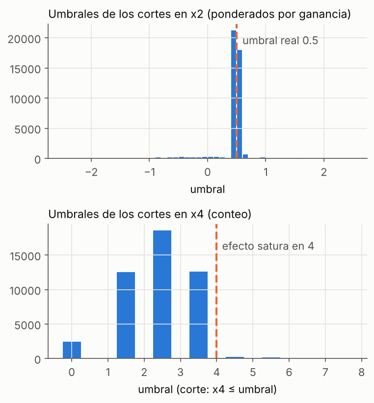
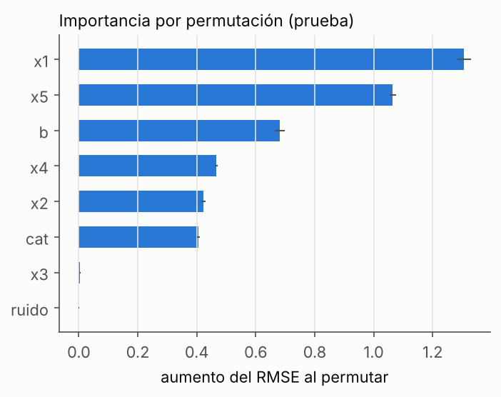
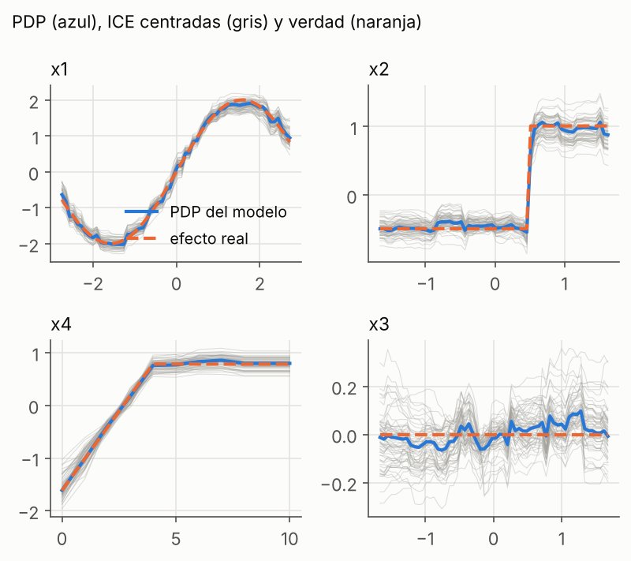
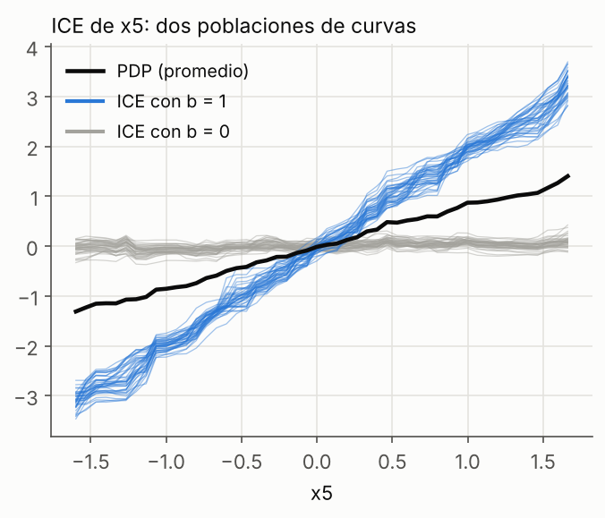
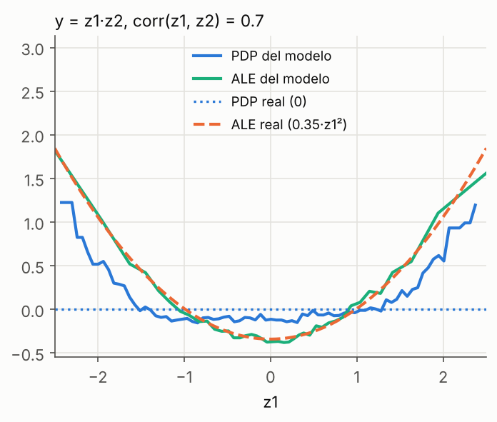
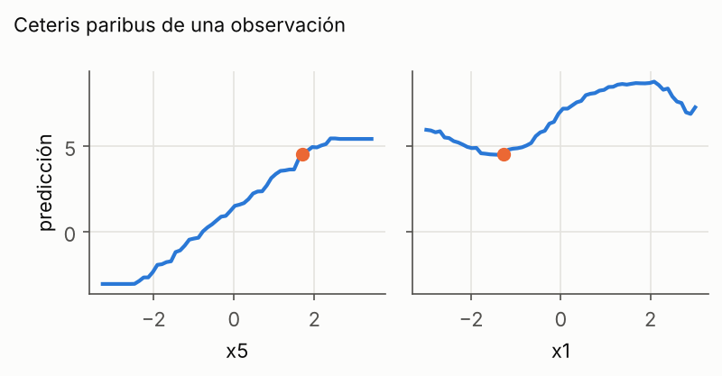
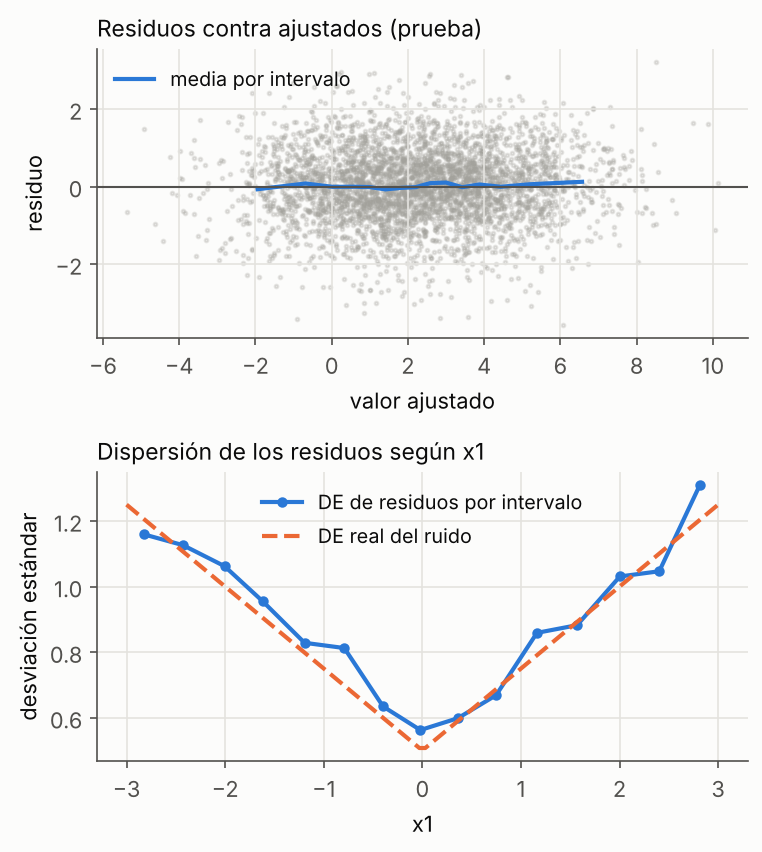
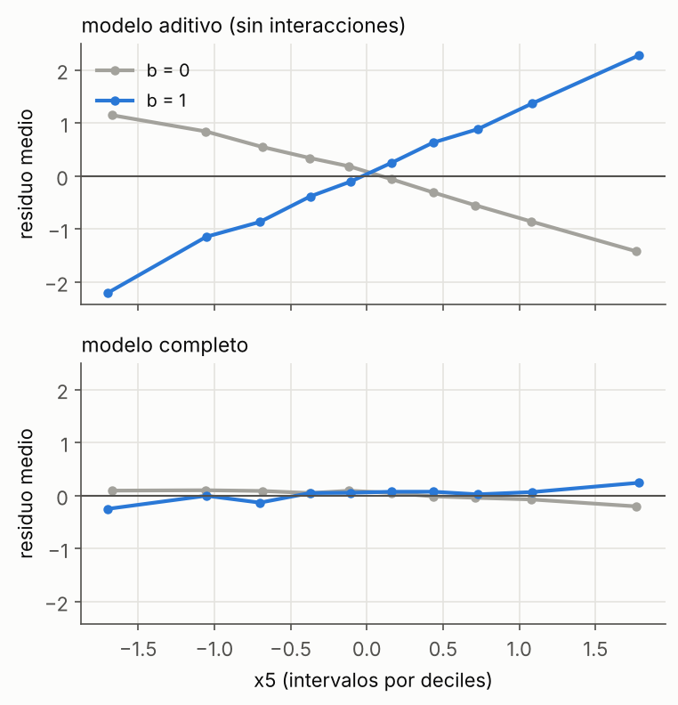

*Nota práctica. La idea es explorar un LightGBM ya entrenado con herramientas que van más allá de las contribuciones SHAP, usando datos simulados donde **conocemos la verdad**, para ver qué recupera cada herramienta y dónde engaña. Todo el código está en `ejemplos/` del repositorio: `simulacion.py`, `herramientas.py` y `explicabilidad_regresion.py`. Versiones: `lightgbm` 4.7.0, `scikit-learn` 1.9.1, `dalex` 1.8.0.*

# El diseño del experimento

Ocho variables con estructura conocida:

| Variable | Tipo | Efecto verdadero | Qué pone a prueba |
|:--|:--|:--|:--|
| `x1` | continua, $U(-3,3)$ | $2\sin(x_1)$ | no linealidad suave |
| `x2` | continua, $N(0,1)$ | $1.5\cdot\mathbf 1\{x_2>0.5\}$ | umbral |
| `x3` | continua, $0.9x_2+$ruido | ninguno | variable correlacionada ($r\approx0.9$) sin efecto |
| `x4` | discreta, Poisson(3) | $0.6\min(x_4,4)$ | conteo que satura |
| `cat` | categórica, A–F | A 0, B 0.8, C −0.5, D 0, E 1.5, F −1 | efectos por nivel |
| `b` | binaria, Bernoulli(0.4) | ninguno por sí sola | solo interactúa |
| `x5` | continua, $N(0,1)$ | $2\,x_5\, b$ | interacción pura |
| `ruido` | continua, $N(0,1)$ | ninguno | control negativo |

La respuesta es $y=\eta(\mathbf x)+\varepsilon$, con $\eta$ la suma de los efectos y $\varepsilon\sim N\big(0,\ \sigma(x_1)^2\big)$, $\sigma(x_1)=0.5+0.25\lvert x_1\rvert$: el ruido es **heterocedástico**, crece con $\lvert x_1\rvert$. Entrenamiento 6 000, validación 2 000, prueba 4 000.

```python
import lightgbm as lgb
import simulacion as sim

Xtr, ytr = sim.simular_regresion(6000, 1)
Xva, yva = sim.simular_regresion(2000, 2)
Xte, yte = sim.simular_regresion(4000, 3)
# sklearn.inspection no acepta columnas enteras: discretas como float
Xtr, Xva, Xte = [d.astype({"x4": float, "b": float})
                 for d in (Xtr, Xva, Xte)]

modelo = lgb.LGBMRegressor(
    n_estimators=3000, learning_rate=0.03, num_leaves=15,
    min_child_samples=20, subsample=0.8, subsample_freq=1,
    colsample_bytree=0.8, random_state=0, verbose=-1)
modelo.fit(Xtr, ytr, eval_set=[(Xva, yva)],
           callbacks=[lgb.early_stopping(100, verbose=False)])
```

`cat` es una columna `pandas.Categorical`, así que LightGBM la trata como categórica nativa sin declararla.

# Paso 0: ¿qué tan bueno es el modelo?

Antes de interpretar, hay que saber si vale la pena. Con datos simulados podemos comparar contra el **oráculo**, que predice con $\eta(\mathbf x)$ verdadera:

| | RMSE prueba | $R^2$ prueba |
|:--|:--|:--|
| LightGBM (647 árboles) | 0.928 | 0.857 |
| Oráculo $\eta(\mathbf x)$ | 0.882 | 0.871 |

El RMSE entre la predicción del modelo y $\eta$ es 0.282: el modelo está cerca de la función verdadera. Todo lo que sigue interpreta un modelo bueno; interpretar un modelo malo describe sus errores, no los datos.

# 1. Estructura del modelo: mirar dentro de los árboles

LightGBM expone los árboles completos como tabla:

```python
arb = modelo.booster_.trees_to_dataframe()
# columnas: tree_index, node_depth, node_index, parent_index,
#           split_feature, threshold, decision_type, split_gain,
#           value, count, ...
cortes = arb[arb.split_feature.notna()]
```

Cada fila es un nodo. Con esto se pueden contestar preguntas que ninguna librería de explicabilidad responde directamente.

**Forma de los árboles.** Todos tienen 15 hojas (`num_leaves=15`), pero el crecimiento por hojas produjo ramas de hasta profundidad 13.

**¿Dónde corta el modelo?** Agrupando los umbrales de cada variable, ponderados por la ganancia del corte:



- En `x2` la ganancia se concentra en el umbral real 0.5. El modelo encontró el escalón.
- En `x4` (conteo) la ganancia se reparte entre los cortes $x_4\le 0$ (5 %), $\le 1.5$ (27 %), $\le 2.5$ (40 %) y $\le 3.5$ (27 %). Los cortes por encima de 4 suman menos del 1 %: el modelo “sabe” que el efecto satura en 4.

**Cortes categóricos.** En la columna `threshold` de un corte categórico aparecen los códigos del grupo izquierdo, separados por `||`. Traducidos a niveles y ponderados por ganancia:

| Grupo enviado a la izquierda | % de la ganancia en `cat` |
|:--|:--|
| {B, E} | 46.6 % |
| {C, F} | 27.3 % |
| {E} | 15.4 % |
| {F} | 6.0 % |

Los grupos son exactamente los niveles con efecto positivo (B, E) y negativo (C, F). Es el ordenamiento por gradiente de la nota 3 funcionando.

**Pista estructural de interacciones.** Si dos variables aparecen en cortes consecutivos de una rama (padre e hijo), el árbol está modelando el efecto de una condicionado a la otra. Contando esos pares, ponderados por la ganancia del hijo (`coocurrencia_en_ramas` en `herramientas.py`):

| Par padre–hijo | % de la ganancia |
|:--|:--|
| b × x5 | 31.4 % |
| x1 × x2 | 8.0 % |
| x4 × x5 | 7.9 % |
| cat × x4 | 7.5 % |

El único par real domina. Los demás son ruido estructural: un árbol también apila variables con efectos aditivos, porque cada rama tiene que representar algo. Es una pista barata, no una medida; para medir, más adelante usamos el estadístico H.

# 2. Importancia de variables: tres medidas que no coinciden

```python
from sklearn.inspection import permutation_importance

imp_split = modelo.booster_.feature_importance("split")
imp_gain = modelo.booster_.feature_importance("gain")
perm = permutation_importance(
    modelo, Xte, yte, scoring="neg_root_mean_squared_error",
    n_repeats=10, random_state=0)
```

| Variable | % de cortes | % de ganancia | Permutación: ΔRMSE |
|:--|:--|:--|:--|
| x1 | 20.9 | 39.5 | 1.307 ± 0.022 |
| x5 | 21.8 | 17.9 | 1.065 ± 0.010 |
| b | 6.5 | 12.3 | 0.682 ± 0.017 |
| x4 | 7.0 | 10.3 | 0.467 ± 0.005 |
| x2 | 15.2 | 9.6 | 0.422 ± 0.008 |
| cat | 5.8 | 8.6 | 0.405 ± 0.005 |
| x3 | 11.5 | 1.0 | 0.003 ± 0.002 |
| ruido | 11.2 | 0.8 | 0.000 ± 0.001 |



Lecturas:

- **El conteo de cortes engaña.** `x3` y `ruido` reciben 11 % de los cortes cada una, más que `x4` o `cat`. Son cortes de poca ganancia que el modelo hace porque puede (refinamientos de ruido en ramas profundas). La importancia por `split` es casi inútil para decidir qué importa.
- **Ganancia y permutación ordenan parecido**, pero la ganancia se mide en entrenamiento y la permutación en prueba. La permutación responde a una pregunta más útil: cuánto empeora la predicción en datos nuevos si se rompe la relación de la variable con todo lo demás.
- **`b` es importante sin tener efecto principal.** Permutarla destruye la interacción con `x5`. La importancia mide efecto total (principal más interacciones), no efecto “propio”.
- **Variables correlacionadas.** Permutar `x3` casi no cambia nada (0.003), porque el modelo usa `x2`. Pero si el modelo hubiera repartido el efecto entre las dos, permutar cada una por separado subestimaría su importancia conjunta. `dalex` permite permutar grupos:

```python
import dalex as dx
exp = dx.Explainer(modelo, Xte, yte, label="LightGBM", verbose=False)
grupos = exp.model_parts(
    variable_groups={"x2+x3": ["x2", "x3"], "x2": ["x2"], "x3": ["x3"]},
    B=10, random_state=0)
```

Resultado (aumento del RMSE): `x2` 0.413, `x3` 0.003, `x2+x3` 0.427. Aquí el grupo apenas añade algo, confirmando que `x3` es redundante. Además, permutar una variable correlacionada crea combinaciones que no existen en los datos ($x_2$ alto con $x_3$ bajo); la importancia por permutación evalúa el modelo fuera de su soporte, el mismo problema que veremos con el PDP.

# 3. Dependencia parcial (PDP) e ICE

La **dependencia parcial** de la variable $j$ es el promedio de la predicción fijando $x_j$ y dejando las demás como están en los datos:

$$\mathrm{PD}_j(z) = \frac1n\sum_{i=1}^{n} \hat f\big(z,\ \mathbf x_{i,-j}\big)$$

Las curvas **ICE** (*individual conditional expectation*) son los sumandos: una curva $z\mapsto \hat f(z, \mathbf x_{i,-j})$ por observación. El PDP es su promedio.

```python
from sklearn.inspection import partial_dependence
res = partial_dependence(modelo, Xte, ["x1"], kind="both",
                         grid_resolution=60)
grid, pdp, ice = (res["grid_values"][0], res["average"][0],
                  res["individual"][0])
```

Para comparar con la verdad, centré cada curva para que su promedio sobre la distribución de la variable sea cero (`centrar` en `herramientas.py`).



- `x1`: la sinusoide se recupera casi perfecta.
- `x2`: el escalón aparece en 0.5 con altura 1.43 (real 1.5). El PDP de un modelo de árboles es escalonado por construcción.
- `x4`: la rampa y la saturación en 4 son claras.
- `x3`: el PDP oscila en ±0.1 alrededor de cero (rango 0.16). Es el residuo de los cortes de ruido; las ICE se dispersan más que el PDP.
- Que las ICE centradas sean casi paralelas al PDP indica que **no hay interacciones** fuertes con esas variables.

**Categórica.** Con `categorical_features=["cat"]`, el PDP por nivel (centrado con las frecuencias):

| Nivel | n (prueba) | PDP modelo | Efecto real |
|:--|:--|:--|:--|
| A | 1211 | −0.11 | −0.12 |
| B | 795 | 0.62 | 0.68 |
| C | 584 | −0.64 | −0.62 |
| D | 617 | −0.09 | −0.12 |
| E | 377 | 1.38 | 1.38 |
| F | 416 | −1.07 | −1.12 |

**ICE para detectar interacciones.** Para `x5` el PDP tiene pendiente 0.82, que no describe a nadie: las observaciones con $b=1$ tienen pendiente 2 y las de $b=0$ tienen pendiente 0. Coloreando las ICE por `b`:



Pendientes medianas de las ICE en $[-1.5, 1.5]$: 1.91 con $b=1$, 0.06 con $b=0$, y 0.82 el PDP ($\approx 0.4\cdot 2$, porque $P(b=1)=0.4$). **Siempre mira las ICE antes de creer un PDP**: un PDP plano o moderado puede ser el promedio de efectos opuestos.

# 4. ALE: cuando las variables están correlacionadas

El PDP fija $x_j=z$ y combina ese valor con los $\mathbf x_{-j}$ de **todas** las observaciones. Si $x_j$ está correlacionada con otra variable, muchas de esas combinaciones no existen en los datos, y el PDP promedia predicciones del modelo **fuera de su soporte**, donde los árboles extrapolan como constantes.

Los **efectos locales acumulados** (ALE, Apley y Zhu 2020) evitan eso. Se divide el rango de $x_j$ en intervalos por cuantiles $z_0<z_1<\dots<z_K$, y en cada intervalo se promedia la diferencia de predicción entre sus bordes **solo sobre las observaciones que caen en él**:

$$\widehat{\mathrm{ALE}}_j(z) = \sum_{k=1}^{k(z)} \frac{1}{n_k}\sum_{i\in I_k} \Delta_{ik} \;-\; c$$

donde $I_k$ son las $n_k$ observaciones con $x_{ij}\in(z_{k-1},z_k]$, $c$ es una constante de centrado y

$$\Delta_{ik} = \hat f(z_k, \mathbf x_{i,-j}) - \hat f(z_{k-1}, \mathbf x_{i,-j})$$

Las diferencias se evalúan con los $\mathbf x_{-j}$ que realmente acompañan a $x_j$ en ese intervalo. En el límite, el ALE es la integral de $\mathbb E\big[\partial f/\partial x_j \mid x_j\big]$.

**En nuestro modelo, PDP y ALE coinciden**: el rango de la curva de `x2` es 1.70 con ambos, y el de `x3`, 0.19 frente a 0.20. El modelo casi no usa `x3`, así que no hay combinaciones problemáticas que importen.

**Un ejemplo donde difieren.** Sea $y=z_1 z_2+\varepsilon$ con $z_1,z_2\sim N(0,1)$ y $\operatorname{corr}(z_1,z_2)=\rho$. Para la función verdadera:

- $\mathrm{PD}_{z_1}(z) = z\,\mathbb E[z_2] = 0$: plano. Fijar $z_1$ y promediar sobre todos los $z_2$ cancela el efecto.
- $\mathrm{ALE}_{z_1}(z) = \int_0^{z}\mathbb E[z_2 \mid z_1=u]\,du = \tfrac{\rho}{2} z^2$ (más una constante): una parábola. Es el efecto de mover $z_1$ “arrastrando” a $z_2$ como en los datos.

No hay una curva “correcta”: el PDP responde *¿qué pasa si muevo $z_1$ dejando $z_2$ como está?*, y el ALE responde *¿cómo cambia la predicción a lo largo de $z_1$ en la zona donde hay datos?*. Ajustando LightGBM a estos datos con $\rho=0.7$:



Valores centrados en $z_1=-2,\,0,\,2$:

| $\rho$ | PDP modelo | ALE modelo | ALE real | `dalex` *accumulated* |
|:--|:--|:--|:--|:--|
| 0.5 | 0.14, −0.03, 0.17 | 0.73, −0.27, 0.76 | 0.73, −0.27, 0.73 | 0.27, −0.10, 0.44 |
| 0.7 | 0.52, −0.11, 0.56 | 1.09, −0.37, 1.15 | 1.02, −0.38, 1.02 | 0.64, −0.16, 0.80 |
| 0.9 | 1.39, −0.27, 1.34 | 1.44, −0.47, 1.40 | 1.32, −0.48, 1.32 | 1.43, −0.30, 1.40 |

Tres lecciones:

1. **El ALE del modelo recupera el ALE real** en los tres casos. Usé mi implementación directa de la fórmula (`ale_1d` en `herramientas.py`).
2. **El PDP del modelo se aleja del PDP real (0) conforme crece $\rho$.** Con $\rho=0.9$ el PDP del modelo ya es casi igual a su ALE. La razón: fuera de la diagonal no hay datos, y el modelo nunca aprendió $z_1z_2$ ahí; aprendió algo que, sobre la diagonal, se parece a $0.45z_1^2+0.45z_2^2$. Con $\rho=0.7$, alrededor del 10 % de las combinaciones que evalúa el PDP están a más de 3 desviaciones estándar condicionales de los datos. **El PDP de un modelo con variables correlacionadas describe en parte cómo extrapola el modelo, no los datos.**
3. **`dalex` (`model_profile(type="accumulated")`) no coincidió con el ALE de Apley y Zhu** en mis pruebas con $\rho=0.5$ y $0.7$. `dalex` implementa los *accumulated local profiles* del libro de Biecek y Burzykowski, que suavizan con un núcleo (parámetro `span`), y con estos datos subestimó la curvatura. Para ALE usé mi implementación; el paquete `PyALE` es otra opción, que no probé aquí.

# 5. Interacciones: el estadístico H de Friedman

Si $\hat f$ no tiene interacción entre $j$ y $k$, su dependencia parcial conjunta se descompone como suma: $\mathrm{PD}_{jk}(x_j,x_k)=\mathrm{PD}_j(x_j)+\mathrm{PD}_k(x_k)$ (con funciones centradas). El estadístico de Friedman y Popescu (2008) mide el incumplimiento, evaluando en los puntos observados:

$$H^2_{jk}=\frac{\sum_i\big[\mathrm{PD}_{jk}(x_{ij},x_{ik})-\mathrm{PD}_j(x_{ij})-\mathrm{PD}_k(x_{ik})\big]^2}{\sum_i \mathrm{PD}_{jk}(x_{ij},x_{ik})^2}$$

Es la fracción de la variación conjunta que se debe a la interacción. No viene en `sklearn` ni en `dalex`; está implementado por fuerza bruta en `h_friedman` (`herramientas.py`): con una muestra de $m$ observaciones, cada PD cuesta $m^2$ predicciones. Con $m=200$ y 8 variables son unos 1.4 millones de predicciones, un par de segundos con LightGBM.

Para tener una referencia, apliqué la misma función a $\eta$ verdadera. Resultados ordenados por la versión **sin normalizar**, $\sqrt{\tfrac1m\sum_i[\cdots]^2}$, que está en unidades de $y$:

| Par | $H^2$ modelo | $H^2$ real | $H$ sin normalizar (modelo) | (real) |
|:--|:--|:--|:--|:--|
| b × x5 | 0.557 | 0.604 | 0.842 | 0.909 |
| x1 × x4 | 0.002 | 0 | 0.068 | 0 |
| x1 × x5 | 0.001 | 0 | 0.058 | 0 |
| x1 × x2 | 0.001 | 0 | 0.051 | 0 |
| x3 × ruido | **0.066** | — | 0.017 | 0 |

- El H identifica la única interacción real y su magnitud es correcta.
- **Cuidado con el $H^2$ normalizado**: `x3 × ruido` obtiene $H^2=0.066$, el segundo más alto, porque el denominador es casi cero (ninguna de las dos tiene efecto). Para la función real el cociente es $0/0$. En unidades de $y$, la interacción es 0.017: irrelevante. Ordena por la versión sin normalizar, o filtra antes las variables sin efecto.
- El H se basa en dependencias parciales, así que hereda el problema de extrapolación con variables correlacionadas.

# 6. Explicaciones locales sin SHAP

Una observación de prueba: $x_1=-1.28$, $x_2=-2.03$, $x_4=3$, `cat`=E, $b=1$, $x_5=1.70$. Predicción 4.52; $\eta$ real 4.78.

**Ceteris paribus** (en `dalex`: `predict_profile`) es la curva ICE de esa observación: cómo cambiaría su predicción moviendo una variable y dejando las demás fijas.



Para esta observación ($b=1$), la predicción sube casi linealmente con `x5`, con pendiente cercana a 2. Para una observación con $b=0$ el perfil sería plano. También se ve que está cerca del mínimo de la sinusoide en `x1`.

***Break-down*** (`predict_parts(type="break_down")`) reparte la predicción en aportes, agregando variables una a una en un orden y anotando cuánto cambia la predicción promedio:

| Paso (orden automático) | Aporte | | Paso (otro orden) | Aporte |
|:--|:--|:--|:--|:--|
| intercepto | 2.231 | | intercepto | 2.231 |
| x5 = 1.70 | 1.385 | | x5 = 1.70 | 1.385 |
| cat = E | 1.315 | | b = 1 | 1.920 |
| x4 = 3 | 0.263 | | x1 = −1.28 | −2.154 |
| b = 1 | 1.887 | | x2 = −2.03 | −0.424 |
| x1 = −1.28 | −2.154 | | cat = E | 1.436 |
| (resto) | −0.411 | | (resto) | 0.123 |
| predicción | 4.515 | | predicción | 4.515 |

Los aportes **dependen del orden** cuando hay interacciones o correlaciones: `cat` aporta 1.32 o 1.44 según cuándo entre. SHAP resuelve esto promediando sobre todos los órdenes. La variante `type="break_down_interactions"` detecta el par interactuante y lo reporta junto: `x5:b = 1.70:1` aporta 3.154, cerca del 3.4 de $2x_5b$.

# 7. Diagnóstico de residuos

Aquí entra la tradición de Fox: un modelo flexible también deja huellas en los residuos. En datos de prueba:



- **Residuos contra ajustados**: la media por intervalo está en cero en todo el rango. No hay sesgo sistemático por nivel de predicción.
- **Dispersión según `x1`**: la desviación estándar de los residuos sigue la forma de V de $\sigma(x_1)=0.5+0.25\lvert x_1\rvert$. El modelo ajusta bien la media, pero **un solo RMSE oculta que la incertidumbre se duplica en los extremos de `x1`**. Si importan los intervalos de predicción, esto pide regresión cuantílica (`objective="quantile"`) o un modelo para la varianza.

**Los residuos detectan lo que falta.** Entrené un segundo modelo que prohíbe todas las interacciones (`interaction_constraints=[[0],[1],...,[7]]`, un GAM ajustado por boosting). Su RMSE de prueba es 1.352, frente a 0.928. Graficando la media de los residuos por deciles de `x5`, separando por `b`:



El modelo aditivo deja dos rectas cruzadas: residuo con pendiente $+1.2$ cuando $b=1$ y $-0.8$ cuando $b=0$. Es exactamente $2x_5b - 0.8x_5$, la parte de la interacción que un efecto aditivo de pendiente 0.8 no puede capturar. En el modelo completo, ambas líneas son planas.

Es el análisis clásico de residuos contra predictores, aplicado por grupos. Funciona sin saber nada del modelo, y con `dalex` los residuos se obtienen con `exp.model_diagnostics()`.

# 8. Modelo sustituto global

Un árbol de decisión pequeño ajustado a las **predicciones** del modelo (no a $y$) da un resumen legible:

```python
from sklearn.tree import DecisionTreeRegressor, export_text
sust = DecisionTreeRegressor(max_depth=3, min_samples_leaf=100)
sust.fit(Xtr.assign(cat=Xtr.cat.cat.codes), modelo.predict(Xtr))
```

```
|--- x1 <= -0.10
|   |--- x2 <= 0.51
|   |   |--- x5 <= -0.19  -> -0.38
|   |   |--- x5 >  -0.19  ->  0.89
|   |--- x2 >  0.51
|   |   |--- x4 <= 3.50   ->  1.33
|   |   |--- x4 >  3.50   ->  2.81
|--- x1 >  -0.10
|   |--- x2 <= 0.52
|   |   |--- x4 <= 2.50   ->  2.27
|   |   |--- x4 >  2.50   ->  3.61
|   |--- x2 >  0.52
|   |   |--- x5 <= -0.07  ->  3.70
|   |   |--- x5 >  -0.07  ->  5.24
```

Encuentra los umbrales reales de `x2` (0.51) y `x4`, pero su **fidelidad** ($R^2$ entre sus predicciones y las del modelo, en prueba) es solo 0.51. Con 8 hojas no puede representar la sinusoide ni la interacción. Reporta siempre la fidelidad: un sustituto con fidelidad baja es una caricatura.

# Resumen: qué herramienta para qué pregunta

| Pregunta | Herramienta | Paquete | Cuidado |
|:--|:--|:--|:--|
| ¿Qué tan bien predice? | Comparar contra una referencia | — | Interpretar solo modelos buenos |
| ¿Dónde corta el modelo? | Umbrales ponderados por ganancia | `lightgbm` (`trees_to_dataframe`) | Describe el modelo, no los datos |
| ¿Qué categorías agrupa? | Conjuntos de los cortes categóricos | `lightgbm` | Códigos en `threshold` |
| ¿Qué variables importan? | Permutación en prueba | `sklearn`, `dalex` | No uses el conteo de cortes |
| ¿Grupos correlacionados? | Permutación por grupos | `dalex` | Permutar crea puntos irreales |
| ¿Forma del efecto? | PDP + ICE | `sklearn` | Extrapolación si hay correlación |
| ¿Forma con correlación? | ALE | implementación propia, `PyALE` | `dalex` *accumulated* no coincidió |
| ¿Hay interacciones? | H de Friedman, ICE coloreadas | implementación propia | Normalizado inestable |
| ¿Por qué esta predicción? | Ceteris paribus, *break-down* | `dalex` | Depende del orden |
| ¿Qué le falta al modelo? | Residuos contra predictores, por grupos | `dalex`, propio | Agrupar por intervalos |
| ¿Resumen legible? | Árbol sustituto | `sklearn` | Reportar fidelidad |

# Referencias

- Apley, D. W. y Zhu, J. (2020). *Visualizing the effects of predictor variables in black box supervised learning models*. JRSS B, 82(4).
- Friedman, J. H. y Popescu, B. E. (2008). *Predictive learning via rule ensembles*. Annals of Applied Statistics, 2(3).
- Goldstein, A. et al. (2015). *Peeking inside the black box: visualizing statistical learning with plots of individual conditional expectation*. JCGS, 24(1).
- Biecek, P. y Burzykowski, T. (2021). *Explanatory Model Analysis*. CRC Press.
- Molnar, C. *Interpretable Machine Learning*.
- Fox, J. (2020). *Regression Diagnostics*, 2.ª ed. SAGE.
