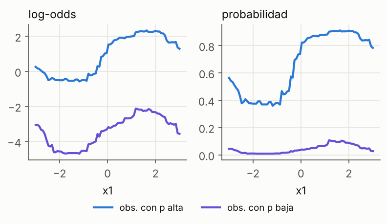
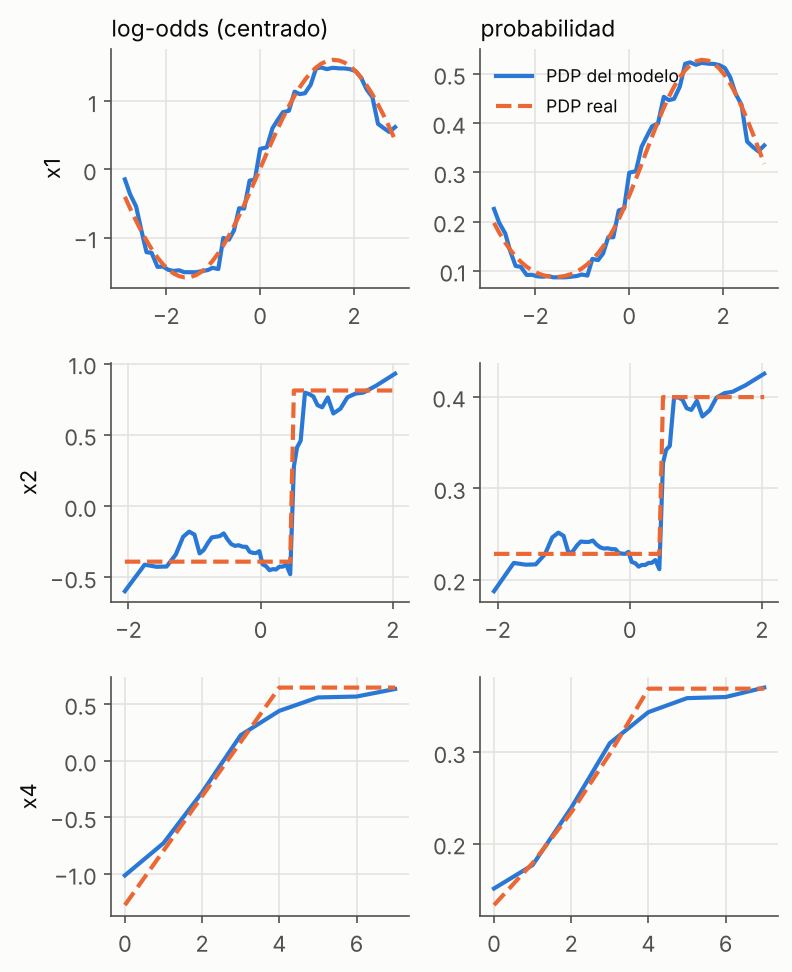
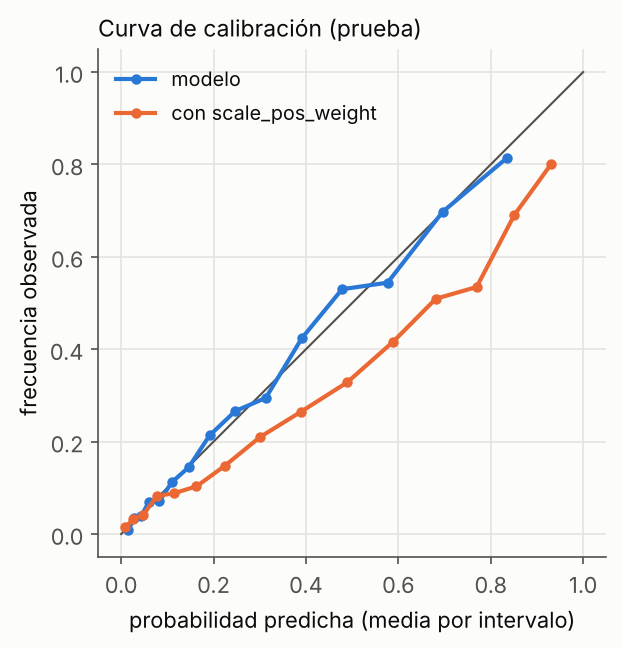
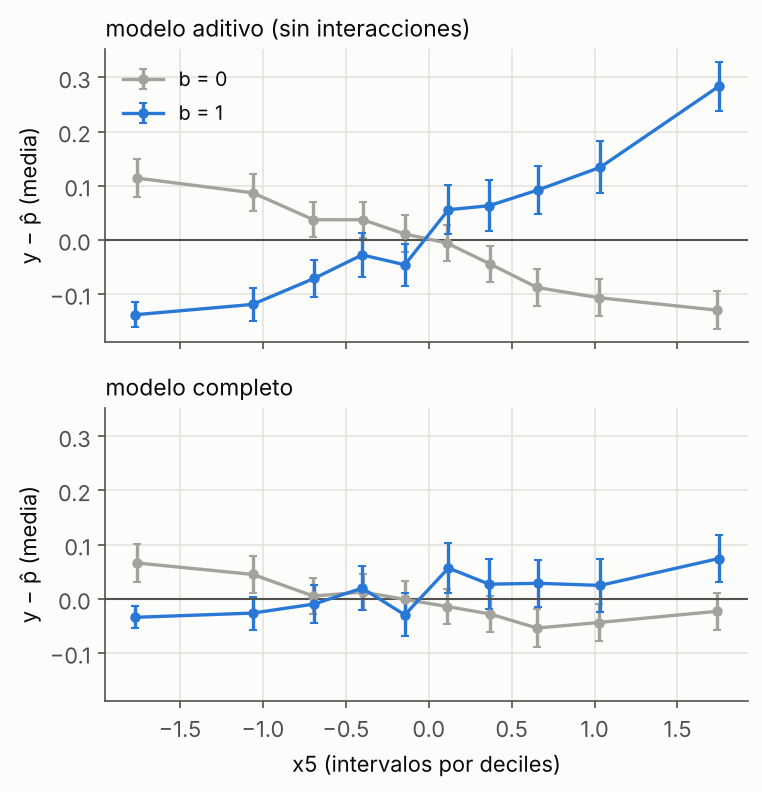

*Continuación de la nota de regresión: mismas variables, mismas herramientas. Aquí me concentro en lo que **cambia** en clasificación: la escala en que se explica, la calibración y los residuos de una respuesta binaria. Script: `ejemplos/explicabilidad_clasificacion.py`.*

# El diseño

Las variables son las mismas de la nota anterior. Ahora la respuesta es binaria con

$$\operatorname{logit} P(y=1\mid\mathbf x) = -3.2 + 0.8\,\eta(\mathbf x)$$

donde $\eta$ es la misma suma de efectos ($2\sin x_1$, el escalón en $x_2$, la saturación de $x_4$, los niveles de `cat`, y $2x_5b$). La tasa de positivos es 28 %. Entrenamiento 8 000, validación 3 000, prueba 8 000. El modelo es un `LGBMClassifier` con los mismos hiperparámetros que en regresión, con parada temprana sobre la log-loss (322 árboles).

**La verdad es aditiva en log-odds**, salvo la interacción $x_5\times b$. Esto va a importar.

# Paso 0: desempeño contra referencias

| | log-loss | AUC | Brier | media de $\hat p$ |
|:--|:--|:--|:--|:--|
| Tasa constante (28.1 %) | 0.597 | 0.500 | 0.204 | 0.281 |
| LightGBM | 0.432 | 0.842 | 0.140 | 0.281 |
| Oráculo ($p$ verdadera) | 0.420 | 0.852 | 0.136 | 0.283 |

La tasa observada en prueba es 28.4 %. El modelo está cerca del oráculo. Notar que incluso el oráculo tiene AUC 0.85: con una respuesta binaria hay un piso de error irreducible mucho mayor que en regresión.

# 1. La escala importa: log-odds frente a probabilidad

Un clasificador de LightGBM suma árboles en la escala del **log-odds** (`raw_score`) y luego aplica la sigmoide:

```python
raw = modelo.predict(X, raw_score=True)    # log-odds, suma de árboles
p = modelo.predict_proba(X)[:, 1]           # sigma(raw)
```

Cualquier herramienta de explicación (PDP, ICE, H, *break-down*, permutación) puede aplicarse a cualquiera de las dos funciones, y **dan respuestas distintas**.

**Por qué.** Si el modelo es aditivo en log-odds, $\operatorname{logit} p = \sum_j f_j(x_j)$, en la escala de probabilidad aparecen interacciones:

$$\frac{\partial^2 p}{\partial x_j\,\partial x_k} = \sigma''\Big(\sum_l f_l\Big)\, f_j'(x_j)\, f_k'(x_k) \neq 0$$

El efecto de mover $x_j$ sobre la probabilidad depende de dónde está la suma de los demás: cerca de $p=0.5$ la sigmoide es empinada y el efecto es grande; cerca de 0 o 1, es pequeño.

**ICE en las dos escalas.** Dos observaciones, una con probabilidad alta y otra baja, moviendo solo `x1`:



| | rango en log-odds | rango en probabilidad |
|:--|:--|:--|
| observación con $p$ alta | 2.91 | 0.552 |
| observación con $p$ baja | 2.58 | 0.098 |

En log-odds, `x1` mueve a las dos observaciones casi lo mismo. En probabilidad, a una la mueve 55 puntos y a la otra 10. Ambas afirmaciones son ciertas; responden preguntas distintas.

**El H de Friedman en las dos escalas.** Aplicado a $\hat f$ y a la función verdadera, en cada escala:

| Par | $H^2$ log-odds modelo | (real) | $H^2$ prob. modelo | (real) |
|:--|:--|:--|:--|:--|
| b × x5 | 0.445 | 0.574 | 0.501 | 0.685 |
| x1 × x2 | 0.005 | 0 | 0.035 | 0.023 |
| x1 × x4 | 0.002 | 0 | 0.031 | 0.031 |
| x4 × cat | 0.009 | 0 | 0.032 | 0.013 |
| x1 × cat | 0.004 | 0 | 0.027 | 0.026 |
| x1 × x5 | 0.004 | 0 | 0.025 | 0.019 |

En log-odds, la verdad tiene una sola interacción, y el modelo la encuentra con el resto cerca de cero. En probabilidad, **la verdad misma** tiene interacciones entre todos los pares con efecto, de un 2–3 %, y el modelo las reproduce. No son errores del modelo: son la sigmoide.

**Regla práctica:** para entender la **estructura** del modelo (qué variables interactúan, formas de los efectos), trabaja en log-odds. Para comunicar **efectos en la decisión** (cuánto cambia el riesgo para este cliente), trabaja en probabilidad.

**PDP en las dos escalas** contra la verdad (en probabilidad, la “verdad” es el PDP de la función verdadera, calculado igual):



En log-odds el PDP recupera $0.8f_j$; en probabilidad, la forma se deforma (la sinusoide se aplana abajo, por la sigmoide), y el modelo sigue la verdad igual de bien. La forma de un efecto en probabilidad no es la forma “del efecto”: es la forma del efecto **promediada a través de la sigmoide** sobre la distribución de las demás variables.

Con `sklearn`, `partial_dependence` usa por defecto (`response_method="auto"`) `predict_proba` en clasificadores: escala de probabilidad. Para log-odds, pasa `response_method="decision_function"`; `LGBMClassifier` la implementa y devuelve lo mismo que `predict(X, raw_score=True)` (lo comprobé en la versión 4.7.0).

# 2. Calibración

En clasificación, la predicción es una probabilidad y debe **significar** lo que dice: de las observaciones con $\hat p\approx0.3$, alrededor del 30 % deben ser positivas.

```python
from sklearn.calibration import calibration_curve
frec_obs, p_media = calibration_curve(yte, p, n_bins=15,
                                      strategy="quantile")
```

**Un error común: reponderar clases.** Con clases desbalanceadas, es tentador usar `scale_pos_weight` (o `is_unbalance=True`). Entrené el mismo modelo con `scale_pos_weight` $=w=(1-\bar y)/\bar y=2.57$:



| | log-loss | AUC | Brier | media de $\hat p$ |
|:--|:--|:--|:--|:--|
| Sin reponderar | 0.432 | 0.842 | 0.140 | 0.281 |
| `scale_pos_weight=2.57` | 0.479 | 0.833 | 0.158 | 0.378 |
| … corregido con $-\log w$ | 0.450 | 0.833 | 0.145 | 0.254 |

El modelo reponderado **sobrestima sistemáticamente** la probabilidad (media 0.38 frente a 0.28 real) y no ganó discriminación (AUC un poco menor).

**Por qué el desplazamiento es $\log w$.** Si los positivos pesan $w$, la pérdida esperada en un punto con probabilidad verdadera $p$ es $-w\,p\log q-(1-p)\log(1-q)$, que se minimiza en

$$q=\frac{wp}{wp+1-p}\quad\Longleftrightarrow\quad \operatorname{logit} q = \operatorname{logit} p + \log w$$

Restar $\log w$ al log-odds deshace el desplazamiento en el caso ideal. Aquí la corrección mejora la calibración, pero no recupera el modelo original (0.450 frente a 0.432): reponderar también cambió qué árboles se construyeron. **Si necesitas probabilidades, no repondera**; si necesitas otro umbral de decisión, mueve el umbral sobre $\hat p$.

**Calibración por grupos.** La curva global puede esconder grupos mal calibrados. Por nivel de `cat`:

| Nivel | n | tasa observada | $\hat p$ media |
|:--|:--|:--|:--|
| A | 2354 | 0.269 | 0.262 |
| B | 1620 | 0.360 | 0.357 |
| C | 1248 | 0.223 | 0.210 |
| D | 1179 | 0.254 | 0.279 |
| E | 796 | 0.452 | 0.423 |
| F | 803 | 0.151 | 0.160 |

Las diferencias son del orden del error de muestreo (con $n\approx800$ y $p\approx0.45$, el error estándar es 0.018). Es la versión de clasificación de “residuos contra predictores”.

# 3. Importancia por permutación: ¿con qué métrica?

En clasificación hay varias métricas y la importancia depende de cuál uses. Normalizadas al máximo:

| Variable | log-loss | AUC | Brier | ganancia |
|:--|:--|:--|:--|:--|
| x1 | 1.000 | 1.000 | 1.000 | 1.000 |
| x5 | 0.471 | 0.443 | 0.489 | 0.459 |
| b | 0.246 | 0.229 | 0.269 | 0.251 |
| x2 | 0.222 | 0.210 | 0.249 | 0.341 |
| cat | 0.207 | 0.198 | 0.221 | 0.206 |
| x4 | 0.192 | 0.187 | 0.200 | 0.239 |
| ruido | −0.002 | −0.003 | −0.002 | 0.124 |
| x3 | −0.004 | −0.006 | −0.005 | 0.119 |

```python
permutation_importance(modelo, Xte, yte, scoring="neg_log_loss",
                       n_repeats=10, random_state=0)
# también "roc_auc", "neg_brier_score"
```

Aquí las tres métricas coinciden en el orden. Pueden diferir: el AUC solo mide **orden**, así que una variable que mejora la calibración sin cambiar el orden no aparece con AUC. La log-loss mide ambas cosas y es la que el modelo optimizó. De nuevo, la importancia por ganancia le da 12 % del máximo a `ruido` y a `x3`, que no sirven en prueba.

# 4. Residuos de una respuesta binaria

Con $y\in\{0,1\}$ un residuo individual $y_i-\hat p_i$ solo toma dos valores, y graficarlo contra una variable no sirve. La solución clásica (Gelman y Hill) son los **residuos agrupados**: promediar $y-\hat p$ dentro de intervalos de una variable, con su intervalo de confianza $\pm1.96\,s/\sqrt{n}$.

Igual que en regresión, comparé el modelo completo con uno aditivo (`interaction_constraints` de una variable por grupo). El aditivo tiene log-loss 0.461 frente a 0.432, y AUC 0.814 frente a 0.842:



El modelo aditivo deja las mismas rectas cruzadas que en regresión, ahora en la escala de $y-\hat p$. En el modelo completo los intervalos cubren el cero casi en todos los deciles. Los residuos agrupados también son la manera de revisar calibración contra cada variable, no solo contra $\hat p$.

# Resumen: lo que cambia en clasificación

| Tema | Regresión | Clasificación |
|:--|:--|:--|
| Escala | una sola | log-odds (estructura) o probabilidad (decisión) |
| Interacciones | propiedad del modelo | también las crea la sigmoide en probabilidad |
| Referencia de desempeño | RMSE del oráculo | log-loss y AUC del oráculo; el piso es alto |
| Calidad de $\hat y$ | sesgo de la media | calibración global y por grupos |
| Residuos | individuales | agrupados por intervalos |
| Desbalance | — | no reponderar si importan las probabilidades |

# Ejercicios

1. **Interacción por la sigmoide.** Con $\operatorname{logit}p=f_1(x_1)+f_2(x_2)$, ¿en qué región de $(x_1,x_2)$ es máxima la interacción en la escala de probabilidad? *Pista:* $\sigma''(z)=\sigma(z)(1-\sigma(z))(1-2\sigma(z))$.
2. **Reponderación.** Comprueba numéricamente la fórmula $\operatorname{logit} q = \operatorname{logit}p+\log w$ ajustando una regresión logística con pesos sobre datos simulados.
3. **AUC frente a log-loss.** Construye una variable que solo cambie la calibración (por ejemplo, multiplicar el log-odds por una constante en un subgrupo) y compara su importancia por permutación con ambas métricas.

# Referencias

- Las de la nota anterior, más:
- Gelman, A. y Hill, J. (2007). *Data Analysis Using Regression and Multilevel/Hierarchical Models*, §5.6 (residuos agrupados).
- Niculescu-Mizil, A. y Caruana, R. (2005). *Predicting good probabilities with supervised learning*. ICML.
