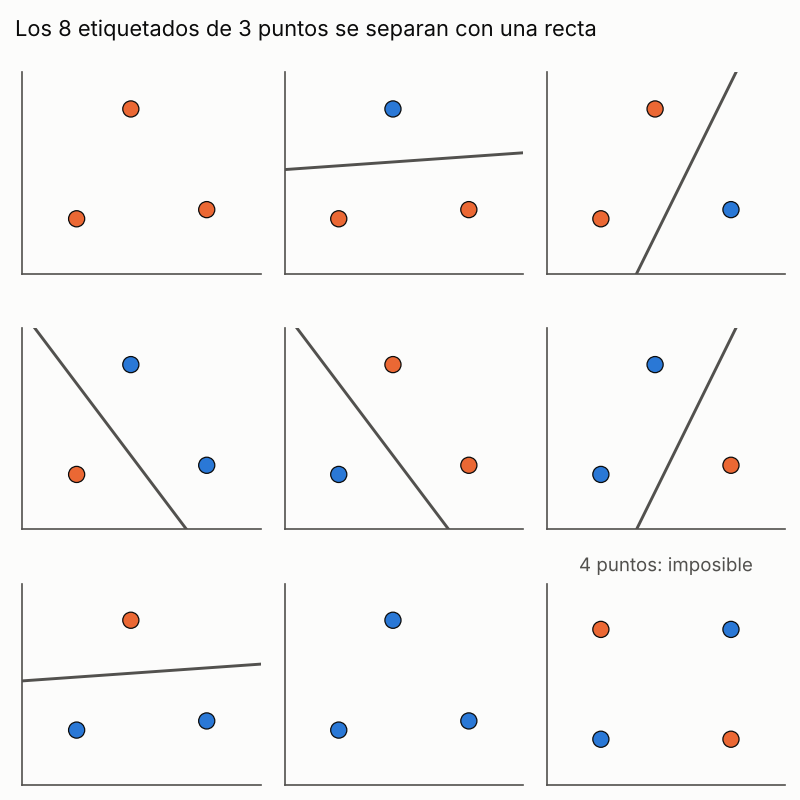
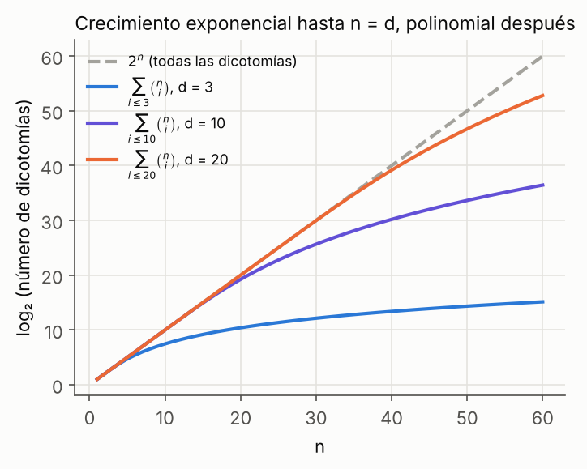
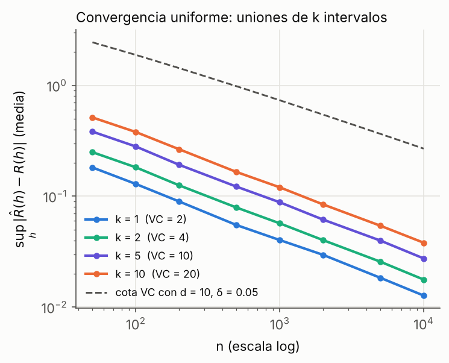
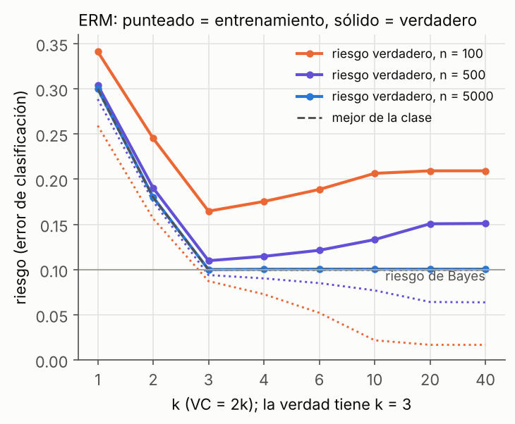

*Nota teórica. Pregunta central: ¿por qué un modelo que se ajusta bien a los datos de entrenamiento debería funcionar en datos nuevos? La respuesta clásica pasa por la convergencia uniforme y la dimensión de Vapnik–Chervonenkis (VC). Todo se desarrolla para clasificación binaria con pérdida 0–1, que es donde la teoría es más limpia. Al final hay una simulación donde los supremos y los minimizadores se calculan exactamente (script: `ejemplos/vc_simulaciones.py`) y una sección sobre lo que esta teoría explica, y lo que no, de boosting.*

# El marco

- **Espacio de entrada** $\mathcal X$, etiquetas $\mathcal Y=\{0,1\}$.
- **Distribución desconocida** $\mathcal D$ sobre $\mathcal X\times\mathcal Y$. Los datos $S=\big((x_1,y_1),\dots,(x_n,y_n)\big)$ son i.i.d. de $\mathcal D$.
- **Clase de hipótesis** $\mathcal H$: un conjunto de funciones $h:\mathcal X\to\{0,1\}$, fijado **antes** de ver los datos (por ejemplo, todos los árboles de profundidad 3, o todas las rectas).
- **Riesgo verdadero** y **riesgo empírico**:

$$\begin{aligned} L_{\mathcal D}(h)&=P_{(x,y)\sim\mathcal D}\big(h(x)\neq y\big) \\ L_S(h)&=\frac1n\sum_{i=1}^n \mathbf 1\{h(x_i)\neq y_i\} \end{aligned}$$

- **Minimización del riesgo empírico** (ERM): elegir $h_S\in\arg\min_{h\in\mathcal H} L_S(h)$.
- **Clasificador de Bayes**: $f^*(x)=\mathbf 1\{P(y=1\mid x)>\tfrac12\}$. Su riesgo $L^*$ es el mínimo posible con cualquier función; es mayor que cero si hay ruido en las etiquetas.

Para un $h$ **fijo**, $L_S(h)$ es un promedio de variables de Bernoulli con media $L_{\mathcal D}(h)$, así que por la ley de los grandes números $L_S(h)\to L_{\mathcal D}(h)$. El problema es que $h_S$ **no** está fijo: depende de $S$, y fue elegido precisamente porque se ve bien en $S$. Ese sesgo de selección es todo el problema de la generalización.

# Descomposición del error

$$\begin{aligned} L_{\mathcal D}(h_S)-L^* &= \underbrace{\Big[\min_{h\in\mathcal H}L_{\mathcal D}(h)-L^*\Big]}_{\text{error de aproximación}} \\ &\quad+ \underbrace{\Big[L_{\mathcal D}(h_S)-\min_{h\in\mathcal H}L_{\mathcal D}(h)\Big]}_{\text{error de estimación}} \end{aligned}$$

- El **error de aproximación** depende solo de $\mathcal H$: qué tan buena es la mejor hipótesis disponible. Una clase más rica lo reduce.
- El **error de estimación** mide cuánto perdemos por elegir con una muestra finita. Una clase más rica lo **aumenta**.

Es el compromiso sesgo–complejidad. La teoría de esta nota se ocupa del segundo término: cuantificar cuán rica puede ser $\mathcal H$ para un $n$ dado.

# La herramienta clave: convergencia uniforme

**Lema.** Si $\sup_{h\in\mathcal H}\lvert L_S(h)-L_{\mathcal D}(h)\rvert\le\varepsilon$, entonces el ERM cumple

$$L_{\mathcal D}(h_S)\le\min_{h\in\mathcal H}L_{\mathcal D}(h)+2\varepsilon$$

> **Demostración.** Sea $h^\circ$ la mejor hipótesis de la clase. Entonces $L_{\mathcal D}(h_S)\le L_S(h_S)+\varepsilon\le L_S(h^\circ)+\varepsilon\le L_{\mathcal D}(h^\circ)+2\varepsilon$. La primera y la última desigualdad usan la hipótesis; la del medio, que $h_S$ minimiza $L_S$. $\blacksquare$

Así, **basta controlar el peor desvío** entre riesgo empírico y verdadero sobre toda la clase. Si la muestra es “representativa para todas las hipótesis a la vez”, el ERM no puede engañarse mucho.

# Clases finitas

**Desigualdad de Hoeffding.** Si $Z_1,\dots,Z_n$ son i.i.d. con valores en $[0,1]$ y media $\mu$, entonces

$$P\Big(\Big\lvert \tfrac1n\textstyle\sum_i Z_i-\mu\Big\rvert>\varepsilon\Big)\le 2e^{-2n\varepsilon^2}$$

Aplicada a $Z_i=\mathbf 1\{h(x_i)\neq y_i\}$ para un $h$ fijo, y sumando sobre las $\lvert\mathcal H\rvert$ hipótesis (cota de la unión):

$$P\Big(\sup_{h\in\mathcal H}\lvert L_S(h)-L_{\mathcal D}(h)\rvert>\varepsilon\Big)\le 2\lvert\mathcal H\rvert\, e^{-2n\varepsilon^2}$$

Igualando el lado derecho a $\delta$ y despejando: con probabilidad al menos $1-\delta$, **para todo** $h\in\mathcal H$,

$$\lvert L_S(h)-L_{\mathcal D}(h)\rvert\le\sqrt{\frac{\ln\lvert\mathcal H\rvert+\ln(2/\delta)}{2n}}$$

Equivalente, en términos de **complejidad muestral**: basta $n\ge\dfrac{\ln\lvert\mathcal H\rvert+\ln(2/\delta)}{2\varepsilon^2}$.

Lecturas:

- La complejidad entra como $\ln\lvert\mathcal H\rvert$: el número de **bits** necesario para nombrar una hipótesis. Duplicar la clase cuesta poco.
- El error decrece como $1/\sqrt n$. Para reducir $\varepsilon$ a la mitad hace falta cuatro veces más datos.
- La cota no depende de $\mathcal D$: es una garantía en el peor caso, **libre de distribución**.

**Ejemplo.** Un modelo con 30 parámetros guardados en 32 bits es, estrictamente, una clase finita con $\lvert\mathcal H\rvert\le2^{960}$, y $\ln\lvert\mathcal H\rvert\approx665$. Con $n=10\,000$ y $\delta=0.05$ la cota da $\varepsilon\approx0.18$. Es un argumento válido pero tosco: cuenta bits, no comportamiento.

# Aprendizaje PAC

Valiant (1984) formalizó qué significa “aprender”. Una clase $\mathcal H$ es **aprendible PAC agnóstica** si existe un algoritmo y una función $n_{\mathcal H}(\varepsilon,\delta)$ tal que, para **toda** distribución $\mathcal D$, con $n\ge n_{\mathcal H}(\varepsilon,\delta)$ datos, el algoritmo devuelve $h$ con

$$L_{\mathcal D}(h)\le\min_{h'\in\mathcal H}L_{\mathcal D}(h')+\varepsilon \quad\text{con probabilidad}\ \ge1-\delta$$

“Probablemente” ($1-\delta$) “aproximadamente correcto” ($\varepsilon$). El caso **realizable** supone además que alguna $h\in\mathcal H$ tiene riesgo cero; ahí las tasas son mejores ($1/n$ en lugar de $1/\sqrt n$).

Lo anterior muestra que **toda clase finita es aprendible PAC** con ERM. La pregunta interesante es qué pasa con clases infinitas, que son las que usamos: umbrales, rectas, árboles con umbrales reales.

# Clases infinitas: lo que importa es el comportamiento sobre la muestra

Considera los umbrales en la recta, $h_a(x)=\mathbf 1\{x\ge a\}$ con $a\in\mathbb R$: una clase infinita. Pero sobre $n$ puntos distintos solo producen $n+1$ etiquetados distintos (el umbral puede caer en cualquiera de los $n+1$ huecos). Para la muestra, la clase se comporta como una clase finita de tamaño $n+1$.

**Restricción y función de crecimiento.** Para $C=\{x_1,\dots,x_n\}$, sea $\mathcal H_C$ el conjunto de vectores $\big(h(x_1),\dots,h(x_n)\big)$ que produce $\mathcal H$ (las **dicotomías** de $C$). La **función de crecimiento** es

$$\Pi_{\mathcal H}(n)=\max_{\lvert C\rvert=n}\lvert\mathcal H_C\rvert\;\le\;2^n$$

Para umbrales, $\Pi(n)=n+1$. La idea de Vapnik y Chervonenkis (1971) es reemplazar $\lvert\mathcal H\rvert$ por $\Pi_{\mathcal H}$ en la cota. Si $\Pi$ crece polinomialmente, $\ln\Pi(n)=O(\ln n)$, y $\sqrt{\ln\Pi(n)/n}\to0$.

# Fragmentación y dimensión VC

$\mathcal H$ **fragmenta** (*shatters*) un conjunto $C$ de $n$ puntos si produce las $2^n$ dicotomías: $\lvert\mathcal H_C\rvert=2^n$. La **dimensión VC** es

$$\mathrm{VC}(\mathcal H)=\max\{\,n:\ \exists\, C,\ \lvert C\rvert=n,\ \mathcal H \text{ fragmenta } C\,\}$$

(infinita si se fragmentan conjuntos arbitrariamente grandes). Para mostrar que $\mathrm{VC}=d$ hay que probar dos cosas: **existe** un conjunto de $d$ puntos fragmentado, y **ningún** conjunto de $d+1$ puntos lo es.

**Ejemplos.**

| Clase | VC | Argumento |
|:--|:--|:--|
| Umbrales $\mathbf 1\{x\ge a\}$ en $\mathbb R$ | 1 | 2 puntos $x_1<x_2$: no se puede etiquetar $(1,0)$ |
| Intervalos $\mathbf 1\{a\le x\le b\}$ | 2 | 3 puntos: no se puede $(1,0,1)$ |
| Uniones de $k$ intervalos | $2k$ | $2k+1$ puntos alternados $1,0,1,\dots$ requieren $k+1$ intervalos |
| Rectángulos alineados a los ejes en $\mathbb R^2$ | 4 | con 5 puntos, el que no es extremo no se puede excluir |
| Semiplanos $\mathbf 1\{w^\top x+b\ge0\}$ en $\mathbb R^d$ | $d+1$ | teorema de Radon (abajo) |
| Clase finita | $\le\log_2\lvert\mathcal H\rvert$ | fragmentar $d$ puntos exige $2^d$ hipótesis |
| $\mathbf 1\{\sin(\omega x)>0\}$, $\omega\in\mathbb R$ | $\infty$ | un solo parámetro fragmenta cualquier número de puntos bien elegidos |

> **Semiplanos en $\mathbb R^d$.** *Cota inferior:* los $d+1$ puntos $0, e_1,\dots,e_d$ se fragmentan: para cualquier etiquetado $y\in\{0,1\}^{d+1}$ basta tomar $b$ y $w_j$ con los signos adecuados. *Cota superior:* por el teorema de Radon, cualquier conjunto de $d+2$ puntos en $\mathbb R^d$ se parte en dos subconjuntos $A$ y $B$ cuyos cascos convexos se cortan. El etiquetado “1 en $A$, 0 en $B$” no es realizable: si un semiplano contuviera a $A$ y excluyera a $B$, contendría el casco convexo de $A$ y excluiría el de $B$, que se cortan. $\blacksquare$

**La dimensión VC no es el número de parámetros.** Para los semiplanos coinciden ($d+1$ parámetros, VC $d+1$), pero $\sin(\omega x)$ tiene un parámetro y VC infinita. Lo que cuenta es la **capacidad de producir etiquetados**, no cuántos números describen la función.

# Lema de Sauer–Shelah

El resultado que hace funcionar todo: si $\mathrm{VC}(\mathcal H)=d<\infty$, entonces para todo $n$

$$\Pi_{\mathcal H}(n)\le\sum_{i=0}^{d}\binom{n}{i}\;\le\;\Big(\frac{en}{d}\Big)^d\quad(n\ge d)$$

La función de crecimiento es $2^n$ hasta $n=d$ y, a partir de ahí, **polinomial** de grado $d$. No hay término medio: o la clase fragmenta muestras arbitrariamente grandes, o su crecimiento colapsa a polinomial.

Por ejemplo, con $d=3$ y $n=40$: hay $2^{40}\approx1.1\times10^{12}$ etiquetados posibles, pero una clase de VC 3 produce a lo sumo $10\,701$.

> **Idea de la demostración** (inducción sobre $n$). Fijemos $C=\{x_1,\dots,x_n\}$ y $C'=C\setminus\{x_n\}$. Cada dicotomía de $C'$ se extiende a una o a dos dicotomías de $C$. Las que se extienden de **dos** formas forman una clase sobre $C'$ que no puede fragmentar $d$ puntos (si lo hiciera, junto con $x_n$ fragmentaría $d+1$). Por inducción: $\lvert\mathcal H_C\rvert\le\sum_{i\le d}\binom{n-1}{i}+\sum_{i\le d-1}\binom{n-1}{i}=\sum_{i\le d}\binom{n}{i}$, usando la identidad de Pascal. $\blacksquare$

# La cota de generalización VC

**Teorema (Vapnik y Chervonenkis, 1971).** Con probabilidad al menos $1-\delta$, para todo $h\in\mathcal H$,

$$L_{\mathcal D}(h)\le L_S(h)+\sqrt{\frac{8}{n}\,\ln\frac{4\,\Pi_{\mathcal H}(2n)}{\delta}}$$

Esta es la forma de Abu-Mostafa, Magdon-Ismail y Lin (2012); hay variantes con otras constantes. Con Sauer, el término es del orden de

$$\sqrt{\frac{d\,\ln(n/d)+\ln(1/\delta)}{n}}$$

**De dónde sale el $2n$** (idea de la demostración):

1. **Simetrización.** Se introduce una “muestra fantasma” $S'$ de otros $n$ puntos. Si $L_S(h)$ está lejos de $L_{\mathcal D}(h)$, con probabilidad razonable también está lejos de $L_{S'}(h)$. Así se reemplaza la cantidad desconocida $L_{\mathcal D}$ por una cantidad observable sobre $2n$ puntos.
2. **Reducción a una clase finita.** Sobre los $2n$ puntos de $S\cup S'$, la clase solo tiene $\Pi_{\mathcal H}(2n)$ comportamientos distintos.
3. **Hoeffding y cota de la unión** sobre esos $\Pi_{\mathcal H}(2n)$ comportamientos, condicionando en los $2n$ puntos y aleatorizando cuáles van a $S$ y cuáles a $S'$.

# El teorema fundamental del aprendizaje estadístico

Para clasificación binaria con pérdida 0–1, las siguientes afirmaciones son **equivalentes** (Blumer et al. 1989; Shalev-Shwartz y Ben-David, teorema 6.7):

1. $\mathcal H$ tiene convergencia uniforme.
2. ERM aprende $\mathcal H$ en sentido PAC agnóstico.
3. $\mathcal H$ es aprendible PAC agnóstica (con cualquier algoritmo).
4. $\mathcal H$ es aprendible PAC en el caso realizable.
5. $\mathrm{VC}(\mathcal H)<\infty$.

Y la complejidad muestral queda determinada por $d$, salvo constantes (teorema 6.8 del mismo libro):

$$n_{\mathcal H}(\varepsilon,\delta)=\Theta\!\left(\frac{d+\ln(1/\delta)}{\varepsilon^2}\right)$$

en el caso agnóstico. En el caso realizable está entre $\dfrac{d+\ln(1/\delta)}{\varepsilon}$ y $\dfrac{d\ln(1/\varepsilon)+\ln(1/\delta)}{\varepsilon}$, salvo constantes.

Que la cota inferior también dependa de $d$ dice algo fuerte: **ningún algoritmo**, por ingenioso que sea, puede aprender una clase de VC $d$ con muchos menos de $d/\varepsilon^2$ datos **en el peor caso**.

**No hay almuerzo gratis.** El reverso: si $\mathrm{VC}(\mathcal H)=\infty$, no es aprendible. En particular, la clase de **todas** las funciones no es aprendible: para cualquier algoritmo y $n<\lvert\mathcal X\rvert/2$ existe una distribución donde una función perfecta existe, pero el algoritmo falla con probabilidad apreciable (Shalev-Shwartz y Ben-David, teorema 5.1). **Aprender requiere sesgo inductivo**: restringir la clase.

# Simulación: ver la teoría con números exactos

Para ver la teoría sin aproximaciones elegí un problema donde todo se puede calcular:

- $x\sim U(0,1)$. La función objetivo vale 1 en $[0.10,0.25]\cup[0.40,0.60]\cup[0.75,0.85]$, y cada etiqueta se invierte con probabilidad 0.1. Riesgo de Bayes: $L^*=0.1$.
- $\mathcal H_k$ = uniones de a lo sumo $k$ intervalos, con extremos en una malla de 400 puntos. $\mathrm{VC}(\mathcal H_k)=2k$. La verdad está en $\mathcal H_3$.
- Como el riesgo verdadero de cada hipótesis se conoce en forma cerrada, tanto $\sup_h\lvert L_S(h)-L_{\mathcal D}(h)\rvert$ como el ERM se calculan **exactamente** por programación dinámica sobre la malla. Verifiqué la programación dinámica contra fuerza bruta en 200 casos.

## Convergencia uniforme

Media del peor desvío sobre 40 muestras por cada $n$ (la última columna es la cota VC con $d=10$ y $\delta=0.05$):

| $n$ | VC 2 | VC 4 | VC 10 | VC 20 | cota VC |
|:--|:--|:--|:--|:--|:--|
| 100 | 0.129 | 0.182 | 0.281 | 0.380 | 1.883 |
| 1 000 | 0.040 | 0.057 | 0.088 | 0.120 | 0.734 |
| 10 000 | 0.013 | 0.018 | 0.028 | 0.038 | 0.269 |

Tres lecciones:

1. **La tasa $1/\sqrt n$ es exacta.** La pendiente en escala log-log es $-0.49$ para las cuatro clases.
2. **La dependencia en $d$ es como $\sqrt d$.** La razón entre VC 20 y VC 2 es 2.94 en promedio; $\sqrt{10}=3.16$.
3. **La cota VC es correcta pero muy pesimista**: con $d=10$ y $n=10\,000$ promete $0.27$, y lo observado es $0.028$, diez veces menos. Con $n=100$ supera 1, así que no dice nada. La cota es para el **peor** caso de distribución, y usa desigualdades que no son ajustadas (la cota de la unión, Sauer, la simetrización).

Valores de la cota VC con $\delta=0.05$ para tener una idea de su escala:

| $d$ \\ $n$ | $10^3$ | $10^4$ | $10^5$ | $10^6$ |
|:--|:--|:--|:--|:--|
| 2 | 0.40 | 0.14 | 0.049 | 0.016 |
| 10 | 0.73 | 0.27 | 0.095 | 0.033 |
| 100 | 1.80 | 0.71 | 0.263 | 0.094 |

## ERM y el compromiso sesgo–complejidad

Riesgo de entrenamiento (punteado) y verdadero (sólido) del ERM en cada $\mathcal H_k$:

Con $n=100$:

| $k$ | 1 | 2 | 3 | 4 | 6 | 10 | 20 |
|:--|:--|:--|:--|:--|:--|:--|:--|
| riesgo de entrenamiento | 0.259 | 0.157 | 0.087 | 0.073 | 0.052 | 0.022 | 0.017 |
| riesgo verdadero | 0.341 | 0.245 | **0.165** | 0.175 | 0.189 | 0.207 | 0.209 |
| mejor de la clase | 0.300 | 0.180 | 0.100 | 0.100 | 0.100 | 0.100 | 0.100 |

- Con $k<3$ domina el **error de aproximación**: ni la mejor hipótesis de la clase llega al riesgo de Bayes.
- Con $k>3$ el error de aproximación ya es cero (la verdad está en la clase), pero el **error de estimación** crece: el ERM usa los intervalos sobrantes para encerrar etiquetas ruidosas. El riesgo de entrenamiento baja hasta 0.017 mientras el verdadero sube hasta 0.209.
- La **brecha** entre entrenamiento y verdadero crece con $d$, como predice la teoría.
- Con $n=5\,000$ la curva es plana a partir de $k=3$ (0.100–0.101): con suficientes datos, la capacidad sobrante casi no cuesta. El mismo $k$ óptimo (3) aparece para los tres tamaños, pero el costo de equivocarse hacia arriba depende de $n$.

# Más allá de VC: complejidad de Rademacher

La dimensión VC es un número que depende solo de la clase. La **complejidad de Rademacher** mide la capacidad de la clase **sobre la distribución de los datos**: cuánto puede correlacionarse con ruido puro.

Sean $\sigma_1,\dots,\sigma_n$ signos aleatorios $\pm1$ equiprobables. Para una clase $\mathcal G$ de funciones con valores en $[0,1]$,

$$\mathfrak R_n(\mathcal G)=\mathbb E_{S,\sigma}\Big[\sup_{g\in\mathcal G}\frac1n\sum_{i=1}^n\sigma_i\, g(z_i)\Big]$$

**Cota (Mohri, Rostamizadeh y Talwalkar, teorema 3.3).** Con probabilidad al menos $1-\delta$, para toda $g\in\mathcal G$,

$$\mathbb E[g(z)]\le\frac1n\sum_{i=1}^n g(z_i)+2\,\mathfrak R_n(\mathcal G)+\sqrt{\frac{\ln(1/\delta)}{2n}}$$

Aplicada a $g=$ pérdida de $h$, da una cota de generalización. Se conecta con VC por el **lema de Massart**: para una clase de clasificadores, $\mathfrak R_n(\mathcal H)\le\sqrt{2\ln\Pi_{\mathcal H}(n)/n}$. Rademacher es al menos tan buena como VC, y se puede **estimar con los datos**. Además permite clases de funciones reales, como las de margen, que es lo que se necesita para boosting.

# Minimización estructural del riesgo

Si no sabemos qué clase usar, tomamos una sucesión anidada $\mathcal H_1\subset\mathcal H_2\subset\cdots$ de VC crecientes $d_1<d_2<\cdots$, y elegimos el $k$ que minimiza la **cota**, no el riesgo empírico:

$$\hat k=\arg\min_k\Big[L_S(h_{S,k})+\varepsilon(n,d_k,\delta_k)\Big]$$

con $\sum_k\delta_k\le\delta$ (por ejemplo, $\delta_k=\delta\,2^{-k}$) para que la garantía valga simultáneamente para todas las clases. Es la formalización de Vapnik del principio de Occam.

En la práctica, como acabamos de ver, las cotas son tan holgadas que el término de penalización domina y la minimización estructural elige clases demasiado simples. Por eso se usa **validación cruzada** o un conjunto de validación, que estiman el riesgo directamente. La idea de SRM sobrevive como justificación de la regularización: penalizar la complejidad es razonable, y la teoría dice por qué.

# Lo que esta teoría dice (y no dice) sobre boosting y árboles

**Lo que sí dice.**

- Un árbol con muchas hojas es una clase de VC grande; la dimensión VC de un árbol crece con su número de hojas. Limitar `max_depth`, `num_leaves` o `min_data_in_leaf` es controlar capacidad.
- Un ensamble de $T$ clasificadores de una clase de VC $d$ tiene dimensión VC del orden de $T\,d\log(T\,d)$ (Shalev-Shwartz y Ben-David, lema 10.3). La capacidad crece con el número de árboles: es la justificación teórica de la parada temprana.

**Lo que no explica.** Según la cota anterior, el error de prueba de AdaBoost debería empeorar al añadir rondas. Empíricamente, muchas veces **sigue bajando aun después de que el error de entrenamiento llega a cero**. Schapire, Freund, Bartlett y Lee (1998) lo explicaron con **márgenes**: para un voto ponderado $f(x)\in[-1,1]$ y etiquetas $\pm1$, el margen es $y\,f(x)$. Probaron que, con probabilidad $1-\delta$, para todo $\theta>0$,

$$\begin{aligned} P_{\mathcal D}\big(y f(x)\le0\big) &\le P_S\big(y f(x)\le\theta\big) \\ &\quad+O\!\left(\sqrt{\frac{d\log^2(n/d)}{n\,\theta^2}+\frac{\log(1/\delta)}{n}}\right) \end{aligned}$$

donde $d$ es la VC de la clase **base**, no la del ensamble. La cota **no depende de $T$**. Seguir haciendo boosting después de clasificar bien el entrenamiento agranda los márgenes, y eso mejora la garantía.

**Lo que tampoco explica.** Los modelos modernos (redes profundas, ensambles enormes) tienen capacidad suficiente para memorizar etiquetas aleatorias y aun así generalizan bien. Zhang et al. (2017) lo mostraron experimentalmente para redes; para estas clases, cualquier cota basada solo en la capacidad de la clase es vacía. La explicación tiene que incluir **al algoritmo** (qué hipótesis prefiere el optimizador dentro de la clase), no solo a la clase. Es un área abierta.

**La lección práctica** que sobrevive: la brecha entre entrenamiento y prueba crece con la capacidad efectiva y decrece como $1/\sqrt n$. Por eso, con pocos datos, árboles chicos y regularización; con muchos datos, la capacidad cuesta menos.

# Resumen

- Generalizar es controlar $\sup_h\lvert L_S(h)-L_{\mathcal D}(h)\rvert$: si es pequeño, el ERM está a $2\varepsilon$ del mejor de la clase.
- Para clases finitas, Hoeffding y la cota de la unión dan $\varepsilon\approx\sqrt{\ln\lvert\mathcal H\rvert/n}$.
- Para clases infinitas, lo que importa es cuántos etiquetados distintos produce la clase sobre la muestra: la función de crecimiento.
- La dimensión VC es el mayor tamaño de muestra que la clase fragmenta. Por Sauer–Shelah, si es finita la función de crecimiento es polinomial y $\varepsilon\approx\sqrt{d\ln(n/d)/n}$.
- Teorema fundamental: aprendible PAC $\Leftrightarrow$ VC finita, con complejidad muestral $\Theta(d/\varepsilon^2)$.
- En la simulación: tasa $n^{-1/2}$ exacta, dependencia $\sqrt d$, y la cota VC diez veces más holgada que la realidad.
- Para boosting, la explicación correcta pasa por márgenes; para modelos sobreparametrizados, la teoría clásica no basta.

# Ejercicios

1. **Intervalos.** Demuestra que $\mathrm{VC}=2$ para intervalos en $\mathbb R$ y que $\Pi(n)=\binom{n+1}{2}+1$.
2. **Rectángulos.** Demuestra que los rectángulos alineados a los ejes en $\mathbb R^2$ tienen VC 4. *Pista:* para la cota superior, considera el punto de cada lado más extremo.
3. **Complejidad muestral.** Con la cota de clase finita, ¿cuántos datos hacen falta para $\varepsilon=0.05$ y $\delta=0.01$ si $\lvert\mathcal H\rvert=10^6$? ¿Y si $\lvert\mathcal H\rvert=10^{12}$?
4. **Sauer.** Demuestra $\sum_{i=0}^{d}\binom ni\le(en/d)^d$ para $n\ge d$. *Pista:* multiplica por $(d/n)^d\le(d/n)^i$ y usa el binomio de Newton.
5. **Lema del ERM.** Si solo sabemos que $L_S(h)\le L_{\mathcal D}(h)+\varepsilon$ para todo $h$ (una sola dirección), ¿qué se puede decir del ERM?
6. **Experimento.** En el script, cambia el ruido de 0.1 a 0.3. ¿Cómo cambian el peor desvío y el $k$ óptimo para $n=100$?

# Referencias

- Shalev-Shwartz, S. y Ben-David, S. (2014). *Understanding Machine Learning: From Theory to Algorithms*. Cambridge University Press. Caps. 2–6, 10, 26.
- Abu-Mostafa, Y. S., Magdon-Ismail, M. y Lin, H.-T. (2012). *Learning From Data*. AMLBook. Caps. 1–2.
- Mohri, M., Rostamizadeh, A. y Talwalkar, A. (2018). *Foundations of Machine Learning*, 2.ª ed. MIT Press. Caps. 2–3.
- Vapnik, V. N. y Chervonenkis, A. Ya. (1971). *On the uniform convergence of relative frequencies of events to their probabilities*. Theory of Probability and its Applications, 16(2).
- Vapnik, V. N. (1998). *Statistical Learning Theory*. Wiley.
- Valiant, L. G. (1984). *A theory of the learnable*. Communications of the ACM, 27(11).
- Blumer, A., Ehrenfeucht, A., Haussler, D. y Warmuth, M. (1989). *Learnability and the Vapnik–Chervonenkis dimension*. Journal of the ACM, 36(4).
- Bousquet, O., Boucheron, S. y Lugosi, G. (2004). *Introduction to statistical learning theory*. Advanced Lectures on Machine Learning, LNAI 3176.
- Schapire, R. E., Freund, Y., Bartlett, P. y Lee, W. S. (1998). *Boosting the margin: a new explanation for the effectiveness of voting methods*. Annals of Statistics, 26(5).
- Zhang, C., Bengio, S., Hardt, M., Recht, B. y Vinyals, O. (2017). *Understanding deep learning requires rethinking generalization*. ICLR.
