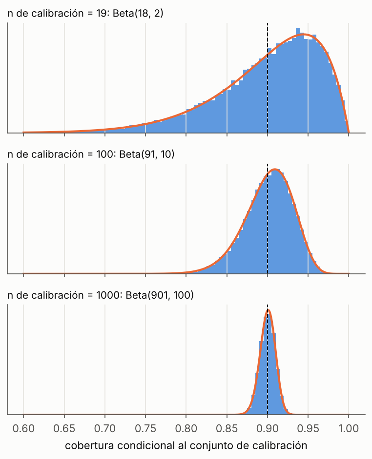
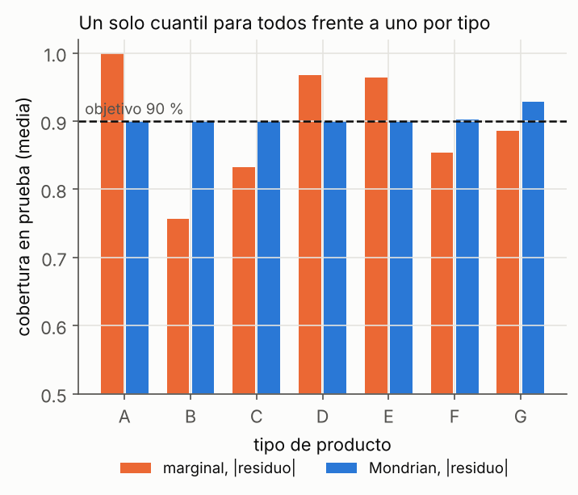
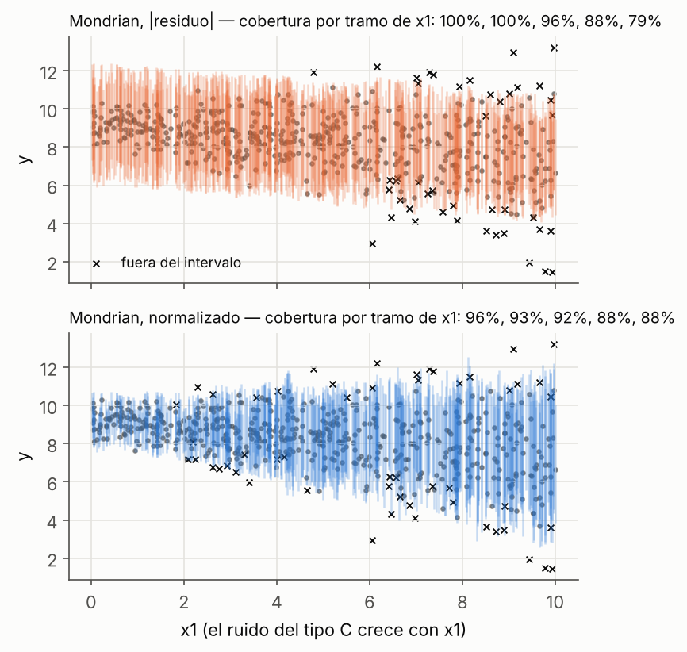

*Nota teórica y práctica. Objetivo: construir intervalos de predicción con cobertura garantizada en muestras finitas, sin supuestos sobre el modelo ni sobre la distribución del error, y con una garantía **por tipo de producto** cuando un solo modelo atiende a todos los tipos. Todo el código está en `ejemplos/conformal_productos.py`. Versiones: `lightgbm` 4.7.0, `crepes` 0.9.1, `mapie` 1.6.0.*

# El problema

Tienes un modelo $\hat\mu(x)$, por ejemplo un LightGBM, que predice un precio (o su logaritmo). Quieres un intervalo $C(x)$ tal que

$$P\big(Y\in C(X)\big)\ge 1-\alpha$$

por ejemplo con $\alpha=0.1$ (90 %). Las rutas clásicas tienen problemas:

- **Intervalos paramétricos** ($\hat\mu\pm1.645\hat\sigma$) suponen normalidad y homocedasticidad, que rara vez se cumplen.
- **Regresión cuantílica** estima los cuantiles, pero sin garantía en muestra finita: si el modelo está mal ajustado, la cobertura real puede ser cualquiera.
- **Bootstrap** es caro con modelos de boosting y tampoco garantiza nada en muestra finita.

*Conformal prediction* (Vovk, Gammerman y Shafer, 2005) da una garantía **exacta en muestra finita**, válida para **cualquier** modelo y **cualquier** distribución, con un solo supuesto: intercambiabilidad.

**Tu caso.** Los datos son una mezcla de tipos de producto con comportamientos distintos (unos predecibles, otros ruidosos, unos con muchos datos, otros con pocos) y un solo modelo para todos. Veremos que la garantía estándar es **marginal**: cubre al 90 % en promedio sobre la mezcla, y puede cubrir al 76 % en un tipo y al 100 % en otro. La solución es calibrar por tipo (*conformal Mondrian*), con un problema práctico: los tipos con pocos datos.

# Intercambiabilidad

Una sucesión $Z_1,\dots,Z_m$ es **intercambiable** si su distribución conjunta no cambia al permutar los índices: $(Z_1,\dots,Z_m)\overset{d}{=}(Z_{\pi(1)},\dots,Z_{\pi(m)})$ para toda permutación $\pi$.

- Datos i.i.d. son intercambiables. La intercambiabilidad es más débil: permite dependencia, siempre que sea simétrica.
- Lo que la rompe: **cambios en el tiempo** (el mercado se mueve y los datos de calibración son de otra época), **selección** (calibrar con un subconjunto distinto del que se predice) o **retroalimentación** (las predicciones cambian los datos futuros).

Toda la garantía descansa en este supuesto. Si no se cumple, hay extensiones (al final de la nota), pero la garantía exacta se pierde.

# Conformal por partición (*split conformal*)

**Ingredientes.**

1. Un modelo $\hat\mu$ entrenado con datos de **entrenamiento**.
2. Un conjunto de **calibración** $(X_1,Y_1),\dots,(X_n,Y_n)$ que el modelo **no vio**.
3. Una **función de puntaje** (*nonconformity score*) $s(x,y)$ fijada antes de ver la calibración. Mide qué tan “raro” es $y$ para $x$. La más simple: $s(x,y)=\lvert y-\hat\mu(x)\rvert$.

**Algoritmo.**

1. Calcular los puntajes de calibración $s_i=s(X_i,Y_i)$, $i=1,\dots,n$.
2. Tomar $k=\lceil(n+1)(1-\alpha)\rceil$ y $\hat q=s_{(k)}$, el $k$-ésimo menor puntaje (si $k>n$, $\hat q=\infty$).
3. Para un $x$ nuevo, $C(x)=\{\,y:\ s(x,y)\le\hat q\,\}$. Con el residuo absoluto, $C(x)=[\hat\mu(x)-\hat q,\ \hat\mu(x)+\hat q]$.

**Teorema.** Si $(X_1,Y_1),\dots,(X_n,Y_n),(X_{n+1},Y_{n+1})$ son intercambiables, entonces

$$P\big(Y_{n+1}\in C(X_{n+1})\big)\ge1-\alpha$$

Si además los puntajes no tienen empates (con probabilidad 1), también

$$P\big(Y_{n+1}\in C(X_{n+1})\big)\le1-\alpha+\frac1{n+1}$$

> **Demostración.** Como $\hat\mu$ y $s$ se fijaron sin usar estos $n+1$ datos, los puntajes $s_1,\dots,s_n,s_{n+1}$ son intercambiables. Entonces el **rango** de $s_{n+1}$ entre los $n+1$ puntajes es uniforme en $\{1,\dots,n+1\}$ (sin empates). El evento $Y_{n+1}\in C(X_{n+1})$ es $s_{n+1}\le s_{(k)}$, que equivale a que el rango de $s_{n+1}$ entre los $n+1$ sea a lo sumo $k$. Su probabilidad es $\frac{k}{n+1}=\frac{\lceil(n+1)(1-\alpha)\rceil}{n+1}$, que está entre $1-\alpha$ y $1-\alpha+\frac1{n+1}$. Con empates, el rango solo puede favorecer la cobertura. $\blacksquare$

Puntos importantes:

- **No se supuso nada** sobre $\hat\mu$: puede ser un mal modelo. Un mal modelo da intervalos **anchos**, no intervalos inválidos.
- La corrección $n+1$ (en lugar de $n$) es lo que hace la garantía exacta en muestra finita. Con $\alpha=0.1$, $\hat q$ es finito solo si $n\ge9$.
- El modelo no se reentrena: calibrar es ordenar $n$ números.

# Qué garantiza exactamente: cobertura marginal

La probabilidad del teorema es sobre **todo**: la calibración y el punto nuevo. Hay dos sutilezas.

**1. Cobertura condicional a la calibración.** Fijado el conjunto de calibración, la cobertura sobre puntos futuros es una variable aleatoria. Con puntajes continuos su distribución es exacta (Vovk 2012; Angelopoulos y Bates 2023):

$$P\big(Y\in C(X)\mid \text{calib.}\big)\sim\mathrm{Beta}(n+1-l,\ l)$$

con $l=\lfloor(n+1)\alpha\rfloor$.



Con 20 000 simulaciones por tamaño:

| $n$ de calibración | Beta | media | desviación estándar | $P(\text{cobertura}<85\%)$ |
|:--|:--|:--|:--|:--|
| 19 | Beta(18, 2) | 0.900 | 0.065 | 0.198 (teórica 0.198) |
| 100 | Beta(91, 10) | 0.901 | 0.029 | 0.055 (teórica 0.055) |
| 1 000 | Beta(901, 100) | 0.900 | 0.010 | 0.000 |

Con 19 puntos de calibración la garantía “90 % en promedio” es cierta, pero en un 20 % de los casos la cobertura real que vas a vivir estará por debajo de 85 %. **El tamaño de la calibración determina qué tan confiable es la garantía en la práctica.** Para un grupo con pocos datos, esto es central.

**2. Marginal sobre $X$.** El 90 % es un promedio sobre la distribución de $X$. Nada impide cubrir al 100 % en una región y al 70 % en otra. Lo ideal sería cobertura **condicional**, $P(Y\in C(X)\mid X=x)\ge1-\alpha$ para todo $x$, pero esto es **imposible** sin supuestos: con $X$ continua, cualquier método libre de distribución con esa garantía produce intervalos de longitud esperada infinita (Vovk 2012; Lei y Wasserman 2014; Foygel Barber et al. 2021).

Lo que **sí** es posible es la cobertura condicional a un **número finito de grupos**. Eso es exactamente lo que necesitas por tipo de producto.

# Funciones de puntaje

La garantía vale para **cualquier** puntaje fijado antes de calibrar. El puntaje determina la **forma** del intervalo:

| Puntaje | $s(x,y)$ | Intervalo | Forma |
|:--|:--|:--|:--|
| Residuo absoluto | $\lvert y-\hat\mu(x)\rvert$ | $\hat\mu(x)\pm\hat q$ | mismo ancho para todos |
| Normalizado | $\dfrac{\lvert y-\hat\mu(x)\rvert}{\hat\sigma(x)}$ | $\hat\mu(x)\pm\hat q\,\hat\sigma(x)$ | ancho proporcional a la dificultad |
| CQR | $\max\{\hat q_{\mathrm{lo}}(x)-y,\ y-\hat q_{\mathrm{hi}}(x)\}$ | $[\hat q_{\mathrm{lo}}(x)-\hat q,\ \hat q_{\mathrm{hi}}(x)+\hat q]$ | sigue a la regresión cuantílica |

- **Normalizado** (Papadopoulos, Gammerman y Vovk 2008): $\hat\sigma(x)$ es un segundo modelo que estima la dificultad, por ejemplo un LightGBM ajustado a $\lvert y-\hat\mu(x)\rvert$. Para que no subestime, conviene ajustarlo con residuos **fuera de muestra** (validación cruzada en entrenamiento).
- **CQR** (*conformalized quantile regression*, Romano, Patterson y Candès 2019): dos modelos cuantílicos ($\alpha/2$ y $1-\alpha/2$, en LightGBM con `objective="quantile"`). El puntaje mide cuánto se sale $y$ del intervalo cuantílico; $\hat q$ puede ser negativo (el intervalo se encoge) o positivo (se agranda).

Un buen puntaje **no cambia la garantía**, cambia **dónde** se reparte el ancho: intervalos angostos donde el modelo es preciso y anchos donde no.

# Conformal Mondrian: una garantía por grupo

Sea $g(x)\in\{1,\dots,G\}$ un grupo que depende **solo de $x$** (aquí, el tipo de producto). El conformal Mondrian (Vovk et al. 2003) calibra **por separado** en cada grupo:

$$\hat q_g = s^{(g)}_{(k_g)}, \qquad k_g=\lceil(n_g+1)(1-\alpha)\rceil$$

donde $s^{(g)}$ son los puntajes de calibración del grupo $g$ y $n_g$ su tamaño. A un punto nuevo de tipo $g$ se le aplica $\hat q_g$.

**Teorema.** Si los datos son intercambiables **dentro de cada grupo**, para todo grupo $g$

$$P\big(Y_{n+1}\in C(X_{n+1})\ \big|\ g(X_{n+1})=g\big)\ge1-\alpha$$

> **Demostración.** Condicionado a los grupos de todas las observaciones, los puntajes de calibración del grupo $g$ y el puntaje del punto nuevo (si es del grupo $g$) siguen siendo intercambiables. Se aplica el teorema anterior con $n_g$ en lugar de $n$. $\blacksquare$

El precio: cada grupo tiene su propio $n_g$, con su propia variabilidad Beta. Un grupo con $n_g<9$ tiene intervalo infinito con $\alpha=0.1$.

# El experimento: siete tipos de producto, un modelo

**Datos simulados.** Siete tipos, A a G, con frecuencias del 34 % al 0.3 %. Para cada tipo, $y = b_t + m_t\,x_1 + 0.8\sin(2x_2) + 0.5x_3 + \sigma_t\,\varepsilon$, con $x_1\sim U(0,10)$, $x_2\sim N(0,1)$, $x_3\sim U(0,1)$ y $\varepsilon\sim N(0,1)$. Puedes pensar $y$ como el logaritmo de un precio.

| Tipo | frecuencia | entrenamiento | ruido $\sigma_t$ |
|:--|:--|:--|:--|
| A | 34 % | 3 391 | 0.4 |
| B | 25 % | 2 487 | 1.5 |
| C | 15 % | 1 506 | $0.2+0.2\,x_1$ (de 0.2 a 2.2) |
| D | 13 % | 1 282 | 0.8 |
| E | 8 % | 815 | 0.8 |
| F | 4.7 % | 500 | 1.2 |
| G | 0.3 % | 19 | 1.0 |

**Modelos.** Un solo `LGBMRegressor` para todos los tipos, con `tipo` como categórica, entrenado con 10 000 observaciones. Además, un LightGBM para $\hat\sigma(x)$ (ajustado a residuos absolutos fuera de muestra) y dos LightGBM cuantílicos (5 % y 95 %) para CQR. Ninguno se reentrena después.

**Evaluación.** En cada una de 300 repeticiones, sorteo un conjunto de calibración de 5 000 observaciones y uno de prueba de 50 000, ambos nuevos. Reporto la cobertura media en prueba por tipo, su desviación estándar entre repeticiones y la mediana del ancho.

## Marginal frente a Mondrian



Cobertura media en prueba (objetivo 90 %):

| Tipo | $n$ calib. | marginal $\lvert r\rvert$ | Mondrian $\lvert r\rvert$ | marginal normalizado | Mondrian normalizado | Mondrian CQR |
|:--|:--|:--|:--|:--|:--|:--|
| A | 1 704 | **1.000** | 0.900 | 0.929 | 0.900 | 0.900 |
| B | 1 247 | **0.757** | 0.901 | 0.863 | 0.900 | 0.900 |
| C | 750 | 0.832 | 0.900 | 0.897 | 0.900 | 0.900 |
| D | 653 | 0.968 | 0.900 | 0.904 | 0.901 | 0.900 |
| E | 398 | 0.964 | 0.901 | 0.896 | 0.901 | 0.901 |
| F | 235 | 0.854 | 0.903 | 0.900 | 0.903 | 0.903 |
| G | 14.7 | 0.886 | 0.929 | 0.799 | 0.931 | 0.924 |
| **total** | 5 000 | 0.900 | 0.901 | 0.900 | 0.901 | 0.901 |

Mediana del ancho del intervalo:

| Tipo | marginal $\lvert r\rvert$ | Mondrian $\lvert r\rvert$ | Mondrian normalizado | Mondrian CQR |
|:--|:--|:--|:--|:--|
| A | 3.55 | 1.43 | 1.42 | 1.47 |
| B | 3.55 | 5.00 | 5.05 | 5.06 |
| C | 3.55 | 4.55 | 4.15 | 4.29 |
| D | 3.55 | 2.72 | 2.69 | 2.77 |
| E | 3.55 | 2.79 | 2.76 | 3.14 |
| F | 3.55 | 4.04 | 4.09 | 4.08 |
| G | 3.55 | 4.26 | 4.52 | 5.10 |
| total | 3.55 | 2.81 | 2.74 | 2.90 |

Lecturas:

- **Marginal: 90 % en total, pero nadie recibe 90 %.** El tipo A (bajo ruido) se cubre siempre con intervalos 2.5 veces más anchos de lo necesario; el tipo B (alto ruido) se cubre solo al 76 %. Un cliente de un producto tipo B recibe un intervalo que falla una de cada cuatro veces.
- **Mondrian: 90 % en cada tipo**, con desviación estándar de 0.8 a 2 puntos en los tipos con cientos de datos de calibración. El ancho se adapta: 1.43 para A, 5.00 para B.
- Con Mondrian, el **ancho medio total baja** (2.81 frente a 3.55): repartir el ancho según la dificultad de cada tipo es más eficiente que un ancho único.
- El **puntaje normalizado sin Mondrian** mejora mucho (B sube a 86 %, A baja a 93 %), porque $\hat\sigma(x)$ ya sabe que B es ruidoso. Pero **no hay garantía por tipo**: B queda debajo del 90 % y G en 80 %. Un buen puntaje acerca la cobertura condicional; solo la calibración por grupo la garantiza.
- Los tres puntajes con Mondrian tienen la misma garantía. Difieren dentro de cada tipo, como veremos con el tipo C.

## Dentro de un tipo: el ruido que crece con $x_1$

En el tipo C la desviación del ruido va de 0.2 ($x_1=0$) a 2.2 ($x_1=10$). Mondrian garantiza 90 % para el tipo C **en promedio**, pero con el residuo absoluto el intervalo tiene el mismo ancho para todo el tipo:



Cobertura en el tipo C por tramos de $x_1$, con una calibración fija (unos 30 000 puntos de prueba de C para las filas de Mondrian y 8 000 para las de MAPIE). El ancho mediano de las filas de Mondrian es el de la tabla anterior:

| Método | 0–2 | 2–4 | 4–6 | 6–8 | 8–10 | ancho mediano |
|:--|:--|:--|:--|:--|:--|:--|
| Mondrian, $\lvert r\rvert$ | 1.000 | 0.996 | 0.955 | 0.878 | **0.790** | 4.55 |
| Mondrian, normalizado | 0.963 | 0.926 | 0.919 | 0.878 | 0.881 | 4.15 |
| Mondrian, CQR | 0.986 | 0.954 | 0.940 | 0.894 | 0.861 | 4.29 |
| MAPIE condicional: tipo | 1.000 | 0.995 | 0.963 | 0.876 | 0.788 | 5.03 |
| MAPIE condicional: tipo + $x_1$ en C | 0.947 | 0.925 | 0.918 | 0.905 | **0.905** | **4.18** |

- Con el residuo absoluto, los productos de C con $x_1$ alto se cubren al 79 % y los de $x_1$ bajo al 100 %: el mismo problema de antes, ahora dentro de un tipo.
- El puntaje normalizado y CQR reparten mejor el ancho; ninguno lo garantiza por tramo.
- La última fila usa el método de **calibración condicional** de Gibbs, Cherian y Candès (implementado en MAPIE como `ConditionalSplitConformalRegressor`), con funciones “indicador de tipo” y “$x_1$ dentro de C”. La cobertura queda casi plana entre 90 % y 95 %, con intervalos más angostos. Lo explico abajo.

## El tipo con pocos datos

El tipo G tiene en promedio 14.7 datos de calibración (de 5 000) y solo 19 de entrenamiento. Comparé tres estrategias, con el puntaje normalizado, para tres tamaños de calibración total:

| Calibración total | $n$ de G | Estrategia | cobertura de G | $P(\text{cob.}<80\%)$ | ancho mediano | intervalos infinitos |
|:--|:--|:--|:--|:--|:--|:--|
| 2 000 | 5.9 | Mondrian, solo G | 0.987 | 0.013 | 4.61 | 83 % |
| | | G junto con E y F | 0.807 | 0.393 | 3.07 | 0 % |
| | | marginal (todos) | 0.795 | 0.567 | 2.98 | 0 % |
| 5 000 | 14.7 | Mondrian, solo G | 0.931 | 0.043 | 4.47 | 4.3 % |
| | | G junto con E y F | 0.806 | 0.413 | 3.05 | 0 % |
| | | marginal (todos) | 0.798 | 0.520 | 2.98 | 0 % |
| 20 000 | 58.8 | Mondrian, solo G | 0.907 | 0.013 | 4.02 | 0 % |
| | | G junto con E y F | 0.801 | 0.457 | 3.03 | 0 % |
| | | marginal (todos) | 0.794 | 0.550 | 2.98 | 0 % |

- **Mondrian puro mantiene la garantía** (siempre $\ge 90\%$ en promedio), pero con muy pocos datos la paga con intervalos infinitos: con 2 000 de calibración total, G tiene menos de 9 datos el 83 % de las veces.
- **Agrupar G con tipos “parecidos” rompe la garantía para G**: E y F son menos ruidosos que G, así que el cuantil del grupo es demasiado chico para G, y su cobertura cae al 81 %, por debajo de 80 % en el 40 % de las repeticiones. Agrupar solo es válido si los tipos agrupados son de verdad intercambiables entre sí, y eso no se puede comprobar con 15 datos.
- Con 59 datos de calibración, Mondrian ya funciona bien (90.7 %, cobertura bajo 80 % en solo 1.3 % de los casos).

**Recomendaciones para tipos pequeños.**

1. Calcula el $n_g$ mínimo que necesitas: con $\alpha=0.1$, al menos 9 para un intervalo finito; con la tabla Beta, unos 100 para que la cobertura realizada rara vez baje de 85 %.
2. Si un tipo no llega, **reporta que su intervalo no tiene garantía** o usa un intervalo conservador (por ejemplo, el máximo de los cuantiles de los grupos). Es preferible un intervalo ancho y honesto que uno angosto e inválido.
3. Solo agrupa tipos cuando tengas razones de dominio para creerlos intercambiables, y vigila la cobertura del grupo resultante.
4. El problema de fondo del tipo G es que el **modelo** tampoco tiene datos (19 de entrenamiento). El intervalo ancho refleja esa incertidumbre real.

# Calibración condicional más allá de grupos

Mondrian funciona con una partición. Si quieres garantías para grupos que **se traslapan** (tipo × región, tipo × antigüedad), las celdas de la partición se vuelven muy pequeñas. Gibbs, Cherian y Candès (2023) generalizan la idea: eliges un vector de funciones $\Phi(x)\in\mathbb R^p$, y el método garantiza

$$\mathbb E\big[f(X)\,\mathbf 1\{Y\in C(X)\}\big]\ \ge\ (1-\alpha)\,\mathbb E[f(X)]$$

para toda función $f(x)=\beta^\top\Phi(x)$ no negativa. Con $\Phi(x)$ = indicadores de tipo, $f$ puede ser el indicador de cualquier tipo y la garantía coincide con Mondrian: en mi prueba los intervalos fueron **idénticos** (diferencia máxima 0.0). Añadiendo $x_1\cdot\mathbf 1\{\text{tipo}=C\}$, la garantía también vale ponderando por $x_1$ dentro de C, lo que obliga a cubrir bien los $x_1$ altos. El precio es resolver un problema de programación lineal por punto: en mis pruebas, unos 2.5 segundos por cada 3 000 predicciones con 5 000 datos de calibración.

# Implementación en Python

**Desde cero** (lo que usé en los experimentos):

```python
import math
import numpy as np

def cuantil_conformal(s, alfa=0.1):
    n = len(s)
    k = math.ceil((n + 1) * (1 - alfa))
    return np.inf if k > n else np.sort(s)[k - 1]

# residuos de calibración y cuantil por tipo
s_cal = np.abs(y_cal - modelo.predict(X_cal))
q = {t: cuantil_conformal(s_cal[tipo_cal == t])
     for t in np.unique(tipo_cal)}

# intervalo para datos nuevos
pred = modelo.predict(X_new)
q_new = np.array([q[t] for t in tipo_new])
lo, hi = pred - q_new, pred + q_new
```

Para el puntaje normalizado, divide `s_cal` entre `sigma_cal` y multiplica `q_new` por `sigma_new`.

**Con `crepes`** (Mondrian con el argumento `bins`):

```python
from crepes import ConformalRegressor
cr = ConformalRegressor()
cr.fit(residuals=y_cal - modelo.predict(X_cal), bins=tipo_cal)
iv = cr.predict_int(y_hat=modelo.predict(X_new), bins=tipo_new,
                    confidence=0.9)        # columnas: inferior, superior
```

Para el normalizado, pasa `sigmas=` en `fit` y en `predict_int`. `crepes` también ofrece `WrapRegressor`, que envuelve el modelo y acepta `mc=` (una función que devuelve la categoría) y `de=` (un estimador de dificultad). En mi prueba, `crepes` reprodujo exactamente los intervalos Mondrian de la implementación propia.

**Con MAPIE, marginal** (API 1.x):

```python
from mapie.regression import SplitConformalRegressor
mp = SplitConformalRegressor(estimator=modelo,
                             confidence_level=0.9, prefit=True)
mp.conformalize(X_cal, y_cal)
pred, iv = mp.predict_interval(X_new)   # iv[:, 0, 0] y iv[:, 1, 0]
```

Coincidió exactamente con la versión marginal propia. No encontré en MAPIE 1.6 una clase Mondrian para regresión; el método condicional con indicadores de grupo da los mismos intervalos.

**Con MAPIE, condicional.** Requiere `pip install "mapie[conditional]"` (usa `cvxpy`). Convierte las entradas a una matriz numérica, así que con una columna categórica de pandas hace falta un adaptador pequeño:

```python
from sklearn.base import BaseEstimator, RegressorMixin
from mapie.conditional_conformal_prediction import (
    ConditionalSplitConformalRegressor)

class ConCodigos(RegressorMixin, BaseEstimator):
    """Recibe X numérica (tipo como código) y llama al
    modelo con la columna categórica."""
    def __init__(self, modelo=None): self.modelo = modelo
    def fit(self, X, y): return self
    def predict(self, X):
        X = np.asarray(X, float)
        D = pd.DataFrame(dict(
            x1=X[:, 0], x2=X[:, 1], x3=X[:, 2],
            tipo=pd.Categorical.from_codes(X[:, 3].astype(int), TIPOS)))
        return self.modelo.predict(D)

def phi(Z):            # indicadores de tipo + x1 dentro de C
    Z = np.asarray(Z)
    ind = np.stack([(Z[:, 3] == k) for k in range(len(TIPOS))], 1)
    C = (Z[:, 3] == TIPOS.index("C"))
    return np.c_[ind.astype(float), C * Z[:, 0]]

cc = ConditionalSplitConformalRegressor(
    feature_map=phi, estimator=ConCodigos(modelo),
    confidence_level=0.9, prefit=True)
cc.conformalize(X_cal_num, y_cal)
pred, iv = cc.predict_interval(X_new_num)
```

# Consideraciones prácticas

- **Particiones disjuntas.** Los datos de calibración no pueden haberse usado para entrenar el modelo, ni para la parada temprana, ni para ajustar $\hat\sigma$ o los cuantiles. Si los usas, los residuos de calibración son optimistas y la cobertura cae.
- **Pocos datos.** Separar calibración cuesta datos de entrenamiento. Las alternativas son *jackknife+* y CV+ (Foygel Barber et al. 2021), que reutilizan todos los datos con validación cruzada; la garantía baja a $1-2\alpha$ en el peor caso, aunque en la práctica suele ser cercana a $1-\alpha$.
- **Escala logarítmica.** Si modelas $\log(\text{precio})$, calibra en esa escala y exponencia los extremos: como la transformación es monótona, $P(\text{precio}\in[e^{a},e^{b}])=P(\log\text{precio}\in[a,b])$, y la cobertura se conserva exactamente. El intervalo en pesos queda multiplicativo, que suele ser lo razonable para precios.
- **Cambios en el tiempo.** Si los precios se mueven, calibra con datos recientes, y **monitorea la cobertura por tipo** con datos nuevos. Hay extensiones con garantías aproximadas: *conformal* ponderado bajo cambio de covariables (Tibshirani et al. 2019) e inferencia conformal adaptativa, que ajusta $\alpha$ en línea según los aciertos recientes (Gibbs y Candès 2021).
- **Reporta cobertura y ancho por grupo.** La cobertura sin el ancho no dice nada (un intervalo infinito cubre siempre), y el ancho sin la cobertura tampoco.
- **El grupo debe depender solo de $x$.** Si el tipo se define con información que no se conoce al predecir, la garantía no aplica.

# Resumen

- *Conformal* convierte cualquier modelo en intervalos con cobertura $\ge1-\alpha$ en muestra finita, suponiendo solo intercambiabilidad.
- La garantía estándar es **marginal**: con una mezcla de productos, cubre al 90 % en promedio y puede cubrir al 76 % en el tipo más ruidoso y al 100 % en el más fácil.
- La cobertura condicional exacta en cada $x$ es imposible sin supuestos; por **grupos finitos** sí es posible: **conformal Mondrian**, calibrando por tipo.
- La cobertura realizada sigue una Beta que depende del tamaño de calibración del grupo: con 19 datos, una de cada cinco veces queda por debajo de 85 %.
- Buenos puntajes (normalizado, CQR) reparten mejor el ancho dentro de cada tipo, pero no garantizan nada adicional; para garantías más finas, la calibración condicional de Gibbs, Cherian y Candès.
- Con tipos muy pequeños: intervalos anchos o infinitos pero honestos. Agrupar tipos distintos parece resolverlo y rompe la garantía.

# Ejercicios

1. **Tamaño mínimo.** Demuestra que $\lceil(n+1)(1-\alpha)\rceil\le n$ si y solo si $n\ge\lceil 1/\alpha\rceil-1$. ¿Cuántos datos de calibración necesita un tipo con $\alpha=0.05$?
2. **Distribución Beta.** Con puntajes continuos, muestra que la cobertura condicional a la calibración es $F(s_{(k)})$, donde $F$ es la distribución del puntaje, y que $F(s_{(k)})$ es el estadístico de orden $k$ de $n$ uniformes, es decir, $\mathrm{Beta}(k,\,n+1-k)$. Comprueba que $k=n+1-l$.
3. **CQR.** Demuestra que el intervalo $[\hat q_{\mathrm{lo}}(x)-\hat q,\ \hat q_{\mathrm{hi}}(x)+\hat q]$ es exactamente $\{y:\ s(x,y)\le\hat q\}$ para el puntaje de CQR.
4. **Agrupar.** Si el grupo $A\cup B$ tiene cobertura $\ge1-\alpha$, ¿qué puedes decir de la cobertura de $A$ si $A$ representa el 10 % del grupo?
5. **Experimento.** En el script, cambia $\alpha$ a 0.2 y repite la tabla del tipo G. ¿Qué tamaño de calibración total hace falta para que Mondrian casi nunca dé intervalos infinitos?

# Referencias

- Vovk, V., Gammerman, A. y Shafer, G. (2005). *Algorithmic Learning in a Random World*. Springer.
- Vovk, V., Lindsay, D., Nouretdinov, I. y Gammerman, A. (2003). *Mondrian confidence machine*. Technical report, Royal Holloway, University of London.
- Vovk, V. (2012). *Conditional validity of inductive conformal predictors*. ACML, PMLR 25.
- Lei, J. y Wasserman, L. (2014). *Distribution-free prediction bands for non-parametric regression*. JRSS B, 76(1).
- Lei, J., G'Sell, M., Rinaldo, A., Tibshirani, R. J. y Wasserman, L. (2018). *Distribution-free predictive inference for regression*. JASA, 113(523).
- Papadopoulos, H., Gammerman, A. y Vovk, V. (2008). *Normalized nonconformity measures for regression conformal prediction*. AIA.
- Romano, Y., Patterson, E. y Candès, E. (2019). *Conformalized quantile regression*. NeurIPS 32.
- Foygel Barber, R., Candès, E., Ramdas, A. y Tibshirani, R. J. (2021). *Predictive inference with the jackknife+*. Annals of Statistics, 49(1).
- Foygel Barber, R., Candès, E., Ramdas, A. y Tibshirani, R. J. (2021). *The limits of distribution-free conditional predictive inference*. Information and Inference, 10(2).
- Tibshirani, R. J., Foygel Barber, R., Candès, E. y Ramdas, A. (2019). *Conformal prediction under covariate shift*. NeurIPS 32.
- Gibbs, I. y Candès, E. (2021). *Adaptive conformal inference under distribution shift*. NeurIPS 34.
- Gibbs, I., Cherian, J. J. y Candès, E. J. (2023). *Conformal prediction with conditional guarantees*. arXiv:2305.12616.
- Angelopoulos, A. N. y Bates, S. (2023). *Conformal prediction: a gentle introduction*. Foundations and Trends in Machine Learning, 16(4).
- Documentación de `crepes` (Boström) y de MAPIE 1.x.
