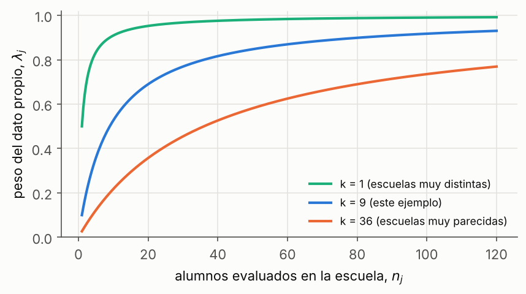
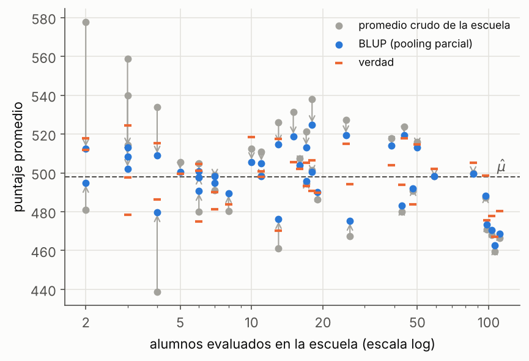
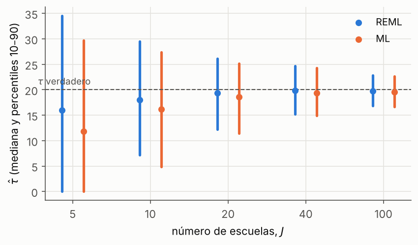

*Primera nota de una serie incremental sobre modelos de efectos mixtos, con ejemplos simulados de contextos ficticios. Esta nota cubre el caso más simple, un solo intercepto aleatorio, y con él las tres ideas que se repiten en toda la serie: el encogimiento (*partial pooling*), las componentes de varianza y su efecto sobre el error de los efectos fijos. Todo el código está en `ejemplos/mixtos_01_escuelas.py` (`statsmodels` 0.14).*

# El problema

Una secretaría de educación aplica un examen estandarizado en $J=40$ escuelas y quiere el puntaje promedio de **cada escuela**. Algunas escuelas evaluaron a más de 100 alumnos; otras, a 2 o 3. ¿Qué número reportas para una escuela con 3 alumnos que sacaron, en promedio, 578?

Hay dos respuestas extremas:

- **Sin pooling:** el promedio de la escuela, $\bar y_j$. No tiene sesgo, pero con 3 alumnos es muy ruidoso.
- **Pooling completo:** el promedio global, $\bar y$. Es estable, pero ignora que las escuelas sí son distintas.

El modelo mixto da la respuesta intermedia, **pooling parcial**, y decide cuánto pesa cada extremo según los datos.

# El modelo

$$y_{ij}=\mu+u_j+\varepsilon_{ij},\qquad u_j\sim N(0,\tau^2),\qquad \varepsilon_{ij}\sim N(0,\sigma^2)$$

con $i$ el alumno y $j$ la escuela, todo independiente.

- $\mu$ es el **efecto fijo**: el puntaje promedio de la población de escuelas.
- $u_j$ es el **efecto aleatorio** de la escuela: cuánto se aparta de $\mu$.
- $\tau^2$ y $\sigma^2$ son las **componentes de varianza**: entre escuelas y entre alumnos de la misma escuela.

En la simulación: $\mu=500$, $\tau=20$ y $\sigma=60$. Los alumnos varían mucho más entre sí que las escuelas, como es típico. Los tamaños $n_j$ son log-uniformes entre 2 y 120.

“Aleatorio” no significa que el efecto de la escuela sea azaroso. Significa que **las 40 escuelas se tratan como una muestra de una población de escuelas**, con una distribución que se puede estimar. Esa distribución es la que permite tomar prestada información de unas escuelas para otras.

## La misma cosa, vista como correlación

Si integras el efecto aleatorio, lo que queda es un modelo sobre la covarianza de las observaciones:

$$\operatorname{Var}(y_{ij})=\tau^2+\sigma^2,\qquad \operatorname{Cov}(y_{ij},y_{i'j})=\tau^2\ (i\ne i'),\qquad \operatorname{Cov}(y_{ij},y_{i'j'})=0\ (j\ne j')$$

Dos alumnos de la misma escuela están correlacionados con

$$\rho=\frac{\tau^2}{\tau^2+\sigma^2}=0.1$$

la **correlación intraclase** (ICC). En forma matricial, para la escuela $j$, $\operatorname{Var}(y_j)=\sigma^2 I+\tau^2\mathbf 1\mathbf 1^\top$: correlación constante dentro del grupo (*simetría compuesta*). Es la misma lógica que entender un proceso MA por su función de autocovarianza: el intercepto aleatorio **es** una estructura de correlación.

De aquí sale la identidad que usaremos todo el tiempo:

$$\operatorname{Var}(\bar y_j)=\tau^2+\frac{\sigma^2}{n_j}$$

El promedio de una escuela varía por dos razones: porque las escuelas son distintas ($\tau^2$) y porque cada promedio tiene ruido de muestreo ($\sigma^2/n_j$).

# El encogimiento: tres derivaciones del mismo resultado

Suponiendo por ahora que $\mu$, $\tau^2$ y $\sigma^2$ son conocidos, el mejor predictor de $\theta_j=\mu+u_j$ es

$$\hat\theta_j=\lambda_j\,\bar y_j+(1-\lambda_j)\,\mu,\qquad \lambda_j=\frac{\tau^2}{\tau^2+\sigma^2/n_j}=\frac{n_j}{n_j+k},\qquad k=\frac{\sigma^2}{\tau^2}$$

Equivalentemente, $\hat u_j=\lambda_j(\bar y_j-\mu)$. Es el **BLUP** (*best linear unbiased predictor*) de Henderson. Tres formas de llegar a él:

**1. Promedio ponderado por precisión.** Hay dos fuentes de información sobre $\theta_j$. El dato propio: $\bar y_j\mid\theta_j\sim N(\theta_j,\sigma^2/n_j)$. La población de escuelas: $\theta_j\sim N(\mu,\tau^2)$. Combinar dos estimaciones independientes de lo mismo, ponderando por el inverso de sus varianzas, da exactamente $\lambda_j$.

**2. Posterior normal-normal.** Con $\theta_j\sim N(\mu,\tau^2)$ como *prior* y la verosimilitud de arriba, la posterior es normal con media $\hat\theta_j$ y varianza

$$\operatorname{Var}(\theta_j\mid y)=\left(\frac1{\tau^2}+\frac{n_j}{\sigma^2}\right)^{-1}=\lambda_j\frac{\sigma^2}{n_j}=(1-\lambda_j)\,\tau^2$$

**3. Mínimos cuadrados penalizados (ridge).** Minimizar

$$\sum_{i,j}\frac{(y_{ij}-\mu-u_j)^2}{\sigma^2}+\sum_j\frac{u_j^2}{\tau^2}$$

en $u_j$ da $\hat u_j=\dfrac{n_j(\bar y_j-\mu)}{n_j+\sigma^2/\tau^2}$. Es una regresión ridge sobre las dummies de escuela con penalización $k=\sigma^2/\tau^2$: las *ecuaciones del modelo mixto* de Henderson. Es el mismo factor $N/(N+\lambda)$ de Hierarchical Shrinkage (nota 11), con una diferencia clave: aquí la penalización **no se elige por validación cruzada, sale de las componentes de varianza**.

**Cómo leer $k$.** Es un “umbral natural”: una escuela con $n_j=k$ alumnos recibe exactamente la mitad de peso para su dato propio. Aquí $k=3600/400=9$.

- Si las escuelas son muy distintas ($\tau^2$ grande), $k$ es chico y hasta escuelas pequeñas confían en su dato.
- Si el ruido individual domina ($\sigma^2$ grande), $k$ crece y se necesitan muchos alumnos para alejarse de $\mu$.

**El error de cada estimador** (con parámetros conocidos):

| estimador | error cuadrático medio de $\theta_j$ |
|:--|:--|
| sin pooling, $\bar y_j$ | $\sigma^2/n_j$ |
| pooling completo, $\mu$ | $\tau^2$ |
| pooling parcial, $\hat\theta_j$ | $\left(1/\tau^2+n_j/\sigma^2\right)^{-1}$ |

El del pooling parcial es la mitad de la media armónica de los otros dos: siempre es menor que ambos. Con $n_j=2$: 42.4 puntos (sin pooling), 20 (completo) y 18.1 (parcial), en raíz del ECM.

# Experimento 1: cómo se ve en un conjunto de datos

Un conjunto simulado con las 40 escuelas. Ajuste por REML: $\hat\mu=497.9$, $\hat\tau=19.9$, $\hat\sigma=59.9$, $\hat k=9.0$.

Se ve el patrón de **embudo**. La escuela de 2 alumnos con promedio crudo de 578 se lleva a 512 (la verdad es 518). La de 4 alumnos con 439 sube a 480 (verdad: 486). Y la de 3 alumnos con 559 baja a 513, cuando su verdad es 498: el encogimiento corrige la mayor parte de la exageración, aunque no toda. Las escuelas con más de 50 alumnos casi no se mueven. En este conjunto, la raíz del ECM sobre las 40 escuelas es 21.3 sin pooling, 16.9 con pooling completo y **10.5** con pooling parcial.

Un detalle: el BLUP encoge **hacia** $\hat\mu$, así que una escuela pequeña que de verdad es extrema queda subestimada. Es el precio del encogimiento: algo de sesgo a cambio de mucha menos varianza. En promedio sobre las escuelas, el trato conviene.

# Experimento 2: el error según el tamaño de la escuela

1000 repeticiones del mismo diseño, con $\tau$ y $\sigma$ estimados en cada una. Raíz del ECM de $\theta_j$ (puntos del examen):

| alumnos en la escuela | sin pooling | pooling completo | pooling parcial | parcial con $\tau,\sigma$ verdaderos |
|:--|:--|:--|:--|:--|
| 2–5 | 34.5 | 20.4 | **17.6** | 17.1 |
| 6–15 | 20.1 | 20.5 | **14.5** | 14.1 |
| 16–40 | 12.2 | 20.3 | **10.6** | 10.4 |
| 41–120 | 7.4 | 19.2 | **6.9** | 6.8 |
| todas | 21.2 | 20.1 | **13.0** | 12.7 |

- El pooling parcial gana en **todos** los tamaños. En las escuelas chicas se parece al pooling completo; en las grandes, al promedio propio, y siempre queda un poco mejor que el mejor de los dos.
- Estimar $\tau$ y $\sigma$ en lugar de conocerlos cuesta poco: 13.0 frente a 12.7. Con 40 escuelas, las componentes de varianza se estiman bien. El experimento 3 muestra qué pasa con pocas.

# ¿De dónde salen $\tau^2$ y $\sigma^2$?

**Intuición (método de momentos).** $\sigma^2$ se estima con la variación **dentro** de las escuelas. La variación **entre** promedios de escuela mezcla las dos fuentes, $\operatorname{Var}(\bar y_j)=\tau^2+\sigma^2/n_j$, así que $\tau^2$ es “la varianza entre promedios menos el ruido que ya explica el muestreo”. En el caso balanceado es el ANOVA de un factor: $E[\text{CM}_\text{dentro}]=\sigma^2$, $E[\text{CM}_\text{entre}]=\sigma^2+n\tau^2$, de donde

$$\hat\tau^2=\frac{\text{CM}_\text{entre}-\text{CM}_\text{dentro}}{n}$$

**Esta resta puede salir negativa.** Si las escuelas no varían más de lo que explicaría el ruido, se trunca en $\hat\tau^2=0$, y entonces $\lambda_j=0$ para todas: pooling completo.

**ML y REML.** Con tamaños desiguales se maximiza la verosimilitud marginal de $y\sim N(\mu\mathbf 1,\ \Psi)$, con $\Psi$ la matriz de bloques de simetría compuesta. ML estima $\tau^2$ con sesgo hacia abajo porque no descuenta los grados de libertad que se gastan en estimar $\mu$: es el mismo problema que dividir entre $n$ en vez de $n-1$. REML maximiza la verosimilitud de los contrastes que no dependen de $\mu$ y corrige ese sesgo. Con muchos grupos dan casi lo mismo; con pocos, no.

**Bayes empírico.** El procedimiento completo tiene dos pasos: estimar $\tau^2$ y $\sigma^2$ (REML), y luego meterlos en $\lambda_j$ como si fueran conocidos. Por eso se llama “empírico”: el *prior* $N(\mu,\tau^2)$ se estima con los mismos datos.

# Experimento 3: estimar $\tau$ con pocas escuelas

400 repeticiones para cada número de escuelas $J$:

| $J$ | mediana de $\hat\tau$ (REML / ML) | % de veces con $\hat\tau=0$ (REML / ML) |
|:--|:--|:--|
| 5 | 16.0 / 11.8 | 21 % / 32 % |
| 10 | 18.0 / 16.2 | 6 % / 9 % |
| 20 | 19.4 / 18.6 | 1 % / 1 % |
| 40 | 19.8 / 19.4 | 0 % / 0 % |
| 100 | 19.7 / 19.6 | 0 % / 0 % |

- **Con pocos grupos, $\tau$ casi no se puede estimar.** Con 5 escuelas, el intervalo 10–90 % va de 0 a 35, y en uno de cada cinco casos (REML) el modelo concluye que no hay diferencias entre escuelas. Ahí el BLUP hace pooling completo **con total confianza**, que es lo opuesto de lo que querrías.
- **ML subestima** de forma sistemática con pocos grupos; REML corrige buena parte.
- Esta es la debilidad central del enfoque empírico: trata $\hat\tau$ como exacto. La versión bayesiana completa, con un *prior* para $\tau$, la resuelve (lo veremos en una nota posterior).

**Una trampa de software.** En `statsmodels`, con `method="lbfgs"`, el optimizador se quedó en $\hat\tau=0$ en el conjunto del experimento 1, aunque el óptimo REML es 19.9. Con el método por defecto (BFGS) o con Powell converge bien. Moraleja: **un $\hat\tau=0$ siempre merece una segunda mirada** (otro optimizador, otro paquete, el perfil de la verosimilitud).

# La media global y su error estándar

Ahora la pregunta es otra: ¿cuál es el puntaje promedio $\mu$ de la población de escuelas, y con qué precisión lo conocemos?

**Estimador de MCO**: el promedio de todos los alumnos, $\bar y$, con el error estándar “de libro”, $s/\sqrt N$. Este ignora que los alumnos de una escuela están correlacionados.

**Estimador del modelo mixto** (mínimos cuadrados generalizados):

$$\hat\mu=\frac{\sum_j w_j\bar y_j}{\sum_j w_j},\qquad w_j=\frac{1}{\tau^2+\sigma^2/n_j}=\frac{1}{\operatorname{Var}(\bar y_j)}$$

Pondera cada escuela por la precisión de su promedio, pero con un techo: aunque una escuela tenga infinitos alumnos, su peso no pasa de $1/\tau^2$, porque sigue siendo **una sola escuela** de la población.

Con 1000 repeticiones:

| | MCO (promedio de alumnos) | modelo mixto |
|:--|:--|:--|
| sesgo de $\hat\mu$ | 0.1 | 0.1 |
| desviación estándar real de $\hat\mu$ | 5.1 | **4.2** |
| error estándar reportado (promedio) | 1.9 | 4.1 |
| cobertura del IC al 95 % | **55 %** | 93 % |

Esto es lo que intuías desde fuera: **la estimación puntual casi no cambia** (ambas son insesgadas y tienen dispersiones parecidas), **pero el error sí**. MCO reporta un error de 1.9 cuando el real es 5.1, y su intervalo “al 95 %” cubre solo 55 % de las veces. Con unos 1150 alumnos por conjunto parece que hay mucha información, pero en realidad hay 40 escuelas.

En el caso balanceado esto tiene nombre: **efecto de diseño**, $\operatorname{Var}_\text{real}/\operatorname{Var}_\text{MCO}=1+(m-1)\rho$, con $m$ alumnos por escuela. Con $\rho=0.1$ y $m=30$ el factor es 3.9: el tamaño de muestra efectivo es la cuarta parte del nominal. Una ICC que parece pequeña tiene un efecto enorme cuando los grupos son grandes.

El 93 % del modelo mixto, un poco por debajo de 95 %, viene de usar la normal con $\tau$ estimado. Las correcciones de grados de libertad (Satterthwaite, Kenward-Roger) o el enfoque bayesiano lo acercan a 95 %.

# Resumen

- Un intercepto aleatorio es, a la vez, un **supuesto sobre la población de grupos** ($u_j\sim N(0,\tau^2)$) y una **estructura de correlación** (ICC constante dentro del grupo).
- El BLUP es un promedio ponderado entre el dato propio y la media de la población, con peso $n_j/(n_j+k)$ y $k=\sigma^2/\tau^2$. Es ridge con penalización estimada, y es la media posterior normal-normal.
- Las componentes de varianza **mueven la predicción de cada grupo** (sobre todo en grupos chicos) y **corrigen el error de los efectos fijos** (aunque su punto casi no se mueva).
- Con pocos grupos, $\tau^2$ está mal determinada y puede salir exactamente 0. Hay que tratarlo con cuidado: REML mejor que ML, y Bayes mejor que ambos.

# Para experimentar

En `ejemplos/mixtos_01_escuelas.py`:

1. Cambia $\tau$ a 5 o a 60 y mira cómo cambia el embudo. ¿Cuándo el pooling completo es casi igual de bueno que el parcial?
2. Haz que las escuelas grandes sean sistemáticamente mejores (correlaciona $n_j$ con $u_j$). ¿Qué estima ahora $\bar y$ y qué estima $\hat\mu$? (Pista: dejan de estimar lo mismo.)
3. Con $J=5$, compara el ECM del pooling parcial cuando $\hat\tau=0$ contra el del promedio propio de cada escuela.

# Lo que sigue en la serie

- **Nota 14 · Pendientes aleatorias y medidas repetidas.** Plantas que crecen a ritmos distintos: cada grupo tiene su propio intercepto **y** su propia pendiente, y aparece la correlación entre ellos.
- **Nota 15 · Efectos cruzados y anidados.** Catadores que califican vinos; alumnos en salones dentro de escuelas. Cómo se reparte la varianza entre varios factores.
- **Nota 16 · Varianza que cambia entre grupos.** Modelos de localización y escala: cuando unos grupos son mucho más ruidosos que otros.
- **Nota 17 · Respuestas binarias y conteos.** El modelo lineal generalizado mixto, la aproximación de Laplace y la ICC en escala latente.
- **Nota 18 · Bayes completo.** Qué hacer cuando $\hat\tau=0$ y hay pocos grupos: *priors* para las varianzas.
- **Nota 19 · De vuelta al ML.** Árboles más efectos aleatorios, con todo lo anterior a la mano (conecta con las notas 9 a 12).

**Lecturas para esta nota:** Gelman y Hill (2007), capítulos 11 y 12; Efron y Morris (1977), “Stein's paradox in statistics”; Robinson (1991), “That BLUP is a good thing”.
